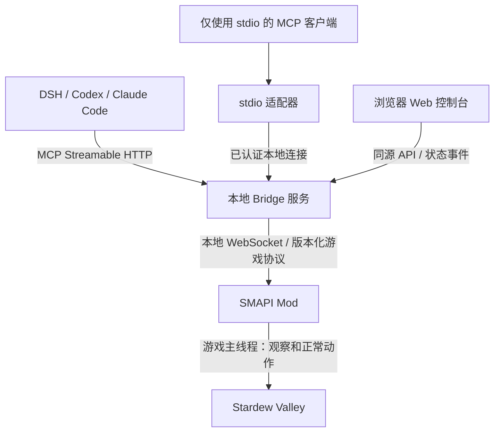

# Stardew Agent Bridge：Mod + Web + MCP 项目计划

日期：2026-10-22（北京时间）。文档版本：1.1。状态：规划文件与独立本地 Git 仓库已准备；代码迁移、MCP/Web 实现和新项目实测尚未开始。

建议项目名 **Stardew Agent Bridge**，GitHub 仓库名暂定 `stardew-agent-bridge`，名称可用性尚未检查。项目从现有 0.3.0 游戏桥接提取可复用部分，独立发布从 `0.1.0` 开始，并记录迁移来源。

> 让支持 MCP 工具调用的本地 Agent，通过统一接口观察和游玩星露谷；用户通过本地网页查看状态、配置连接、停止动作并接管游戏。

## 文档入口与使用方式

| 文件 | 用途 |
| --- | --- |
| [README.md](README.md) | 项目简介、当前状态和阅读入口 |
| 本文件 `PLAN.md` | 范围、架构、迁移原则与发布门槛 |
| [任务清单](docs/TASKS.md) | 带编号、依赖、交付物和验收条件的实施任务 |
| [接口与状态机草案](docs/PROTOCOL.md) | 控制会话、动作收据、故障恢复、MCP/Web/Mod 边界 |
| [验收方案](docs/ACCEPTANCE.md) | 测试场景、通过条件、证据格式与客户端矩阵 |
| [GitHub Desktop 使用步骤](docs/GITHUB_DESKTOP.md) | 导入本地仓库、首次提交和远程发布流程 |

实施时按任务 ID 推进；更改接口必须同步本文件、接口草案和对应测试。任务通过验收后才更新状态，旧项目的通过记录不能填入新项目的结果栏。规划默认值是待实测的设计目标，不能记为已经达到的性能。

## 1. 产品定位与首版范围

首版支持 Windows、SMAPI、单人游戏、一个本地游戏实例。DSH、Codex 和 Claude Code 列入正式验收名单；其他程序按协议与实测结果加入兼容表。

模型由用户的 Agent 程序提供。项目自身不托管模型、不保存模型 API Key，不要求特定模型供应商。文字模型使用结构化观察，支持图片的模型还可以读取截图。

MCP 提供的是观察和行动接口。持续规划、上下文维护、模型调用预算和下一轮运行仍由 Agent 宿主负责。Web 中的“恢复控制”只恢复游戏控制条件，不代表能主动唤醒已经结束的 Agent 会话。

首版交付两个安装部分：

1. **SMAPI Mod**：安装到游戏的 Mods 目录。
2. **本地 Bridge 程序**：包含服务端、网页和 MCP 接入适配器，提供双击启动入口；发布包携带经过验证的运行时。

首版目标覆盖现有主要玩法：观察、移动、工具使用、菜单、种植采收、商店、出货、箱子、制作放置、食用装备、基础钓鱼战斗、标题页加载与正常跨日。复杂剧情、完整社交、全部动物交互及特殊箱子另列支持矩阵。

后续再扩展 macOS/Linux、多游戏实例、多人联机、远程访问和可选 Agent 调度器。跨平台架构先保留，首版只承诺实际通过测试的平台。

## 2. 总体架构



Web、MCP 和 stdio 适配器共享同一个动作服务、控制权管理器和日志。每个客户端可以有自己的 stdio 子进程，但不能因此各自创建一套游戏控制器。

建议默认端点：网页 `http://127.0.0.1:17655/`，MCP `/mcp`，网页 API `/api/v1`；Mod 内部端口沿用 17654，安装时检测冲突并允许配置。生成的客户端配置必须使用实际地址，不能静默换端口后仍展示旧配置。

### 2.1 SMAPI Mod

- 在游戏进程内读取角色、地图、物品和菜单对象；涉及游戏对象的读取与操作统一回到游戏主线程。
- 执行正常输入、菜单和游戏动作，保留逐帧移动、钓鱼与战斗控制器。
- 负责游戏侧动作串行化、超时、取消、资源后验、引用失效和输入释放。
- 校验连接身份及控制权代次，拒绝已经失去控制权的旧请求。
- Bridge 断开或心跳失效时，游戏侧停止输入，并在可行时正常暂停；网页关闭不影响这条独立保护路径。
- 继续使用与目标游戏及 SMAPI 相匹配的运行时。现有工程为 `net6.0`，不能随服务端升级而直接改变 Mod 的目标框架。

### 2.2 本地 Bridge 服务

- 使用 TypeScript 和官方 MCP SDK，统一暴露 HTTP MCP、Web API 和 stdio 适配器所需接口。
- 管理 Mod 连接、版本协商、控制会话、任务状态、动作收据和紧凑进度。
- 使用轻量持久化动作账本，优先 SQLite；数据库只存控制与观测记录，不承担游戏存档功能。
- 内置静态 Web 文件。网页与服务同源部署，普通用户无需单独启动前端开发服务器。
- 作为独立常驻进程运行。首版 stdio 适配器连接已启动的 Bridge；服务未启动时返回明确启动指引，避免不同宿主反复拉起多个服务。
- 游戏未启动时，网页和诊断接口仍可使用，明确显示“等待游戏连接”。

### 2.3 Web 控制台

- **连接设置**：游戏、Mod、Bridge 版本及连接状态；为三个宿主生成适配其格式的配置。
- **游戏概况**：角色、日期时间、生命体力、背包、附近对象、地图出口和按需截图。
- **控制状态**：当前控制者、动作进度、暂停结果、到期时间；突出显示停止与人工接管。
- **动作记录**：请求、真实执行结果、资源变化、错误原因和恢复建议；支持脱敏导出问题包。
- **进度笔记**：展示 Agent 显式提交的目标、已完成事项和待办。动作日志与 Agent 提供的说明分别标注来源。

网页默认只读。手动按钮也经过同一个动作服务，不绕过控制权和后验核验。首版不提供任意脚本执行或自由输入内部游戏命令的面板。

## 3. MCP 接入与客户端兼容

采用 **Streamable HTTP + stdio** 双入口。两者均为 MCP 标准传输；网页更新事件与 MCP 使用的传输分别实现，不将普通 WebSocket 游戏协议直接称为 MCP。[MCP 传输规范](https://modelcontextprotocol.io/specification/2026-07-28/basic/transports)

截至本次核对，官方 TypeScript SDK v2 已提供当前协议支持及旧客户端兼容入口。新工程采用 v2，并在锁文件中固定已验证的小版本；旧协议兼容由 SDK 适配，实际支持范围写入测试矩阵。[SDK v2](https://ts.sdk.modelcontextprotocol.io/v2/)、[旧客户端支持](https://ts.sdk.modelcontextprotocol.io/v2/serving/legacy-clients.html)

| 客户端 | 已核对的接入依据 | 新项目验收要求 |
| --- | --- | --- |
| DSH | 本机 `dsh-mcp-client 0.2.0-rc.2` 使用 `@modelcontextprotocol/client 2.0.0`；源码具有 `stdio` 与 `streamable-http` 分支 | 通过原生 MCP 配置完成真实工具发现、观察、动作、取消和截图；无需专用星露谷 DSH 插件 |
| Codex | 官方文档支持 stdio 与 Streamable HTTP | 核对实际客户端版本、配置作用域、权限行为、结构化结果和图片显示 |
| Claude Code | 官方文档提供 HTTP 与本地 stdio 配置 | 核对实际客户端版本、工具调用、结果显示、取消及退出后的处理 |
| 其他 MCP 程序 | 有标准传输和工具调用能力 | 先做协议冒烟测试，再决定是否列为已验证兼容 |

Codex 与 Claude Code 的配置依据分别见 [OpenAI 官方 MCP 文档](https://learn.chatgpt.com/docs/extend/mcp?surface=cli) 和 [Claude Code 官方 MCP 文档](https://code.claude.com/docs/en/mcp)。目前核对的是文档及本机 DSH 接入代码，**新项目尚未完成任何客户端实机验收**。

客户端配置向导需要生成实际安装路径、端口和凭据引用；不假设三个客户端使用相同 JSON 外层结构。stdio 的标准输出仅用于 MCP 消息，诊断日志写标准错误或日志文件。

首版兼容底线是工具发现与工具调用。Resources、Prompts、Skills、进度通知属于增强能力：宿主没有自动加载这些能力时，基础工具仍必须可用。关键动作限制直接写进工具描述和错误结果。

## 4. 工具与结果协议

### 4.1 从现有 28 个工具迁移

先保留 `stardew_*` 语义命名，参数与返回值调整在新项目中明确版本。按功能组织代码，不把全部动作收成一个自由文本 `execute` 工具。

| 功能组 | 现有工具 |
| --- | --- |
| 诊断与观察 | doctor、snapshot、inspect、screenshot、status |
| 基础操作 | move、select、use、interact、menu、wait、pause、closemenu、stop |
| 商店与物流 | shop、buy、ship、container |
| 物品与实时动作 | recipes、craft、place、eat、equip、fish、combat |
| 会话与加载 | session、saves、load |

现有 `session` 依赖 DSH 生命周期，需重做为通用控制会话。工具数以最终注册清单为准；28 是迁移起点，不是新项目已完成数量。

建立与宿主无关的 JSON Schema 和业务类型，统一生成 MCP 工具定义、Web 表单约束及协议文档。游戏边界仍独立校验，不能只依赖前端校验。

### 4.2 统一结果

每个动作至少包含：`actionId`、`gameInstanceId`、`worldGeneration`、状态、是否经过后验核验、结束原因和必要的资源变化。错误包含稳定错误码、可读原因，以及应重新观察、查询旧动作还是终止控制。

动作状态采用 `accepted / running / succeeded / partial / failed / cancelled / unknown`。收到请求、动作完成、目标达成分别记录：钓鱼调用正常结束不等于一定钓到鱼，出货入箱不等于收入已经结算。

工具返回结构化结果及紧凑文字摘要。截图以标准 MCP 图片内容返回，并附观察元数据；本地文件路径只作为额外信息。文字模型可以不请求截图。

快照默认返回紧凑摘要，地图与容器支持按区域或引用展开，并设置输出大小上限。对象引用绑定游戏实例、世界代次及适用的场景或菜单代次；切档、重启或引用失效后必须重新观察。地图、菜单和背包槽位变化分别处理，不能把正常菜单开关误判为整个游戏实例重启。

### 4.3 长动作与取消

- 移动、钓鱼、战斗均设置时间上限，内部逐帧执行。
- 首版采用有界工具调用；若以后增加后台任务，使用明确的动作 ID、状态查询和取消接口，完成回执与受理回执分开。
- 协议层取消映射到游戏停止。不同 MCP 协议版本的断流与取消语义交给 SDK 适配，并分别测试，不能将所有 HTTP 连接结束都视为会话结束。
- `stop` 走优先控制通道，不排在耗时动作之后；断连、取消、超时均验证输入确实释放。

## 5. 多客户端控制与模型思考期间的游戏时间

### 5.1 多个观察者、一个控制者

Bridge 维护全局控制租约，Mod 保存最终有效的控制权代次。多个程序可同时读取状态，同一时刻只有一个明确的控制会话可以改变游戏。

`stardew_session(operation=start)` 返回控制会话标识；写操作关联该会话，`operation=end` 释放控制并尝试正常暂停。控制身份绑定已认证客户端，不依赖 MCP 传输会话 ID，也不假定宿主提供聊天 ID 或“模型已结束”事件。同一客户端的不同聊天也必须使用各自显式创建的控制会话。

人工接管依次执行：撤销旧控制权 → 取消当前动作和队列 → 释放输入 → 确认状态 → 交还玩家。旧请求携带旧代次时，即使迟到也不能恢复动作。Mod 提供可配置的本地停止热键，Bridge 崩溃时仍能接管。

### 5.2 默认分步模式

Agent 获得控制后，默认每次动作在正常游戏流程中运行，在可暂停的边界尝试打开正常暂停菜单。下一次动作只自动关闭由本项目自己打开的暂停菜单；不关闭用户菜单或跳过剧情。

钓鱼与战斗在一次有界动作内部连续运行。连续实时模式作为显式选项，具有会话时限、动作时限和控制权到期处理。

过场、加载、特殊菜单等场景可能无法立即暂停。回执和网页必须显示实际暂停结果，不能只显示“已请求暂停”。停止输入与暂停游戏是两个独立状态。

租约只根据控制者的有效活动续期；Bridge 与 Mod 的连接心跳不能无限续期一个已经结束的 Agent 会话。到期时停止，能够暂停时正常暂停。恢复必须重新观察并取得控制。具体默认时限、会话关闭规则和暂停结果格式见接口草案。

## 6. 幂等与故障恢复

1. 写动作使用独立于 MCP 请求编号的稳定 `actionId`。工具输入支持调用者提供动作 ID；同一有效游戏会话内，同 ID、同参数查询已有结果，同 ID、不同参数返回冲突。已经关闭的控制会话只能查询收据，不能借重复请求重新执行。
2. 未提供 ID 时服务生成并记录。若返回丢失，调用者先查询当前会话的未决动作和最近收据，不能用新 ID 自动重试消费动作。
3. Bridge 保存动作账本，Mod 保留动作去重记录。明确其存活范围、保留期限及重启边界；不声称跨崩溃无条件“恰好执行一次”。
4. 买入、制作、出货、箱子转移、食用等动作在正常操作后检查背包、货币、材料或目的地变化，部分成功如实返回。
5. 服务或游戏重启后，在途动作先标记结果待确认；重新建立实例身份、读取状态并核对收据，绝不从日志自动重放写动作。
6. Mod 连接断开时释放覆盖输入，旧队列失效。仅只读请求和连接建立允许有界自动重试。首版只允许一个活动游戏动作，额外写请求直接返回忙碌，不提供隐式等待执行的业务队列；网络层待处理请求仍受控制权校验。
7. 进度笔记用于恢复上下文；真实存档由游戏正常保存。恢复流程必须重新读取现场，不能把笔记视作真实游戏状态。

## 7. 本地连接与发布边界

Mod 和 Bridge 默认仅监听本机回环地址。Bridge 使用本地配对及客户端凭据；Web 使用同源会话，写请求校验来源。MCP 端点校验 Origin、Host 和认证，凭据从运行时配置读取，不进入日志或仓库。该设计遵循 MCP 本地 HTTP 端点的来源校验、回环绑定和认证要求。[MCP HTTP 端点要求](https://modelcontextprotocol.io/specification/2026-07-28/basic/transports/streamable-http)

现有 Mod 拒绝所有带 Origin 的 WebSocket 请求，因此网页不能直接连接旧桥接。新的网页通过 Bridge 调用；Mod 内部连接增加凭据与控制权校验，保留浏览器来源限制。

注册工具以能力白名单为准。迁移时审计现有内部协议中的 `warp`、`skipevent`、`diag` 等入口；修改游戏进度的调试能力从发布构建移除，或仅在明确的开发构建中启用。诊断接口只暴露必要的只读信息。

默认不收集遥测。问题包由用户主动导出，过滤本机用户名、存档标识、完整路径和凭据，并允许预览。首次安装不自动修改 Agent 全局配置，提供复制配置和显式安装入口。

## 8. 现有实现的迁移清单

| 现有部分 | 新项目处理 |
| --- | --- |
| `Observations.cs`、`WorldState.cs` | 提取状态和对象引用；明确版本与字段约束 |
| `GameActions.cs`、各类动作实现、移动和实时输入 | 复用正常游戏动作，补通用控制权及取消测试 |
| `ActionCoordinator.cs`、`ReadyAction.cs` | 保留串行、防重、有界等待和输入释放；与持久化账本对接 |
| `BridgeServer.cs`、`Protocol.cs`、`ModEntry.cs` | 增加认证、控制权代次、能力白名单及版本协商 |
| `bridge.js`、`commands.js` | 提取连接、参数约束、快照压缩和业务语义；去除 DSH SDK 依赖 |
| `index.js` | 宿主专用注册逻辑由 MCP 入口替代；新项目主体不依赖 DSH 包 |
| `session.js` | 从 DSH idle 事件改为显式控制会话、租约和游戏侧看护 |
| 现有 skill 与测试 | 提取通用操作指南、故障案例和契约测试；宿主说明单独维护 |

现有 0.3.0 的 28 工具、动作验证和游玩记录可作为回归基线。它们没有经过新的 MCP/Web 链路，不能直接算作新版本测试通过。跨季节和完整玩法覆盖等未完成项目继续保留。

新仓库按源码清单干净迁移，旧部署作为可回退基线保留。首次安装检测旧 `AgentStardew`，避免两个桥接 Mod 同时接管；迁移步骤明确备份、停用旧版和回退流程。

迁移源以本地现有 `agent-stardew` 与 `dsh-stardew-local` 的明确文件清单为准，记录上游基准提交及本地差异。旧仓库有未提交改动，不能只克隆上游后就声称拿到了当前 0.3.0 实现，也不能把旧仓库整棵目录连同 `.git`、个人输出和游戏依赖一起复制进新仓库。

### 已确定的工程决策

| 项目 | 首版决定 | 原因 |
| --- | --- | --- |
| 部署 | Mod + 独立常驻 Bridge，Web 静态文件随服务分发 | 隔离游戏运行时与 MCP/Web 依赖 |
| 服务端 | TypeScript、官方 MCP SDK v2；具体运行时与依赖补丁版本在 M0 锁定 | 便于共享协议并适配两种传输 |
| Web | TypeScript 单页控制台；组件框架在 M0 通过最小构建验证后锁定 | 保持首个交付聚焦接入与控制 |
| 账本 | SQLite，单写入者，先记录意图再派发游戏动作 | 保留崩溃窗口及未决动作证据 |
| 控制 | 全局单写、显式会话、Mod 侧控制权代次 | 防止跨客户端与迟到指令冲突 |
| 时间 | 默认分步暂停；连续实时模式显式启用 | 减少模型思考耗时对游戏的影响 |
| 发布 | Windows 本机单人优先；便携目录与启动脚本 | 降低安装和回退复杂度 |

尚待 M0 实测决定的事项只有具体依赖版本、Web 组件框架和 Windows 打包工具。决定时记录选项、结果与理由；不以这些选择为由延后只读链路原型。

## 9. 建议仓库结构

```text
stardew-agent-bridge/
  mods/StardewAgentBridge/      # C# SMAPI Mod
  packages/contracts/          # 版本化协议、Schema、错误码
  packages/game-client/        # Mod 连接和状态转换
  packages/control-core/       # 会话、动作账本、控制权、恢复
  packages/mcp/                # MCP 定义、传输适配
  apps/server/                 # 常驻服务、Web API、配置与 CLI
  apps/web/                    # TypeScript Web 控制台
  adapters/stdio/              # 宿主子进程；连接同一常驻服务
  tests/                      # 契约、故障注入、客户端、UI、游戏验收
  scripts/                    # 构建、打包、安装、回退
  docs/                       # 架构、协议、客户端接入、支持矩阵
  examples/                   # 无凭据配置及示例任务
  .github/workflows/          # 检查、测试、构建与发布
  README.md
  README.en.md
  PLAN.md
  LICENSE
  NOTICE.md
  CONTRIBUTING.md
  SECURITY.md
  CHANGELOG.md
```

源码、类型和测试一起维护。运行日志、数据库、配对凭据、用户路径、截图、存档、个人 Agent 配置及临时目录列入忽略规则。

建议沿用 MIT，并保留已读取的上游 MIT 许可、原版权声明及来源提交说明。依赖清单单独记录第三方组件。公开仓库和发布包不夹带游戏 DLL、游戏资源、存档或个人配置；游戏引用通过用户本机路径解析。

公共 CI 先覆盖协议、业务核心、MCP、Web 及打包清单。完整 Mod 构建和实机测试使用具备游戏安装的受控环境；运行此类构建前确认依赖的使用与分发条件，不将游戏文件上传为公共 CI 产物。涉及游戏安装的运行器不执行未经信任的外部 PR 代码。

## 10. 实施里程碑

| 阶段 | 工作内容 | 退出条件 |
| --- | --- | --- |
| M0：建立独立仓库 | 迁移清单、来源许可、目录结构、协议草案、运行时及依赖锁定 | 可从干净检出构建核心；不依赖个人路径、DSH SDK 或 Jev；明确游戏侧本地构建条件 |
| M1：只读 MCP 贯通 | 常驻服务、认证、Mod 连接、HTTP/stdio、doctor/snapshot/inspect/screenshot | DSH、Codex、Claude Code 各有真实发现和只读调用记录；文字状态可读，支持图片的组合能看到截图 |
| M2：通用控制与游戏动作 | 控制租约、旧请求失效、紧急停止、分步模式、动作账本，迁移主要写工具 | 三个宿主分别完成同一短任务；并发写入被正确拒绝；消费动作防重、断线停止和暂停结果通过 |
| M3：Web 控制台 | 配置向导、状态与地图、动作日志、人工接管、脱敏导出 | 新用户按向导完成连接；网页操作与 MCP 控制一致；真实浏览器无关键报错，接管不会被旧请求夺回 |
| M4：0.1.0 预览发布 | Windows 包、安装检测、旧版迁移与回退、文档、兼容表 | 独立目录安装并运行，运行时齐全；所有发布文件来源明确；三个客户端各有完整安装到游玩的记录 |
| M5：0.1.0 稳定验收 | 多轮实际游玩、故障矩阵、长时间运行、问题修复 | 达到下述发布门槛；未覆盖玩法有明确说明；发布记录区分模拟、SDK、客户端与真实游戏证据 |

M1 先建立最小纵向闭环，再迁移全部动作和完善网页。网页骨架可随 M1 提供诊断信息；功能不齐全的预览版本明确标注版本和支持范围。

## 11. 发布验收门槛

- **协议**：HTTP 和 stdio 的工具调用、参数错误、图片、超时、取消通过；实际支持的 MCP 协议版本有记录。
- **控制**：至少两个客户端同时观察，只有租约持有者能够写入；人工接管、旧队列和迟到请求通过故障测试。
- **资源**：购买、转移、制作、食用和出货各有正常、部分成功或拒绝、同 ID 重复、返回丢失案例；资源变化必须可核验。
- **恢复**：分别断开 Agent、stdio、Bridge、Mod；强制终止 Bridge 后由 Mod 独立释放输入；重连不自动重放动作。暂停失败可见。
- **日常游玩**：三个客户端各完成至少一个相同的短任务；至少一个客户端完成连续七个游戏日，正常种植、照料、跨日、采收、出货和核对收入。
- **重复性**：以公开的固定任务和独立测试存档开展五轮运行，至少四轮无需人工补救完成；其余失败可诊断且不发生非预期重复消费。记录宿主、模型、版本、权限与结束原因。
- **界面与安装**：真实浏览器验证连接、日志和接管；从新的安装目录验证中文与空格路径、缺失游戏、端口占用、旧 Mod 冲突和卸载回退。
- **存档**：专用测试存档保留初始备份和夹具说明；核对原用户存档未被测试改动。测试夹具资源与实际游玩所得分别记录。

长时间测试和跨季节覆盖应继续进行。首版通过上述门槛不等于全部玩法完成，也不代表所有模型都会自主完成相同目标。

## 12. GitHub 任务与完成定义

完整任务见 [TASKS.md](docs/TASKS.md)，可按任务 ID 创建 GitHub Issues。当前没有创建远程 Issue。优先级 P0 为贯通与正确性前提，P1 为首版交付所需，P2 为首版之后扩展。

任务完成需要同时满足：实现存在、对应检查通过、文档与能力清单同步、实际证据可定位。模拟协议通过只能关闭模拟检查项；涉及真实游戏效果的任务必须有实机证据。

执行顺序：M0 定义基础 → M1 只读贯通 → M2 控制权和写动作 → M3 Web 接管 → M4 安装包 → M5 稳定验收。每个阶段保留可演示成果，依据退出条件推进，不用日期或提交数量代替完成状态。

## 13. GitHub 首页建议文案

**Description：** A local SMAPI bridge, web dashboard, and MCP server for AI agents to observe and play Stardew Valley.

**中文简介：** 通过 SMAPI Mod 读取真实游戏状态、执行正常游戏动作，并向 DSH、Codex、Claude Code 等本地 Agent 提供统一 MCP 接口。附带本地 Web 控制台，用于连接配置、状态观察、动作记录与人工接管。

**建议 Topics：** `stardew-valley`、`smapi`、`mcp`、`ai-agent`、`game-automation`、`typescript`、`csharp`。

**README 首屏：** 项目用途 → 一张架构图 → 安装与连接 → 一个只读例子和一个短游玩例子 → 实测兼容表 → 支持范围及开发计划。

本地仓库已准备，可用 GitHub Desktop 导入。下一步从 M0 的源码清单和基础契约开始；第一个可展示成果是：同一个 Mod 和 Bridge，被三个本地客户端分别读取到相同的真实游戏状态，网页同步显示该状态。

## 14. 规划修订记录

| 版本 | 日期 | 变更 |
| --- | --- | --- |
| 1.0 | 2026-10-22 | 明确 Mod + Web + MCP 架构及 M0–M5 阶段 |
| 1.1 | 2026-10-22 | 整理为独立本地规划仓库；补充任务依赖、接口与状态机、可执行验收、GitHub Desktop 流程及源代码迁移边界 |
---

## 实施结果（2026-10-22 追加）

本规划稿已在同一仓库内实现为可运行工程：实际状态见 HANDOVER_REPORT.md 与 docs/EVIDENCE.md，接口文档以 docs/PROTOCOL.md（实现版）为准。
规划与实现的差异集中在 docs/PROTOCOL.md §9；未完成的实机验收见 docs/ACCEPTANCE.md §5。

