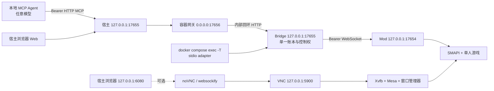

# Stardew Agent Bridge：Docker 单人版完整开发交接书

> 交给 Flash 模型直接执行的实施规格。日期：2026-10-24，北京时间。版本：1.0。
> 本文件是开发任务书，文件中新增的路径、变量、命令、接口和测试均为**待实现的约定**，不表示当前仓库已有这些能力。
> **用户最新约束：联机功能留到后续开发，现在先别动。** 本轮不开发联机、不引入多人服务器、不放开多人保护。
> 分工：Flash 完成代码、脚本、配置、测试源码和文档的编写；构建、测试、Docker 实测和真实游戏验收交回原协作者 Codex。未经本次另外授权，不提交、推送或发布镜像。

## 0. 给实现模型的第一条指令

请完整阅读本文件，检查实际仓库，再直接完成 Docker 单人版实现。不要只输出建议或再次编写一份计划。不要用空函数、占位组件、假成功响应、截图替代品、`TODO` 或“以后再实现”的脚本冒充交付。

实现两个运行模式：

1. `bridge`：在容器中运行现有 Bridge、Web 和 MCP 服务。没有游戏时仍可查看 Web、发现工具和诊断，游戏工具如实返回现有无游戏错误。
2. `game`：在同一个应用容器中运行 Linux 原生游戏、SMAPI、项目 Mod、虚拟显示、Bridge、Web，以及可选 noVNC。由容器外的任意 MCP Agent 提供模型决策，执行正常单人游戏动作。

第二种模式必须完成代码，不得把第一种模式“镜像能启动”当作整个任务完成。真实运行取决于用户提供的 Linux 游戏与 SMAPI，以及后续验收；代码交付时必须保留这个区别。

必须完成第 23 节的全部任务，并提交 `DOCKER_HANDOVER_REPORT.md` 与 `docs/DOCKER_PROGRESS.md`。报告使用“编写完成；未运行构建/测试；待原协作者验证”，不能填“Docker 已支持/已测试通过”。

### 0.1 本轮不得执行的操作

- 不运行 `npm ci/install/build/test/test:mod/test:installer`，不执行 `dotnet build/run`。
- 不运行 Docker/Compose 的 build、pull、up、run、exec、config、down、push、prune，也不安装 Docker。
- 不执行新旧安装器、恢复器、备份器、健康检查、smoke 或验收脚本。
- 不启动游戏、Steam、SMAPI、虚拟桌面，不登录任何平台，不读取或修改用户真实存档。
- 不提交 Git、不推送 GitHub、不创建 Release、不登录或发布 GHCR/Docker Hub。
- 允许只读检查源码、Git 状态、文档、官方资料；允许写实现文件。
- 允许可选的纯语法解析 `node --check`、JSON 解析；它们不得导入或执行被检查脚本。即使通过，也只记录“语法解析”，不记录为构建或测试。
- 无法执行验证不是理由，不得删除测试、降低认证要求、改期望值或把错误改成成功。

### 0.2 依赖顺序与遇到问题的处理

先复核现状，再依次实现配置契约、网关、构建、容器入口、游戏工作目录、生命周期、MCP 配置、运维工具、测试源码与文档。

常规实现选择自行解决。缺少私有游戏文件时继续完成公共代码与无游戏测试源码；将真实输入列为验收前提。涉及游戏启动器或上游版本的不确定点必须查上游资料并在报告记录，不得凭空发明参数。

如果上下文不足：先更新进度文件，写清已改文件、尚缺任务、关键约定、未运行的检查和下一步，再继续。不能仅因上下文将尽就宣布完成。

## 1. 项目身份、基线与现状

### 1.1 唯一维护仓库

| 项目 | 值 |
| --- | --- |
| GitHub 仓库 | https://github.com/amy2022525-sketch/stardew-agent-bridge |
| 维护分支 | `main` |
| 本任务书核对的基线 | `63a4f369feadacf9476660c7af6b1cb9b6ac9a00` |
| Linux 代码提交 | `b6d682a9efbf51df3e42785e417ecb8e5dbff895` |
| 本机当前维护目录 | `D:\星露谷\stardew-agent-bridge` |
| 旧目录 | `F:\星露谷\stardew-agent-bridge`，不可未经核对在旧副本继续开发 |
| 当前应用/Mod 版本 | `0.1.0`，Docker 预览不自行升级既有协议版本 |
| 当前 Node 要求 | `>=22.13.0`，使用 `node:sqlite`，不能改成不满足要求的 Node |
| 当前 Mod | `net6.0`、x64、SMAPI 最低版本 `4.5.2` |

接手时先记录实际 HEAD、工作区状态与差异；如果基线已前进，保留新修改并记录差异，不重置或覆盖。不得把其他协作者的未提交修改当成自己的废文件清除。

### 1.2 已核对的源码事实

| 事实 | 位置 | 对 Docker 的影响 |
| --- | --- | --- |
| HTTP 服务和 CLI 预绑定都固定在 `127.0.0.1` | `apps/server/src/bridge.ts`、`cli.ts` | 单改 Docker 的端口映射无法访问服务 |
| 全局 `isLoopback(req)` 拒绝非回环来源 | `apps/server/src/http-util.ts`、`bridge.ts` | 即使改监听地址，容器网桥来源仍会被拒绝 |
| Mod WebSocket 为回环专用且拒绝 Origin | `mods/StardewAgentBridge/BridgeServer.cs` | 不应把 Mod WebSocket 发布到宿主或网络 |
| Bridge 端口 17655，Mod 端口 17654 | `packages/contracts/src/protocol.ts` | Docker 的额外网关端口不得和它们冲突 |
| MCP、Web、stdio 共用一个业务核心 | `bridge.ts`、`adapters/stdio/src/index.ts` | 不允许为 Docker 再创建第二套账本或控制权 |
| Web 会话入口为 `GET /api/v1/session` | `bridge.ts` | 网关必须正确处理 Host、Origin 和 Cookie |
| Web Cookie 有 HttpOnly、SameSite=Strict | `bridge.ts` | 不得为适配端口取消 Cookie/CSRF 保护 |
| 现有输出多处写死 `http://127.0.0.1:${port}` | `bridge.ts`、`cli.ts`、`hosts.ts` 等 | 外部映射端口和容器内部端口必须区分 |
| stdio 的 `SAB_URL` 使用 Bridge 根 URL，再追加 `/api/v1/tool/...` | `adapters/stdio/src/index.ts` | 不可把带 `/mcp` 的 URL 直接放入该变量 |
| `SAB_HOME` 与 Mod `DataDirectory` 可指向绝对数据根 | 平台层、`PlatformPaths.cs` | 同容器让它们指向同一私有卷 |
| CLI 先抢锁、再绑定端口、最后打开账本 | `cli.ts`、`instance-lock.ts` | 不能为容器启动绕过或改变这个顺序 |
| 多人请求明确返回 `UNSUPPORTED` | `ModEntry.cs` | 保持原检查与行为，不删除、不打补丁绕过 |

### 1.3 已有验证只能作为回归基线

截至基线，Windows/Ubuntu CI 已通过构建、Node 测试、C# 隔离检查和安装器检查；Linux bridge-only 包通过无游戏验证。详细结果见 `LINUX_VALIDATION_REPORT.md`。

这些结果不代表 Docker 镜像、Xvfb、Mesa、noVNC、容器内游戏、容器存档和真实 Agent 已验收。Docker 新增项全部从 `not_run` 开始。

## 2. 交付范围与明确不做的事

### 2.1 本轮必须编写的能力

- 公开源码可构建的 Bridge 镜像；不需要游戏、Steam 账号或存档进入构建上下文。
- 增加虚拟桌面依赖的 game-runtime 镜像；镜像本身不含游戏或私有 SMAPI 安装副本。
- 本地 Mod 构建工具镜像，通过运行时只读挂载游戏引用程序集，输出本项目 Mod。
- `bridge` 与 `game` 的 Compose 配置，以及单独的 noVNC 可选覆盖配置。
- 仅宿主回环端口发布；容器内回环网关；Host/Origin、SSE 和断连取消的完整处理。
- 私有游戏源只读导入、容器工作副本初始化、升级失败回退和文件完整性记录。
- 独立持久化卷：Bridge 数据、游戏 HOME、游戏工作副本、Mod 产物和离线备份。
- 非 root 运行、私有文件权限、只读根文件系统、可控临时目录和日志轮换。
- 启动预检、进程监督、健康/就绪状态、SIGTERM 与异常退出处理。
- Web 的 Docker 模式说明、正确的外部 MCP 地址、有效的 HTTP/stdio 配置生成。
- 跨平台宿主管理脚本、离线备份/恢复、版本回退说明、故障手册。
- 单元/集成/容器/实机测试源码、验收矩阵与未执行状态记录。
- 不自动运行的 Docker 专用 CI 配置源码，以及镜像内容/许可证检查脚本。

### 2.2 本轮不做

- **任何联机功能或相关实现。** 不接入 JunimoServer，不建多人服务器，不加 UDP 24642，不加入房间，不增加第二玩家，不改变 `Context.IsMultiplayer` 的拒绝。
- 不将容器游戏描述成 dedicated server；本轮是单人 Linux 游戏客户端。
- 不把 Windows 游戏二进制放进 Linux 镜像运行，不加入 Wine/Proton 分支。
- 不开发 ARM64、macOS 容器目标、Kubernetes、Swarm、多租户、多农场调度或多容器共享同一存档。
- 不开发公网、LAN、任意域名访问、反向代理 TLS、手机远程控制或自动公网隧道。
- 不自动登录 Steam，不收集密码或 Steam Guard，不做 SteamCMD 账号流程。
- 不把模型、API Key、DSH、Codex 或 Claude Code 本体打进镜像；决策层继续由外部 Agent 提供。
- 不提供“关容器自动存到最新进度”的承诺；星露谷正常保存流程与安全停机必须明确区分。

## 3. 总体架构与决定

### 3.1 固定采用：一个应用容器 + 内部回环网关

首版用一个应用容器承载同一玩家会话的各进程。Bridge、Mod 及 stdio 仍通过同一网络命名空间的回环地址通信。额外添加一个 Node HTTP 网关：只由它监听容器网络接口，向内部 Bridge 转发。



`bridge` 模式只启动网关和 Bridge。`game` 模式额外启动虚拟显示、窗口管理器及游戏。noVNC 只在显式启用时运行。

选择此结构的原因：保留现有回环与凭据安全边界，不让 Mod 改成网络服务；让锁、PID 身份和数据目录仍在同一容器内解释；避免首版引入跨容器进程身份和共享卷竞态。它是本项目首版的实现决定，不是所有 Docker 应用都应合并进程。

多进程生命周期由专用 supervisor 管理，并使用 Compose `init: true` 回收孤儿进程；不能只用 `command1 & command2 & tail -f /dev/null`。Docker 官方说明了主进程管理子进程及 `--init` 的职责，参见[多进程容器说明](https://docs.docker.com/engine/containers/multi-service_container/)。

### 3.2 不采用的捷径

| 捷径 | 不采用的原因 | 正确方案 |
| --- | --- | --- |
| 只增加 `EXPOSE 17655` 或 `ports` | 服务只监听回环，且应用还检查来源 | 由专用网关转发至回环 Bridge |
| 全局把监听/允许来源改为 `0.0.0.0`/任意 | 会改变 Windows/Linux 原有安全模型 | 原 Bridge 与 Mod 保持回环限定 |
| 默认 `network_mode: host` | Docker Desktop 与 Linux 行为不同，隔离降低 | 默认桥接网络 + 明确回环端口发布 |
| 单独容器直接访问宿主 Mod | 宿主 Mod 只接受回环，且数据根/凭据不同 | 本轮完整 game 模式把两者放入同一应用容器 |
| 改写所有响应 JSON 中的 `127.0.0.1` | 易损坏事件、截图内容和合法数据 | 在地址生成入口区分外部 URL 与内部 URL |
| 镜像里复制玩家现有游戏目录 | 游戏、账号痕迹与私有文件可能进入镜像层 | 运行时只读输入 + 私有工作卷 |
| 把 VNC 键鼠作为 AI 唯一控制渠道 | 破坏现有结构化动作/收据设计 | AI 继续走 Mod；VNC 只给人工查看与接管 |

### 3.3 运行范围

目标为 `linux/amd64` 容器。Linux Docker Engine 是正式验收目标；Windows Docker Desktop 的 Linux containers 是另一个待验目标。Windows 用户必须另外准备 **Linux 原生** 游戏与 SMAPI 文件，当前 Windows Steam 目录不能直接替代。

Docker Desktop 后端、文件系统权限、软件 OpenGL 和游戏窗口活动状态都需要单独验收。不要将其写成已保证支持。

## 4. 网络、端口与地址契约

### 4.1 固定端口分工

| 名称 | 容器监听地址 | 宿主发布 | 用途 |
| --- | --- | --- | --- |
| Mod | `127.0.0.1:17654` | 不发布 | Bridge 到游戏的私有 WebSocket |
| Bridge | `127.0.0.1:17655` | 不直接发布 | 原 Web、MCP、API |
| 网关 | `0.0.0.0:17656` | `127.0.0.1:${SAB_HTTP_PORT:-17655}:17656` | 唯一 Web/MCP 入口 |
| VNC | `127.0.0.1:5900` | 不发布 | noVNC 到虚拟显示 |
| noVNC | `0.0.0.0:6080`，仅启用时 | `127.0.0.1:${SAB_NOVNC_PORT:-6080}:6080` | 人工查看与接管 |
| X11 | Unix socket | 不发布 TCP 6000/6099 | 游戏到 Xvfb |

不要使用 `17655:17655`、`6080:6080` 这种省略宿主 IP 的发布方式。省略宿主 IP 默认可能发布到所有接口，参见 [Compose ports](https://docs.docker.com/reference/compose-file/services/#ports)。不需要 `host.docker.internal`、host gateway 或宿主网络。

### 4.2 三类地址必须分开

1. **内部探测地址**：`http://127.0.0.1:17655`，只在容器内使用，供健康检查、stdio、自检和锁复用。
2. **外部展示地址**：`SAB_PUBLIC_BASE_URL`，例如 `http://127.0.0.1:18055`，用于浏览器、生成 MCP HTTP 配置和显示给用户的链接。
3. **MCP 地址**：外部展示根 URL + `/mcp`，不得重复追加 `/mcp/mcp`。

`endpoint.json` 的现有内部定位字段保持含义不变；不要把外部映射地址写入原 `mcpUrl` 导致容器内 stdio 或健康复用绕出容器。可新增兼容字段 `publicBaseUrl`、`publicMcpUrl`，旧消费者忽略新字段。

`SAB_URL` 仍指容器内部的 Bridge **根 URL**；不包含 `/mcp`。外部 Agent 使用的 HTTP MCP URL 是另一项。

### 4.3 外部 URL 校验

新建纯函数模块统一解析外部展示地址。Docker 首版只允许：

- 协议 `http:`；host 为 `127.0.0.1` 或 `localhost`；显式有效端口。
- 无 username/password；无 search/hash；pathname 只接受空或 `/`。
- 端口为合法 1024–65535 整数，不能依靠字符串拼接吞掉 `@`、反斜杠或编码主机名。
- 使用标准 URL 解析后再次校验原输入与规范形式，拒绝 `127.1`、十六进制/整数地址等别名。
- 首版不支持 IPv6 映射；需要时另开任务，不隐式放开 `[::]`。
- `SAB_HTTP_PORT` 与 URL 的端口必须一致；不一致时预检失败，不能生成连不上的配置。
- 仅显式展示配置可设置此地址；忽略请求中的 `Forwarded`/`X-Forwarded-*`，不从不可信 Host 推导公开地址。

外部端口 18055、内部端口 17655 必须成为一个强制测试用例，以阻止“只有默认端口正常”的实现。

## 5. 网关实现的逐项要求

建议新增 `apps/server/src/container-gateway.ts` 与 `container-addresses.ts`，再打包成独立 `container-gateway.mjs`。它不实例化 `Bridge`、`ActionLedger` 或 `ControlManager`，只做受限 HTTP 转发。

### 5.1 转发前校验

- 监听目标只允许配置中的 `0.0.0.0:17656`，上游固定 `127.0.0.1:17655`。不能由 URL/query/header 指定上游，不实现 CONNECT 或通用代理。
- 校验原始 Host 是否属于显式允许的宿主名称与映射端口；拒绝缺失、重复、含非法字符、错误端口、`evil.example` 和 `127.0.0.1.evil.example`。
- Host 允许集合仅为对应端口的 `127.0.0.1` 与 `localhost`。网关预检使用显式合法 Host，不把容器内部端口误加到公共允许集合。
- 请求带 Origin 时，必须精确匹配这两个受控 HTTP origin 之一，包括端口。拒绝 `null`、多 Origin、逗号拼接和后缀匹配。
- 不带 Origin 的 MCP SDK/命令行请求可继续；它们仍必须通过上游 Bearer/会话认证。
- `/api`、`/mcp` 请求若带 `Sec-Fetch-Site: cross-site`，拒绝；该头不是唯一认证依据。
- 不使用 `Access-Control-Allow-Origin: *`；不把任意 Origin 反射给浏览器。
- 不信任或放大任何 `X-Forwarded-Host/Proto/For`；转发时移除这些输入。

### 5.2 内部请求规范化

只有外部校验通过后才把上游 Host 设为 `127.0.0.1:17655`。若原请求有合法 Origin，将其规范为上游同源 origin；无 Origin 的请求继续不带 Origin。

这一点必须在代码旁解释：**先验证原始外部 Origin，再规范化**。若先重写，所有恶意网页都可能被伪装成同源请求。

保留 Authorization、Cookie、`X-SAB-CSRF`、`MCP-Session-Id`、`MCP-Protocol-Version`、Accept、Content-Type、Last-Event-ID 等业务头；清理 hop-by-hop 头时必须解析 `Connection` 中动态列出的头，不能只删除固定名单。

### 5.3 请求和响应流

- 只允许原产品需要的 GET/HEAD/POST/DELETE/OPTIONS；是否接受 OPTIONS 按现有传输协议处理，不借此放开跨域。
- 请求体上限沿用协议的 64 KiB；同时限制总 header 大小和请求读取时间，避免慢连接占用。
- 支持 chunked 请求；超限时终止上游，返回可识别 413；不要一次性无界缓冲。
- 响应采用流式 pipe、处理背压；SSE 不缓冲、不压缩、不合并成一个 JSON。
- 不设置会提前截断钓鱼/加载等合法长调用的统一短响应超时；连接建立超时与持续流空闲策略分开。
- 客户端断开时关闭相应上游请求，并保留现有取消语义；不能关闭共享 Bridge。
- 正常 SSE 响应结束与客户端提前断连分开处理，避免误把已完成动作标记取消。
- 不对购买/制作/丢弃等请求自动重试，包括 ECONNRESET、502、重连和健康变化。
- 网关失去上游时返回 502/503；业务写结果可能未知，不能伪造“执行失败且无副作用”。
- 原样保留多个 Set-Cookie、Content-Type、Cache-Control、状态码、MCP 会话头；不改响应正文里的地址。
- 不把截图响应限制到 64 KiB；64 KiB 是请求上限。截图尺寸/上限继续由原业务约定处理。
- 初版 WebSocket Upgrade 一律拒绝；MCP 使用 HTTP/SSE，VNC 走独立可选入口，Mod WS 从不通过网关。

### 5.4 原有安全策略不变

`isLoopback()`、Mod 拒绝 Origin、MCP Bearer 校验、Web Session/CSRF 与多人拒绝仍保留。原产品非 Docker 启动方式没有网关，不受该扩展影响。

网关进程失效是整个应用单元的关键故障：supervisor 应进入失败关闭流程；不能留下“容器 healthy、但入口已死”的状态。

### 5.5 日志

只记录 requestId、method、受控路径分类、status、duration 和故障类别。URL query、Authorization、Cookie、Set-Cookie、CSRF、MCP 参数/完整消息、Steam/玩家路径均不得输出。普通访问日志不记录存档名或玩家聊天内容。

## 6. 镜像与构建架构

### 6.1 三个公开可构建目标

| 目标 | 应包含 | 不包含 |
| --- | --- | --- |
| `bridge-runtime` | Node 运行时、打包 Bridge/adapter/gateway/supervisor、Web、项目许可证 | 游戏、SMAPI 私有安装、Mod 编译引用、npm/node_modules、SDK |
| `game-runtime` | bridge-runtime + Xvfb、窗口管理器、Mesa/GL、SDL/OpenAL 依赖、中文字体、可选桌面查看所需组件 | 游戏、玩家 HOME、存档、Steam 会话、.NET SDK |
| `mod-build` 工具镜像 | .NET SDK、所需 Node、Mod 源码/构建脚本、manifest、公开构建依赖 | 游戏引用程序集和编译结果，直到运行时挂载输入 |

采用 glibc 发行版，首版不使用 Alpine/musl。Node 版本不得低于 22.13.0。Mod 仍为 net6.0；构建 SDK 版本与游戏携带的运行时分别记录，不能简单把游戏改成 net10.0。

具体基础镜像 tag/digest、APT 包来源和 noVNC/websockify 版本必须集中写入 `docker/versions.json`。Flash 只读核对官方发布信息后固定可用版本，不能填写虚构 digest。尚未核验的 digest 记录为 `null` 并列入交接待验，不能声称可复现构建已经通过。

### 6.2 多阶段构建

1. Node builder：先 COPY package/workspace manifest + lockfile，再 `npm ci`；随后复制源码并构建。Dockerfile 中写这些命令，Flash 本轮不实际执行。
2. 使用 esbuild API 打包 Bridge、stdio adapter、网关和 supervisor；参考既有 Linux pack 的成功做法，不能把 Linux ELF 的 `esbuild/bin/esbuild` 当 JS 文件运行。
3. runtime：只 COPY 运行必需文件与静态资源，禁止整个仓库或 node_modules 进入最终层。
4. game-runtime：在同一 glibc 基线添加图形/字体/桌面组件及明确许可证，不下载游戏。
5. mod-build：独立工具镜像；运行时引用 `/input/game`，输出 `/out`。不得在 Docker build 的 RUN/COPY 层接触游戏程序集。

多阶段构建的职责可参见 [Docker multi-stage builds](https://docs.docker.com/build/building/multi-stage/)。本项目的文件选择与目标布局以本交接书为准。

### 6.3 运行布局

```text
/opt/sab/                         镜像内只读程序
  server/bridge.mjs
  server/stdio-adapter.mjs
  server/container-gateway.mjs
  container/supervisor.mjs
  container/preflight.mjs
  container/healthcheck.mjs
  container/game-seed.mjs
  web/index.html, app.js, styles.css
  metadata/build-info.json
  metadata/versions.json
  licenses/...
/input/game/                      用户提供的 Linux 游戏 + SMAPI，只读
/input/mod/                       本项目 Mod 产物卷，运行时只读
/srv/game/                        游戏工作副本卷，可写
/home/sab/                        独立游戏 HOME 卷，可写
/var/lib/sab/                     Bridge 数据卷，可写，SAB_HOME
/var/backups/sab/                 仅离线工具访问的备份卷
/run/sab/                         tmpfs，PID/状态/私有临时文件
/tmp/                            tmpfs，X11/临时文件
/run/secrets/                     noVNC 等显式注入的 secret，只读
```

### 6.4 构建上下文排除

新增严格 `.dockerignore`，至少排除 `.git/`、所有 `.env` 与私有 override、凭据、日志、数据库及 WAL/SHM、截图、导出、备份、游戏、存档、Steam 文件、已有 release、bin/obj/dist、node_modules、work 和桌面交接副本。

若 `.env.example` 被纳入，必须只含无秘密样例。Docker 版本的样例建议命名 `docker/example.env`，避免既有 `.gitignore` 的 `.env.*` 规则误排除需提交的模板。

不得先 COPY 敏感文件再在下一层删除；不能将账号、令牌、游戏引用用 ARG/ENV 注入镜像层。公开镜像构建应该在物理上没有这些输入。

## 7. 持久化、权限与输入契约

### 7.1 命名卷

| 逻辑卷 | 挂载 | 主要内容 | 正常 runtime 是否可写 |
| --- | --- | --- | --- |
| `sab-data` | `/var/lib/sab` | config、credentials、endpoint、ledger、日志、导出、截图、锁 | 是 |
| `game-home` | `/home/sab` | 独立游戏配置/存档/SMAPI 日志 | 是 |
| `game-work` | `/srv/game` | 从只读源复制的游戏/SMAPI、本项目 Mod | 是 |
| `mod-artifacts` | `/input/mod` | 自己项目 DLL、manifest、校验/来源文件 | runtime 只读；mod-build 写入 |
| `backups` | `/var/backups/sab` | 离线完整备份及清单 | 仅备份/恢复工具写入 |

默认使用命名卷，避免 SQLite 账本落在 Windows NTFS/SMB bind mount。用户私有 Linux 游戏源以 bind mount 只读输入，使用 long syntax，并禁用缺失源目录自动创建；缺失文件夹立即报错。

不允许两个 `runtime` 共享同一 `sab-data/game-home/game-work` 组合。卷名跟 Compose project 隔离，不设固定 `container_name`。本轮不实现横向扩容。

### 7.2 用户与权限

- 镜像建立 `sab`，默认 UID/GID 1000:1000，Dockerfile 的 USER 为该用户。
- 镜像提前创建可写挂载点并赋予正确所有者，考虑命名卷首次 copy-up；不得把 root entrypoint 递归 chown 所有挂载作为常态。
- 如需要非 1000 用户，通过明确 build args 生成匹配镜像并文档化迁移；不要提供实际上无效的 PUID/PGID 环境变量。
- `SAB_HOME` 0700；凭据、锁、内部 endpoint 和敏感临时文件 0600。权限不满足时给出明确诊断，不 chmod 777。
- 私有游戏源无需被 runtime 修改权限；原文件清单/哈希应保持一致。
- rootless Docker、userns-remap 和 Desktop 权限差异单列验收；不声称 Linux mode bit 等同于 Windows ACL。
- 不挂载 docker.sock、宿主根目录、宿主 HOME、宿主 X11/Wayland、音频 socket 或整个 `/dev`。
- 默认 `cap_drop: [ALL]`、`no-new-privileges:true`、非 privileged；不用 host PID/IPC。
- 根文件系统只读，所有确需写入的路径逐一使用卷/tmpfs；不得捕获只读错误后改为全根可写。

### 7.3 Linux 游戏输入

用户负责准备有合法使用权的 **Linux 原生 Stardew Valley + 已安装兼容 SMAPI**。不要求把这些文件上传给实现模型或 GitHub。

预检至少识别游戏程序集、Content、Linux 启动器、SMAPI 入口及 `smapi-internal`。检测 Windows PE 启动器、错误架构、缺少执行位、未知版本、不可读或输入目录为空时，失败并说明缺的具体类别。

启动方式以用户输入与上游已核实启动器为准，不使用任意 shell 命令环境变量。内部 launch descriptor 为经过校验的 executable + argv + cwd，路径必须落在工作副本内。

SMAPI 的 Linux 启动参数存在包装脚本差异；优先使用上游支持的环境变量 `SMAPI_USE_CURRENT_SHELL=true` 或 `SMAPI_NO_TERMINAL=true`，以及 `SMAPI_MODS_PATH`，不凭空假设所有参数会穿透。应核对固定版本，见 [SMAPI technical documentation](https://github.com/Pathoschild/SMAPI/blob/develop/docs/technical/smapi.md)。

Steam/GOG 发行文件、运行时依赖及登录状态均需真实验收。本轮不承诺可绕过平台正常启动要求；遇到平台认证需求应给出不含账号秘密的诊断，而不是引入自动登录或不明补丁。

### 7.4 Mod 产物契约

```text
/input/mod/current/
  StardewAgentBridge.dll
  manifest.json
  artifact.json
```

`artifact.json` 至少含 schemaVersion、sourceCommit、modVersion、targetFramework、gameVersion（可用时）、smapiVersion（可用时）、生成时间、两个公开产物的 SHA-256。不得记录私有游戏路径、用户名或引用程序集原文。

产物中不得夹带 `Stardew Valley.dll`、SMAPI DLL、Harmony、MonoGame、pdb、obj、NuGet 缓存或其他游戏文件。编译引用继续 Private=false；产物检查白名单不因构建方便而放宽。

runtime 挂载此卷只读，并验证 manifest 的 UniqueID 为 `StardewAgentBridge.Bridge`、EntryDll 为 `StardewAgentBridge.dll`、版本一致、哈希匹配。缺失或不一致时不启动游戏。

### 7.5 跨容器写者互斥：内核 flock

**原 Bridge 的 PID/启动身份锁解决同一进程命名空间的实例问题，不能独自证明另一个容器的写者已死。** 新增容器级卷租约，以 util-linux `flock` 对 `/var/lib/sab/container-volume.lock` 持有排他锁。

- runtime 从预检结束到最终退出一直持有该锁；离线 maintenance 也必须拿到同一个锁才能写 sab-data、game-home 或 game-work。
- 使用受控 entrypoint/bootstrap 以结构化 argv 执行 `flock --no-fork -n -E 13 <fixed-lock-path> /usr/local/bin/node <fixed-entry> ...`。不使用 shell 字符串；持锁进程与子进程的信号/退出传播必须写测试。`--no-fork` 让命令继承租约并替代 flock 进程，不能与 `--close` 搭配，参见 [util-linux flock 手册](https://github.com/util-linux/util-linux/blob/master/sys-utils/flock.1.adoc)。
- flock 文件 0600，位于本应用数据卷；文件长期存在不是锁仍被占用的证据，不按文件是否存在判断活跃。
- 同一应用容器的原 CLI/账本仍执行既有 Bridge 锁；新租约是外层互斥，不替代原锁。
- 不通过别的容器 `/proc/<pid>` 判断租约陈旧，不自动删除锁文件“修复占用”。内核在所有持锁 fd 关闭后释放锁。
- 宿主 helper 仍先确认 runtime 停止，但真正防止“检查后另一个容器又启动”的竞态依靠这个排他租约。
- `mod-build` 写产物卷使用独立产物锁和原子 current 切换；runtime 使用已核对并复制到 game-work 的版本，不在游玩中热切换。
- 只读 health/status 不抢占锁、不创建文件。正常 token/adapter 在已运行容器中按原机制工作，不为每次读请求再次申请外层排他锁。
- 这些锁依赖本地 Linux 文件系统；默认命名卷符合目标，NFS/SMB 等共享存储不在首版范围。
- 恢复快照排除容器租约文件和实例锁，维护工具自身持有的 fd 不因恢复覆盖而换 inode。提交数据目录时必须保留锁文件所在的稳定父目录，不能把整个 `/var/lib/sab` mount root 直接 rename 掉。

建议增加 `scripts/docker/runtime/lease-entrypoint.mjs`，Docker ENTRYPOINT 先完成配置纯校验，再进入持锁启动分支。无效配置不应先打开账本；拿不到租约返回 OWNERSHIP_CONFLICT。不要遗漏这一层，只靠宿主脚本“约定不要同时运行”。

## 8. 游戏工作副本的初始化与升级

### 8.1 初次初始化

必须在启动游戏、Bridge 业务核心和网关之前完成预检与工作副本准备。该准备不应打开 SQLite 账本。

1. 校验只读源、产物、挂载点、UID/权限和磁盘空间。
2. 获得仅属于工作卷的初始化锁；锁需有 nonce/进程启动身份，不能只检查一个可能残留的 PID 数字。
3. 在工作卷内部建立私有 staging 目录，生成源版本/清单记录。
4. 将 Linux 游戏和 SMAPI 复制到 staging，保持执行位；不复制源 `Mods/`、任何 Saves、账号文件或玩家用户目录。
5. 外来 Mod 不自动带入。首版只装本项目 Mod；确需上游必需文件以清单说明，不扫入整个现有 Mods。
6. 拒绝 symlink 指向输入根以外、设备文件、FIFO 与异常条目；不能用可越界的递归跟随复制。
7. 验证复制后的清单/关键文件与产物，再把 staging 原子提交为受管理工作目录。
8. 写受保护的初始化 manifest：输入摘要、项目 Mod 摘要、架构、版本、完成状态。
9. 通过既有安装逻辑或抽出的纯服务部署 Mod，配置 `DataDirectory=/var/lib/sab`、Port=17654。
10. 所有步骤成功才允许后续进程启动；不能留下部分 Mods 文件后仍宣告 ready。

源目录可能数 GB，不得每次启动都全量复制。正常重启只验证受管理记录和关键文件；用户显式更新时才重建。完整哈希检查可以是管理工具的独立操作。

### 8.2 发现源版本变化

默认返回 `INPUT_CHANGED`，给出“停止后准备更新”的明确操作；不趁玩家游玩时热替换游戏或 Mod。升级需要新 staging、校验和原副本保留，失败能恢复旧工作目录。

旧工作副本、备份或卷无法确认属于本应用时拒绝操作。复用现有 Linux installer journal 思路；不要照抄一个“先 rm -rf 整个目标再复制”的实现。

### 8.3 中断恢复与磁盘故障

初始化/升级 journal 阶段至少包含 `prepared / copied / validated / committed / cleaned`。每阶段记录受管理目标和已确认哈希，路径必须在已解析工作卷内。

重启遇到未完成事务时进入维护状态，不自动启动游戏；管理工具根据阶段恢复或安全清理仅属于本事务的 staging。保留原工作副本与用户 HOME。

必须在测试源码中覆盖：复制中断、写 manifest 前中断、提交后清理前中断、空间不足、权限不足、被篡改 journal、非法事务 ID、符号链接越界和重复恢复。

### 8.4 存档保护

独立 HOME 的正常 Linux 存档目标通常是 `/home/sab/.config/StardewValley/Saves`，实现时核对实际游戏行为；持久化整个 `/home/sab`，避免只挂 Saves 而丢失必要配置和日志。

默认不导入任何宿主真实存档。导入必须由显式维护命令选择独立副本，检查路径/体积/文件类型，保存导入前清单。不能“找到了就自动加载最近存档”，不能把宿主真实 HOME 挂进容器。

更改输入游戏或 Mod 不触碰 `game-home`。普通停机、重建镜像和 `docker compose down` 不删除卷；示例中禁止无提示使用 `down -v` 或 volume prune。

## 9. 虚拟桌面与游戏进程

### 9.1 图形栈

完整模式使用 Xvfb 的 X11 虚拟显示、轻量窗口管理器和 Mesa 软件渲染。默认显示为 `:99`、1280×720、24 bit；尺寸限制在预设范围内，不能让环境变量注入额外命令参数。

候选组件为 Xvfb、Openbox、Mesa DRI/GLX、SDL/OpenAL 运行库和 CJK 字体。发行版依赖由实现者依据固定基础镜像核对包名，集中记录；不要混用 Debian 与 Ubuntu 专有包名。

MonoGame DesktopGL 依赖 SDL、OpenGL 和 OpenAL，因此“启动了一个 Xvfb 进程”不等于游戏渲染成功，参见 [MonoGame DesktopGL 说明](https://github.com/MonoGame/docs.monogame.github.io/blob/main/articles/getting_started/platforms.md)。Mesa/llvmpipe 与真实游戏版本兼容性必须保留为后续验证项。

- `DISPLAY=:99`、`LIBGL_ALWAYS_SOFTWARE=1` 为默认约定；不要假设宿主具备 GPU。
- Xvfb 使用 `-nolisten tcp`，使用受保护 Xauthority，禁止 `xhost +`。
- `/tmp/.X11-unix`、Xauthority 和临时 socket 只在本容器 tmpfs 内，不能连接宿主桌面。
- 根据实际依赖使用 `/dev/shm`；Compose 配置 `shm_size`，不使用 host IPC。
- 无声模式采用虚拟/空音频配置；不能因没有声卡就不断崩溃重启。
- 中文字体必须有明确来源/许可证，覆盖中文 UI；不从 Windows 系统字体目录打包文件。
- 游戏窗口映射、尺寸和活动状态必须由后续实机检查确认；不要使用 SDL dummy 视频驱动假冒真实可观察窗口。
- GPU 设备透传不在首版必需范围；不加入默认 privileged 或 `/dev/dri` 自动挂载。

### 9.2 启动游戏

启动 descriptor 应由已核对的 Linux 游戏文件和固定白名单构造：

```json
{
  "schemaVersion": 1,
  "executable": "/srv/game/current/StardewValley",
  "args": [],
  "cwd": "/srv/game/current",
  "envPolicy": "curated-linux-game"
}
```

这里的文件名是常见入口示例，不能仅因它存在就假设一定加载了 SMAPI。预检需依据用户提供的受支持布局识别启动器；通过 Mod hello 验证最终确实加载了本项目 Mod。

禁止 `SAB_GAME_COMMAND="任意 shell 文本"`、`eval`、`sh -c "$ENV"`。使用 spawn(executable, args, {shell:false})；入口和 cwd 的 realpath 必须位于当前受管理工作副本。

游戏进程的 HOME 指向 `/home/sab`，`SAB_HOME=/var/lib/sab`；传递必要的显示、语言和 SMAPI 环境，不继承管理工具的 secret 内容。SMAPI console 的 stdin 是否必须保持打开要在实现中考虑：默认 supervisor 持有管道，不因为 Docker 没分配 TTY 就向它写 EOF。

### 9.3 不自动进行的游戏操作

- 不自动跳过标题、选最新存档、创建农场或新玩家。
- 不在启动阶段执行购买、移动、钓鱼、睡觉、修改时间或调试命令。
- 游戏在标题页是合法状态。已连接但未加载存档，应显示 `awaiting_save`。
- 用户可以通过 noVNC 创建/选择测试存档，或后续经已存在且可用的正常工具载入。
- `game` 模式只等待 Mod hello，不把“加载存档”作为容器健康前提。

## 10. noVNC：可选人工观察和接管

必须提供独立覆盖文件 `docker/compose.novnc.yaml`；未加载该文件时，不启动 VNC/websockify、不发布 6080、不要求 VNC secret。

采用 noVNC + websockify + 受密码保护的本地 VNC server。noVNC 是浏览器客户端，后端 VNC 若没有原生 WebSocket 需要代理，参见 [noVNC 上游说明](https://github.com/novnc/noVNC)。固定版本中应明确真实使用的组件、参数、许可证和文件路径，不在容器启动时自动下载最新版本。

### 10.1 认证和端口

- VNC server 只监听 `127.0.0.1:5900`；原始 VNC 端口绝不发布。
- websockify/noVNC 监听容器 6080，通过宿主 `127.0.0.1` 发布。
- 从 `/run/secrets/sab_vnc_password` 读取，缺少、空白、超出所选 VNC 实现限制时预检失败。
- 如用传统 VNC password 文件，明确其有效长度/算法限制；不能假装一个被截断的长密码保留了全部熵。可增加 HTTP 认证，但不能以 BasicAuth 代替 VNC 实现核对。
- 不把密码放 URL、进程 argv、环境变量、Compose 展开结果或日志。需要生成 VNC 格式时通过受保护临时文件和管道完成。
- 不启用上游示例中的无认证模式，不默认把剪贴板双向同步到宿主。
- noVNC WebSocket Origin/Host 也需按所选后端配置为受控本机地址；不能认为只检查了 MCP 网关就保护了另一入口。
- 不能代理到任意 VNC host；固定上游本容器回环。

Compose secrets 以文件形式提供给服务，`_FILE` 变量是应用自己要实现的约定，不是 Docker 自动支持所有变量，参见 [Compose secrets](https://docs.docker.com/compose/how-tos/use-secrets/)。普通本地 Compose 文件 secret 也不应被描述为自动加密的秘密保险箱。

### 10.2 与 Web 的关系

Web 可以显示“打开游戏桌面”按钮，目标来自经过相同本机 URL 校验的 `SAB_DESKTOP_BASE_URL`。使用新标签页和安全链接属性，不把密码带过去，不强制 iframe。

noVNC 是人工辅助。Web 显示“桌面可用”不等于游戏已载入、Agent 已连接或 AI 正在游玩；截图仍由游戏 Mod 提供，不能拿 noVNC 占位图当工具截图。

## 11. 启动监督与退出状态机

### 11.1 新增 supervisor

建议 `scripts/docker/runtime/supervisor.mjs`，使用 Node 标准库、清晰的子进程表、超时、启动身份记录和 shutdown promise。可抽纯模块供测试注入时钟/进程实现。

应用容器采用 Compose `init: true`；supervisor 仍负责所有自建进程的启动/失败/有序退出，不能把 init 当作业务监督器。初版不需要 systemd。

### 11.2 状态

```text
created
  -> preflight
  -> preparing_workdir          仅 game
  -> starting_bridge
  -> starting_gateway
  -> starting_display          仅 game
  -> starting_game             仅 game
  -> awaiting_mod              仅 game
  -> awaiting_save             Mod 在线，未加载存档
  -> ready                     Mod 在线，单人存档已加载

bridge 模式：starting_gateway -> bridge_ready
任意关键故障 -> stopping -> failed
SIGTERM/SIGINT -> stopping -> stopped 或 failed
```

实际启动可以让显示在 Bridge 前准备，但必须遵循以下不变量：失败输入不能先打开账本；Bridge 先生成有效凭据再让 Mod 读取；网关开放前明确 Bridge 状态；game-work 完整提交前不得运行游戏。

### 11.3 具体启动次序

1. 解析/验证配置，设置 `umask 077`，检查 runtime 模式与架构。
2. 只读确认卷、游戏输入、Mod 产物、需要的 secret、用户和写入点；不修改输入。
3. game 模式完成受管理工作副本准备，写 Mod 的绝对 DataDirectory。
4. 启动原 CLI `start --port 17655`，沿用原锁与预绑定顺序；等待受限的内部 `/health`。
5. 启动网关；预检映射配置与公共地址；对外提供已净化的状态信息。
6. game 模式启动 Xvfb，确认 socket/display 可用后启动窗口管理器。
7. 启动游戏，在可配置且有上限的时限内等待 Mod hello。
8. 如启用 noVNC，启动相应组件并记录其实际可用状态。
9. 发布状态文件；标题页记 awaiting_save，不要求游戏自动读档。

若 Bridge 端口或数据根已被其他实例占用，遵守原 CLI 退出码；不能自动接管或杀掉用户的实例。

### 11.4 关键/辅助进程

| 进程 | 是否关键 | 意外退出处理 |
| --- | --- | --- |
| Bridge | 是 | 停止接受新请求；保留未知收据；关闭应用单元 |
| 网关 | 是 | 应用失败退出，不能健康挂起 |
| Xvfb / 窗口管理器 | game 模式为是 | 正常停止动作并关闭本单元 |
| 游戏 / SMAPI | game 模式为是 | 不自动重开/重放动作；记录退出与存档风险 |
| VNC / websockify | 显式开启时为辅助 | 标为 desktop_degraded；不因此强杀正在运行的游戏 |
| docker exec 的 stdio adapter | 否，归外部宿主会话 | 关闭它不停止其他客户端或 Bridge |

容器 game 模式默认 `restart: "no"`，避免游戏异常后无人确认地循环重开。bridge 模式可 `unless-stopped`，但任何动作不会由重启逻辑自动重放。

### 11.5 进程身份与信号

- 保存真实 child 对象与 PID/启动身份/进程组，不用 `pkill node`、进程名匹配或随便读取一个陈旧 pidfile 发送信号。
- 使用应用自己的进程组；对组发送信号前确认属于本次启动。不能命中外部 docker exec 的其他会话。
- 处理 SIGTERM、SIGINT、多次重复信号、启动中退出和部分启动失败。
- 关闭路径幂等，只建立一次 shutdown promise；退出码不被后续成功清理覆盖。
- 先停止新流量和新动作，尽可能通过原控制路径请求停手；不创建可抢占正常玩家控制权的后门。
- 能确认正常停止的记录确认；已发送但结果未知的动作保留原 `actionId` 与 `RESULT_UNKNOWN` 语义。
- 由 Bridge 自己释放 endpoint、lock 和 owner；supervisor 不直接删可能属于别人的锁。
- 对已失联进程有有限等待，再仅结束本次拥有的子进程；记录是否发生强制终止。
- 容器 stop grace 给出有限值（例如 45 秒），内部各阶段总预算必须小于该值，不能无限等待 SSE。

### 11.6 保存语义：必须如实处理

**`docker stop/down`、SIGTERM、暂停和备份都不能自动保证星露谷把当前白天进度保存到磁盘。** 正常进度需要正常游戏保存流程。首版不新增作弊式强制保存。

宿主管理脚本的 `stop` 默认检查是否已回到标题页/游戏已退出等可安全状态；如果正在游玩，返回明确的 `UNSAVED_PROGRESS_POSSIBLE`，提示先通过正常玩法保存。显式 `--accept-unsaved-risk` 才执行这一路径的停止。

用户直接执行 Docker stop 时，容器仍需尽力停手、收账本并退出，不能无限阻塞来“拒绝 Docker 停机”。写 `runtime-stop.json`，记录 reason、时间、游戏阶段、停止确认、是否可能未保存与强杀情况，不填“自动保存成功”。

游戏看门狗和 F9 停手保持原有实现；Web 显示退出流程不替代这两个保护。

## 12. 健康、就绪、诊断和退出码

### 12.1 不混淆四种状态

| 状态 | 意义 | 不是 |
| --- | --- | --- |
| live | 网关、Bridge 和监督器响应 | 游戏已经开始 |
| modConnected | Mod 已与同一 Bridge 完成握手 | 已载入存档 |
| saveLoaded | 已有单人存档 | 正常动作或截图已通过验收 |
| desktopAvailable | 启用的 noVNC 路径工作 | Agent 已完成游戏任务 |

在 Docker 首版中，bridge 模式无游戏仍可 healthy；game 模式在启动宽限后要求必要进程和 Mod hello 存在，但标题页 awaiting_save 仍可 healthy。加载存档是业务 readiness，不是必须读档的启动动作。

### 12.2 状态接口与文件

新增 gateway 自己处理的 `GET /container/live` 和 `GET /container/ready`，不得与原 Bridge `/health` 混淆：

```json
{
  "schemaVersion": 1,
  "mode": "game",
  "state": "awaiting_save",
  "live": true,
  "modConnected": true,
  "saveLoaded": false,
  "desktopEnabled": false,
  "desktopAvailable": false,
  "reasonCode": "AWAITING_SAVE"
}
```

- live 成功 200；关键组件不可用 503。
- ready 在 bridge 模式表示服务可供诊断；game 模式仅 `ready` 返回 200，其余 503 携带上述状态。
- 健康检查读取本容器内部状态和受控 probe，不获取控制权、不创建客户端令牌、不修权限、不安装 Mod、不打开账本。
- 对外状态不含凭据、PID、进程路径、主机用户名、源目录、完整异常栈。
- 原 `/health` 在内部保留。对外经网关响应时如含本机路径/PID，应在这个固定健康端点生成兼容的净化字段视图；不能对所有 JSON 做通用替换。
- 监督器状态写入 `/run/sab/status.json`，原子替换、0600；内容包含 generation/start nonce，健康检查拒绝把上次启动的旧状态当成存活。
- 允许 Web 从经过净化的 Docker 状态增加提示；不把原 `/api/v1/status` 的会话/控制语义全部重新实现。

### 12.3 健康检查预算

建议 interval 15 秒、timeout 5 秒、retries 3、game start_period 180 秒；这些是初始设计值，后续实测再调整。不得每 1 秒启动一个完整 CLI、读所有游戏文件或构造新 Bridge。

`healthcheck.mjs` 只用镜像内 Node 标准库，不能依赖最终镜像不存在的 curl/npm/global Node。Docker unhealthy 默认只报告状态，不在程序中自动触发游戏循环重启。

### 12.4 supervisor 新增退出码

原 CLI 的 0/1/2/3 不改。supervisor/宿主管理工具另立命名空间：

| 码 | code | 含义 |
| --- | --- | --- |
| 0 | OK | 正常结束或纯查询成功 |
| 10 | CONFIG_INVALID | 模式、URL、端口或参数无效 |
| 11 | INPUT_MISSING | Linux 游戏/SMAPI/Mod 产物缺失 |
| 12 | PERMISSION_DENIED | 挂载或文件权限不符合要求 |
| 13 | OWNERSHIP_CONFLICT | 数据卷/工作副本归属或实例冲突 |
| 14 | RECOVERY_REQUIRED | 存在未完成初始化/升级/恢复事务 |
| 15 | START_TIMEOUT | 必需组件未按期启动 |
| 16 | CHILD_EXITED | 关键子进程意外退出 |
| 17 | BACKUP_INVALID | 清单/校验/路径或版本校验失败 |
| 18 | UNSAVED_PROGRESS_POSSIBLE | 管理 stop 被保存风险检查阻止 |
| 19 | DOCKER_UNAVAILABLE | 宿主无 Docker/daemon/合适 Compose |

JSON 模式返回 `{ok, code, message, details}`，退出码与 code 一致；details 仅是经过脱敏的诊断。不要把 raw child stdout、私有挂载路径或 password 写入普通输出。

`reasonCode` 可比顶层 code 更具体。例如输入摘要变化时，顶层 `code=RECOVERY_REQUIRED`、退出码 14，`details.reasonCode=INPUT_CHANGED`；标题页 `AWAITING_SAVE` 是状态原因，不是新的进程退出码。

## 13. Docker 配置契约

### 13.1 环境变量表（本轮新增项需真正实现）

| 变量 | 默认/示例 | 校验与作用 |
| --- | --- | --- |
| `SAB_RUN_MODE` | `bridge` | 只接受 bridge/game |
| `SAB_HOME` | `/var/lib/sab` | 必须绝对且位于预期数据挂载 |
| `SAB_WEB_DIST` | `/opt/sab/web` | 镜像固定资产目录 |
| `SAB_HTTP_PORT` | `17655` | 宿主发布端口，供 Compose 与 URL 校验使用 |
| `SAB_PUBLIC_BASE_URL` | `http://127.0.0.1:17655` | 外部 Web/HTTP MCP 地址；与发布端口匹配 |
| `SAB_GAME_SOURCE` | 宿主绝对目录 | 仅 Compose 输入源路径，不作为应用 shell 命令 |
| `SAB_GAME_ROOT` | `/srv/game/current` | 受管理工作副本绝对路径，不能指到输入目录 |
| `SAB_MOD_ARTIFACTS` | `/input/mod/current` | runtime 的只读 Mod 产物 |
| `SAB_DISPLAY_SIZE` | `1280x720` | 只接受预设尺寸或严格有界整数 |
| `SAB_STARTUP_TIMEOUT_MS` | `180000` | 正整数、合理上下限；仅启动等待 |
| `SAB_SHUTDOWN_TIMEOUT_MS` | `35000` | 小于 Compose stop grace |
| `SAB_DESKTOP_ENABLED` | `false` | true/false，只有 game 模式可 true |
| `SAB_NOVNC_PORT` | `6080` | 宿主端口，不能与 HTTP 发布端口冲突 |
| `SAB_DESKTOP_BASE_URL` | `http://127.0.0.1:6080` | 严格本机 URL，与 VNC overlay 一致 |
| `SAB_VNC_PASSWORD_FILE` | `/run/secrets/sab_vnc_password` | 只读 secret 文件；启用桌面时必需 |
| `SAB_LOG_LEVEL` | `info` | 固定枚举，与 Bridge 日志级别衔接 |
| `SAB_CLIENT_ID` | 每宿主独立值 | 仅 stdio adapter/session 使用 |
| `SAB_URL` | `http://127.0.0.1:17655` | 容器内 adapter 根 URL，绝不带 /mcp |

内部 Bridge 17655、Mod 17654、网关 17656 在首版不做任意端口组合，以减少自相矛盾配置。宿主端口可改；两者不要混同。

### 13.2 配置优先级

非 Docker 原有优先级不动。Docker 新配置统一由一个 parser 处理：显式管理参数 > 传入环境 > 模板默认。不能在 supervisor、gateway、Web 三处分别用不同 fallback。

公共展示 URL 只影响展示/配置导出，不影响锁复用与内部 MCP 自检。进程启动后不通过请求头随意改写它。配置错误必须发生在持久业务状态初始化之前。

如为现有 server 配置新增 `publicBaseUrl` 或 container metadata，应可选、向后兼容，旧 config.json 不需要迁移仍可启动。旧 config 中未知字段的保留策略写清楚，不把其他协作者字段整份覆盖。

### 13.3 样例 secret 文件

`docker/example.env` 只包含非秘密配置；`docker/secrets/` 是运行时私有目录并被 Git/Docker 双重忽略。可提交 `docker/secrets/README.md`，不可提交实际密码或自动生成的 token。

管理工具可创建 secret 模板/随机密码文件，但必须用户显式调用；私有文件原子写、0600，输出只显示“已生成到指定文件”，不在一般日志或 JSON 中回显值。

## 14. Compose 文件的详细规格

### 14.1 `docker/compose.yaml`：无游戏基础模式

必须提供完整可维护 YAML。以下是关键契约示意，不是可直接宣称已交付的最终文件：

```yaml
name: stardew-agent-bridge
services:
  runtime:
    build:
      context: ..
      dockerfile: docker/Dockerfile
      target: bridge-runtime
    image: local/stardew-agent-bridge:bridge-dev
    platform: linux/amd64
    init: true
    user: "1000:1000"
    read_only: true
    cap_drop: [ALL]
    security_opt: ["no-new-privileges:true"]
    restart: unless-stopped
    stop_grace_period: 45s
    environment:
      SAB_RUN_MODE: bridge
      SAB_HOME: /var/lib/sab
      SAB_WEB_DIST: /opt/sab/web
      SAB_HTTP_PORT: "${SAB_HTTP_PORT:-17655}"
      SAB_PUBLIC_BASE_URL: "${SAB_PUBLIC_BASE_URL:-}"
    ports:
      - "127.0.0.1:${SAB_HTTP_PORT:-17655}:17656"
    volumes:
      - sab-data:/var/lib/sab
    tmpfs:
      - /tmp:rw,nosuid,nodev,mode=1777
      - /run/sab:rw,nosuid,nodev,uid=1000,gid=1000,mode=0700
    healthcheck:
      test: [CMD, /usr/local/bin/node, /opt/sab/container/healthcheck.mjs]
      interval: 15s
      timeout: 5s
      retries: 3
      start_period: 30s
    logging:
      driver: json-file
      options:
        max-size: "10m"
        max-file: "3"
volumes:
  sab-data:
```

注意：模板里的 uid/gid 与镜像构建用户必须一致；自定义 UID 模式需同步生成配置。为避免只读根上的 Node HOME 缓存报错，可使用受控 `/tmp/sab-home`，不能默认写镜像内 root HOME。

`SAB_PUBLIC_BASE_URL` 为空时，只能按已验证 `SAB_HTTP_PORT` 构造 `http://127.0.0.1:<port>`；若非空则进行第 4 节校验。

### 14.2 `docker/compose.game.yaml`：完整单人模式覆盖

覆盖同一 `runtime` 服务，target/image 改为 game-runtime，`SAB_RUN_MODE=game`、`restart="no"`、HOME `/home/sab`、合理的 memory/pids/shm 参数与 game 启动宽限。

增加 `game-home`、`game-work`、只读 `mod-artifacts` 和只读游戏输入挂载；`sab-data` 继续使用同一挂载，不添加第二个 Bridge。

```yaml
# 需要实现为有效 Compose 覆盖文件；此处仅列关键新增项。
services:
  runtime:
    build:
      target: game-runtime
    image: local/stardew-agent-bridge:game-dev
    restart: "no"
    environment:
      SAB_RUN_MODE: game
      HOME: /home/sab
      DISPLAY: ":99"
      LIBGL_ALWAYS_SOFTWARE: "1"
      SAB_GAME_ROOT: /srv/game/current
      SAB_MOD_ARTIFACTS: /input/mod/current
    shm_size: 256mb
    pids_limit: 512
    volumes:
      - game-home:/home/sab
      - game-work:/srv/game
      - type: volume
        source: mod-artifacts
        target: /input/mod
        read_only: true
      - type: bind
        source: "${SAB_GAME_SOURCE:?请设置 Linux 游戏与 SMAPI 目录}"
        target: /input/game
        read_only: true
        bind:
          create_host_path: false
volumes:
  game-home:
  game-work:
  mod-artifacts:
```

实现者必须处理继承/合并后的完整结果，而不是只把片段拼成看似正确的文件。新增模式不能默默丢失基础端口、数据卷和安全选项；也不能保留 bridge 模式的错误 HOME。

### 14.3 `docker/compose.novnc.yaml`

只追加可选桌面环境、6080 回环端口和 file secret。它应要求与 game override 同时使用；在 bridge 模式误启用时预检给出 CONFIG_INVALID。

不要在未启用桌面的基础 Compose 中留下必须存在的 secret 文件引用。加载该覆盖文件以后缺少 secret 则立即失败，不降级为无密码服务。

### 14.4 `docker/compose.tools.yaml`

提供显式工具服务：

- `mod-build`：工具镜像，读取 `/input/game:ro`，写 `mod-artifacts`；输出路径和用户与 runtime 兼容。
- `maintenance`：复用受限工具入口，执行离线备份、恢复、输入检查或工作副本更新；无 Web 端口、无 docker.sock、无游戏进程。

工具通过明确命令启动，不因为 `up` 默认拉起。可设置 tools profile，但文档要解释 `compose run <service>` 的行为与 `up --profile` 的区别。

所有文件使用 Compose V2 语法，不需要旧 `version: "3.x"` 字段。记录经过后续验证的最低 Compose 版本，不使用未核对的新版特性；避免用 `!override` 等特性只为合并简单端口列表。

### 14.5 项目名与卷选择

宿主 helper 解析并固定 Compose project 名；所有 build/run/exec/maintenance 命令都显式传同一个 project。不能 runtime 使用 `-p farm-a`，mod-build 却写进默认 project 的另一个卷。

输入源路径位于中文/空格目录时，使用结构化 argv 和 Compose long bind；不得依靠 shell 拼接。`--env-file`、`--project-directory` 和 `-f` 的相对路径基准必须固定并写入文档。

## 15. MCP：宿主无关与配置导出

### 15.1 HTTP MCP 为首选

对外使用 `SAB_PUBLIC_BASE_URL + /mcp`，Bearer 令牌仍由原 AuthStore 发放。每个宿主独立 clientId，如 dsh/codex/claude-code；不共享同一个写者身份来规避控制权管理。

Web 配置生成、CLI hosts 输出、诊断链接、容器管理输出必须统一使用公共 URL resolver。普通非 Docker 启动未配置公共地址时，继续生成原来的回环地址。

HTTP 通用示意：

```json
{
  "mcpServers": {
    "stardew": {
      "type": "http",
      "url": "http://127.0.0.1:17655/mcp",
      "headers": { "Authorization": "Bearer <本地客户端令牌>" }
    }
  }
}
```

具体宿主字段继续由现有 `hosts.ts` 生成，不新抄三套模板；DSH 的 transport 字段等保持当前已实现格式。不要把本通用示意当成三种宿主完全同格式的证据。

### 15.2 stdio：通过现有运行容器转发

保留共享 Bridge 设计。在宿主使用 Docker CLI 执行已有运行容器里的 adapter，而不是每次 Agent 连接时 `docker run` 一个带新 Bridge 的容器。

目标 argv 示例：

```text
docker compose
  --project-name <已校验 project>
  --project-directory <宿主项目绝对目录>
  --env-file <宿主私有 env 绝对路径>
  -f <宿主 compose.yaml 绝对路径>
  [-f <宿主 game override 绝对路径>]
  exec -T -e SAB_CLIENT_ID=dsh runtime
  node /opt/sab/server/stdio-adapter.mjs
```

以上实际配置必须是 `command` 与 `args` 数组；使用 `exec -T`，不分配伪终端；不加 shell、`bash -lc`、`-it`，不把 token 放 argv。

- 每种宿主生成正确 JSON/TOML，并使用该宿主运行环境的真实 Docker 可执行文件。
- 数据目录与 adapter 路径是容器路径，只作为 `docker ... exec` 内部 argv，不能把 `/opt/sab/...` 当成本机 Node 脚本地址。
- Web 位于容器中，不知道宿主 Windows 项目绝对路径。Web 默认推荐 HTTP；不能假造一个可复制的本机 stdio 路径。
- stdio 配置由**宿主** `mcp-config` helper 收集真实 project/env/compose 路径后生成；Web 给清晰操作入口/说明。
- 若本机路径包含空格、中文或引号，要逐项转义 JSON/TOML；不要先 join argv 再交 shell 解析。
- stdin EOF / SIGTERM 只关闭 adapter；不能 stop runtime、revoke 其他客户端或关闭共享 Bridge。
- stdout 只含 MCP 消息。Docker CLI 自身错误应流到 stderr，工具不可用时报告明确错误，不拿空工具列表冒充成功。
- runtime 未启动/daemon 不可用时不自动 up 游戏；退出并给出操作提示。

### 15.3 令牌生命周期

沿用原 issue/rotate/revoke。runtime 第一次启动生成 credentials，但不自动打印 token；健康检查不发令牌。

宿主工具 `token issue/rotate` 默认要求 `--output <私有文件>`，私下捕获需要的子进程输出，原子写入文件并只输出成功路径。只有显式 `--show-secret` 才向交互终端显示秘密，并在说明中提醒不要粘贴到公开问题。

不能给 CI/报告保存真实导出配置；文档只用 `<TOKEN>`。删除单个客户端不删除 Mod token、其他客户端或全部 credentials。

### 15.4 自检与真实接入

保留现有 Web HTTP/stdio 自检；容器内部自检走内部 URL，而新增网关协议测试走实际公共映射入口。

自检通过仅表示协议握手/工具发现/只读调用通过，不能自动把 DSH/Codex/Claude Code 标记为已完成游戏短任务。外部具体 Agent 的验证在第 25 节单独记录。

## 16. Web 和 CLI 的改动清单

### 16.1 Web

- 在原控制台增加简洁的运行模式标识“Docker · 服务模式/单人游戏模式”。
- 分别显示 Bridge、Mod、存档、桌面四种状态；不要只给一个绿色“已连接”。
- MCP 页展示外部可用 HTTP 地址，支持原有复制/导出；改宿主映射端口后地址同步正确。
- stdio 选项说明通过宿主 helper 生成，不能输出容器内部路径当宿主命令。
- noVNC 显式启用时显示“打开游戏桌面”；未启用时显示简短启用说明，不显示坏链接。
- 游戏在标题页时提示选择/创建单人测试存档，不能诱导用户开启联机。
- 停止/重启不新增网页直接杀进程按钮；普通 Agent 工具也不获得 Docker 管理权限。
- 沿用原 CSRF、会话与控制权交互；新增状态不展示 credentials、内部 PID 或宿主真实路径。
- 保持中文 UI、原英文文档、窄屏布局和已有 data-testid；新增控件加稳定 testid。
- 失败提示应指向具体输入或状态，不把 Docker 内部堆栈暴露成面向玩家的主要文案。

### 16.2 CLI / 地址生成

`bridge.ts` 内 API 元数据、hosts 配置、容器模式信息，`cli.ts` 输出给人的 URL，以及 `hosts.ts` 使用的 URL，都要检查。

不要修改控制核心的业务 `port` 字段来伪装宿主映射端口；内部动作状态与公网/宿主地址无关。`launch`、`doctor` 和 instance reuse 继续本机内部探测，不能因此打开浏览器到容器不存在的桌面。

容器 runtime 不调用原 `launch` 自动找 Steam/打开浏览器；它调用原 `start`。宿主 `open` helper 才在用户系统默认浏览器打开公共 Web 地址。

为公共 URL 的 optional config 添加向后兼容测试源码，证明无该字段的旧 config、非 Docker Windows/Linux 工作流行为不变。

## 17. 宿主管理工具规格

建议新增 `scripts/docker/manage.mjs`；Windows PowerShell 与 Linux shell 都调用 Node 入口，内部 `spawn` 结构化 argv、`shell:false`。提供 `.ps1`/`.sh` 薄封装可选，但不能形成两套业务实现。

工具命令本身须实现；Flash 本轮不执行它们。

| 子命令 | 职责 | 默认是否更改状态 |
| --- | --- | --- |
| `plan` | 显示模式、project、非秘密配置和准备步骤 | 否 |
| `preflight` | 检查宿主 Docker/Compose 能力、路径、输入、版本需求 | 只读；不 up/pull/build |
| `build` | 显式构建指定公共镜像目标 | 是，由后续执行者调用 |
| `build-mod` | 运行 mod-build 工具，仅引用只读私有游戏输入 | 是，写产物卷 |
| `start --mode bridge/game` | 按指定覆盖文件启动；不自动选游戏存档 | 是 |
| `status --json` | 获取同一 project 的脱敏状态 | 否 |
| `open` | 打开宿主默认浏览器到已验证 Web URL | 只启动浏览器 |
| `logs` | 获取受控组件日志，默认不含私有配置导出 | 否 |
| `stop` | 先做保存风险检查，安全条件不足时返回 18 | 是/被拒绝时不变 |
| `backup create` | runtime 停止时生成完整一致目录备份 | 是，写备份卷 |
| `backup list/inspect` | 显示清单、版本、校验信息 | 否 |
| `restore --backup-id ...` | 离线校验、staging 恢复、事务提交 | 是 |
| `prepare-update` | 停止后处理明确的新游戏源/Mod 产物 | 是 |
| `mcp-config` | 生成选定宿主/传输的配置至私有输出文件 | 是，只写指定文件 |
| `token issue/rotate/revoke` | 调用原客户端令牌机制 | 是 |
| `generate-secret --output ...` | 生成适合所选 VNC 后端的私有 secret 文件 | 是，只写指定文件 |

### 17.1 所有命令的共有约束

- `--help` 不连接 daemon、不读秘密、不建立目录。
- `plan` 不调用 Docker，不以“探测”名义启动游戏。
- `preflight/status` 只读；不调用其他入口的隐式修复或原 `loadCredentials` 生成路径。
- 验证项目标识与所有路径，匹配项目标签/挂载后再操作容器或卷；不仅依赖名字字符串。
- `--json` stdout 只有一个 JSON 文档，人类日志去 stderr；不能输出 shell 执行文本作为结果。
- secret 输出默认文件化；备份/恢复/更新应有明确 scope 和拒绝不属于本应用的目标。
- 不加入一键 prune、清空存档、删除所有卷、扫描所有 Steam 账号或修整个宿主磁盘权限的命令。
- `stop` 只针对本 project；显式 `--accept-unsaved-risk` 的风险授权也不能扩大到删除卷。
- 不自行切换 GitHub、Docker registry、Steam 或 Agent 账号。

### 17.2 Windows 与 Linux 的文件路径

输入路径从宿主绝对目录解析；Windows 路径不可简单把反斜杠换斜杠然后猜 `/mnt/d/...`。使用 Docker Desktop 支持的 bind 路径，让 Docker 明确报可读性错误。

所有命令保留非 ASCII 字符。包装脚本不以系统默认 ANSI 写 JSON。导出文件采用 UTF-8、JSON/TOML 合法转义；临时文件不能落在将被公开打包的仓库目录。

## 18. 离线备份、恢复和版本回退

### 18.1 首版只做离线一致备份

备份前要求本 project 的 runtime 已停止，且数据卷没有活动 owner/维护锁冲突。不能用“复制 SQLite 主文件”或“游戏已经暂停”当作运行中一致备份。

默认备份使用**目录快照 + JSON manifest + SHA-256**，避免为首版引入不必要的归档解析依赖。若后续增加 tar/zip，必须另补逐条目安全校验；不能直接解压不可信归档。

```text
backups/backup-<UTC>-<nonce>/
  backup.json
  payload/sab-data/...
  payload/game-home/...
  metadata/workdir-manifest.json
  metadata/mod-artifact.json
  COMPLETE
```

必须保存 Bridge config/credentials/ledger 及必要 SQLite sidecar、游戏 HOME/存档、版本与来源摘要。默认不再复制整套游戏到备份，恢复时要求匹配的私有输入和工作副本可用。

排除 endpoint、进程 PID、bridge.lock/owner、`/run` 和不属于备份范围的临时文件。排除的是运行实例身份，不能误排除持久的动作账本或未知收据。

备份目录权限 0700、私有文件 0600。它含凭据与存档，不能当成公开问题包、GitHub artifact 或 Docker 镜像上传。不要声称目录备份默认已加密。

### 18.2 manifest 契约

```json
{
  "schemaVersion": 1,
  "backupId": "backup-<UTC>-<nonce>",
  "createdAt": "<ISO UTC>",
  "sourceCommit": "<commit>",
  "bridgeVersion": "0.1.0",
  "gameVersion": "<detected or unknown>",
  "smapiVersion": "<detected or unknown>",
  "offlineConfirmed": true,
  "files": [
    {"path": "payload/sab-data/config.json", "size": 123, "sha256": "<64 hex>", "mode": "0600"}
  ]
}
```

示例占位值不得被实现当作真实数据写入。目录/文件最大数量、总大小、单项大小和 manifest 深度设合理上限；流式哈希，不把全部存档一次读进内存。

完成标记最后写入，写入前核对文件数量、哈希与必要字段；未有 COMPLETE 的目录只算未完成备份，不能列作可恢复成功项。

### 18.3 恢复

1. 确认 runtime 停止、project/卷归属正确、备份 ID 合法、没有其他维护操作。
2. 校验 manifest、必要文件、全部哈希、文件大小、相对路径和版本兼容。
3. 拒绝绝对路径、`..`、反斜杠歧义、重复条目、symlink/hardlink、设备、FIFO、目录穿越和越界 realpath。
4. 将数据恢复到各目标卷内部 staging；保留旧目录，不先清空目标。
5. 对跨 `sab-data`/`game-home` 的提交使用维护 journal；不存在跨卷原子 rename，必须逐阶段记录，任何未完成状态阻止 runtime 启动。
6. 备份旧数据，完成校验后逐卷切换，写清完成状态；失败可退回一致的旧组合。
7. 新启动按原规则建立新 endpoint/锁和会话；旧未完成动作不自动重放，旧 targetRef 不直接复活。
8. 恢复工具只报告文件恢复完成，不能报告“最新游戏进度已保存”或“真实游戏已加载”。

重复恢复同一已完成事务要幂等或明确返回已完成，不能继续一层层移动目录直到丢掉原数据。

### 18.4 版本回退

保留当前/上一受管理工作副本、对应 Mod 摘要和镜像引用。切换镜像不代表数据自动兼容；CLI/文档须说明需要匹配的离线备份与输入版本。

不自动从网上下载旧游戏，不把 `latest` 当可回退标识，不在失败后删掉唯一可用副本。数据库 schema 不兼容时拒绝启动，不能静默清空账本。

## 19. 日志、元数据与诊断导出

### 19.1 build-info

镜像写入非秘密元数据：sourceCommit、applicationVersion、buildTimestamp、platform、NodeVersion、镜像变体、Docker 规格版本。时间和 commit 来自显式构建参数；无法确定时如实 unknown，不编造 clean Git 状态。

OCI labels 使用 title、description、source、revision、version、licenses；不写宿主目录、邮箱、令牌、玩家信息或游戏安装路径。

### 19.2 运行日志

Bridge、supervisor、gateway、display 和游戏分别带组件标签；保留原始 SMAPI 日志在私有 HOME。不要把所有原始游戏 stdout 当成已脱敏公开诊断。

Docker json-file 日志轮换与应用文件日志各自设上限。无界写 bridge.log/SMAPI 控制台会填满卷，需在容器文档说明检查与收集方式；不自动删除玩家存档腾空间。

### 19.3 诊断导出

可沿用原问题包脱敏并追加非秘密 Docker 元数据。默认不导出 credentials、secret、原始 `.env`、Compose 展开全文、存档、游戏文件、Steam 信息、完整进程 argv 或私有输入绝对路径。

不要执行 `docker inspect` 然后把全部返回值原样交给 Web/报告；它可能包含环境和挂载信息。只提取白名单字段并脱敏。

## 20. 建议新增与修改的文件

路径可因现有工程组织做小幅调整，但所有能力必须有明确文件承载。交接报告列实际映射；不能只保留本清单当“代码已写”。

```text
docker/
  Dockerfile                         bridge-runtime 与 game-runtime 多阶段目标
  Dockerfile.mod-build               私有输入只在运行时挂载的构建工具
  compose.yaml
  compose.game.yaml
  compose.novnc.yaml
  compose.tools.yaml
  example.env
  versions.json
  README.md                          文件用途和入口
  secrets/README.md                   不包含实际 secret
scripts/docker/
  build.mjs                          镜像/运行包构建编排
  manage.mjs                         宿主管理统一入口
  compose-command.mjs                结构化 argv、项目/路径约定
  mcp-config.mjs                     HTTP/exec stdio 配置与私有输出
  inspect-image.mjs                  镜像内容与许可证白名单验证
  runtime/
    config.mjs                       一处解析并校验所有 Docker 配置
    lease-entrypoint.mjs              跨容器 flock 租约、信号和退出传播
    supervisor.mjs                   生命周期状态机与进程监督
    preflight.mjs                    只读输入/挂载/版本检查
    healthcheck.mjs                  只读轻量探测
    game-seed.mjs                    工作副本复制、journal、恢复
    mod-build.mjs                    受限调用 dotnet 与产物整理
    maintenance.mjs                  离线备份/恢复/版本准备入口
    backup.mjs                       文件快照、校验、恢复事务
apps/server/src/
  container-addresses.ts             公共/内部 URL 的纯函数
  container-gateway.ts               受限流式 HTTP 网关
  container-status.ts                净化 Docker 状态（需要时）
  bridge.ts                         展示地址/元数据向后兼容扩展
  config.ts                         可选配置接入；旧配置仍有效
  hosts.ts                          复用现有模板；不复制三套
  cli.ts                            仅展示地址等确有需要的改动
apps/web/
  src/...                           模式/状态/MCP/桌面按钮
  index.html                        必要 DOM 与 testid
  src/styles.css                    状态与窄屏样式
tests/
  src/container-addresses.test.ts
  src/container-gateway.test.ts
  src/container-config.test.ts
  src/container-supervisor.test.ts
  src/container-seed.test.ts
  src/container-backup.test.ts
  src/container-mcp-config.test.ts
  scripts/docker-no-game.mjs
  scripts/docker-acceptance.mjs      分开自动/需人工；不自动碰真存档
  fixtures/docker/...               全部合成，不含游戏/真实存档
docs/
  DOCKER_INSTALL.md
  DOCKER_DEVELOPMENT.md
  DOCKER_ACCEPTANCE.md
  DOCKER_TROUBLESHOOTING.md
  DOCKER_PROGRESS.md
DOCKER_HANDOVER_REPORT.md
.dockerignore
.github/workflows/docker.yml         仅 workflow_dispatch；本轮不运行
```

此外按需更新 package.json 脚本、tsconfig 引用、README 中英文、CHANGELOG、CLIENTS、PLATFORM_MATRIX、TROUBLESHOOTING、TASKS 与 RELEASE_CHECKLIST。

若 runtime .mjs 直接复用 TypeScript 模块，要在构建阶段真正打包到 `/opt/sab`；不要在最终镜像 import 仓库源码、tests/dist、node_modules 或宿主绝对路径。

### 20.1 复用要求

- 复用平台层原子写、权限与进程身份；若 runtime 需要无依赖 bundle，单独导出/打包必要函数。
- 复用现有安装事务、Mod config patch 与路径防护思路；不要使 Docker 安装器弱于 Linux 版本。
- 复用 `hosts.ts` 模板及 MCP 工具定义；不复制 28 个工具或修改工具 schema 来迁就容器。
- 复用测试夹具模式、假 Mod 和真实 SDK 握手；不引入真实游戏程序集到无游戏 CI。
- 默认不添加新的生产 NPM 依赖。若确有必要，报告用途、版本/许可证和 lockfile 处理；不能手写虚构 integrity 或假装 npm 已验证。

## 21. 测试与 CI 源码的组织

### 21.1 本轮只写，不运行

要写能验证行为的测试，不能写“常量等于实现常量”一类自我复述。无游戏测试使用临时目录、模拟子进程/Mod 和合成 DLL 标记，不引用真实 Steam、玩家存档、宿主凭据或已安装 Bridge。

测试文件不能在被导入时启动 Docker/游戏；所有有副作用脚本都有 main guard。验收脚本默认 dry plan，执行真实游戏必须显式指定隔离输入和专用测试 HOME，并由原协作者运行。

### 21.2 建议新增的 npm 命令

| 命令 | 预期作用 |
| --- | --- |
| `docker:plan` | 显示无副作用实施/部署步骤 |
| `docker:build` | 显式镜像构建，默认不 push |
| `docker:start` | 调用宿主管理工具的 start |
| `docker:status` | 只读状态 |
| `docker:stop` | 风险检查后停止 |
| `docker:config` | 导出真实宿主路径的 MCP 配置 |
| `test:docker:unit` | 只执行无 Docker、无游戏的新增单元测试 |
| `test:docker:integration` | 在已有 Docker 的隔离环境做无游戏容器测试 |
| `verify:docker:image` | 检查指定本地镜像的内容、用户、入口和元数据 |

命令名可与现有工程调整，但文档、package.json 和 CI 必须一致。不要让普通 `npm test` 顺带启动 Docker；新增纯单元测试可进入现有测试集合，容器/游戏测试必须独立显式触发。

镜像 ENTRYPOINT、健康检查及内部子进程优先使用 `/usr/local/bin/node` 或 `process.execPath`；不要意外依赖宿主 PATH。若测试主动清空容器 PATH，也要用绝对入口执行，不能通过修改测试跳过这个独立性检查。

### 21.3 Docker 专用 workflow

新增 `.github/workflows/docker.yml`，初始只允许 `workflow_dispatch`，不在编写交付阶段自动触发。原 `ci.yml` 的 Windows/Ubuntu 基线不因容器化删除或放宽。

建议 job：

1. 源码与无游戏单元检查：构建现有 TS/Web 与新增纯单元测试。
2. 公共镜像构建：bridge-runtime 与 game-runtime，只使用公开源码；不含游戏 secrets。
3. 无游戏容器集成：回环发布、网关 SDK、HTTP/stdio、状态、SIGTERM、卷互斥。
4. 镜像检查：用户、只读可启动性、敏感文件扫描、许可证/版本清单和内容白名单。
5. mod-build 工具镜像仅验证可构建与不含私有输入；真正 Mod 编译需要本地游戏文件，不在公共 CI 偷下载。

默认 `contents: read`；无 registry login、无 packages:write、无自动 Docker push。后续镜像发布另由用户授权，不把它绑在任意分支 push。

保存的公开 CI artifacts 仅含脱敏测试结果/公开元数据；不上传 docker inspect 全文、secret、真实导出配置、运行卷、游戏或存档。故障日志先净化再上传。

## 22. 未来使用流程：必须编写对应实现和文档

以下命令是**目标使用流程**，由后续验证者执行。Flash 仅完成其实现，不运行这些命令。

### 22.1 无游戏 Bridge 模式

```text
1. 复制 docker/example.env 到私有配置文件，设置 project 和宿主 HTTP 端口。
2. manage.mjs plan --mode bridge，确认将使用哪些镜像、卷和端口。
3. manage.mjs preflight --mode bridge，只读确认 Docker/Compose 可用。
4. manage.mjs build --mode bridge，构建公共镜像。
5. manage.mjs start --mode bridge。
6. manage.mjs open，查看 Web。
7. 使用原 Web/CLI 发客户端令牌，导出 HTTP 或 exec stdio 配置。
8. Agent 工具发现与只读状态正常，无游戏工具调用如实返回 GAME_UNAVAILABLE。
9. manage.mjs stop，数据卷保留。
```

文档须给 Node 入口的完整命令示例、Windows PowerShell/Linux Bash 两种引用方式，以及非默认端口示例。不能只给上述自然语言列表。

### 22.2 完整单人 game 模式

```text
1. 准备 Linux 原生游戏 + 已安装兼容 SMAPI 的只读源目录。
2. 私有 env 设置 SAB_GAME_SOURCE、HTTP 端口等；不填写 Steam 密码/API Key。
3. 构建公开 game-runtime 与 mod-build 工具镜像。
4. 运行本地 mod-build 工具，把本项目 Mod 输出到同一 project 的产物卷。
5. 可选生成 VNC 私有 secret 文件并启用 noVNC override。
6. preflight --mode game，核对源、产物和挂载/权限。
7. start --mode game；只进行工作副本准备和正常启动，不自动选存档。
8. 打开 Web/桌面，确认 Mod 握手；标题页显示 awaiting_save。
9. 人工选择或创建独立单人测试存档；连接任意一个本地 MCP Agent。
10. 执行正常只读/短动作验收，停止与保存按原游戏规则进行。
11. 保存并回到安全状态后 stop；离线创建备份。
```

文档必须说明本机现有 Windows 游戏/DSH 不会被这个流程自动修改。Docker 单人游戏拥有独立 HOME/存档；用户若要导入，走显式副本导入。

### 22.3 离线维护

给出备份、列表、校验、恢复、镜像/Mod 版本切换、输入变化处理和故障恢复的真实命令语法。每个命令都说明前提、写入目标、失败状态和下一步；不能把“删除卷后重来”作为通用故障处理。

## 23. Flash 必须完成的任务清单

所有任务的编写完成状态写入 DOCKER_PROGRESS。依赖不满足时继续完成不依赖真实输入的代码，不把已存在文件等同于任务完成。

| ID | 任务与核心细节 | 主要交付 | 依赖 |
| --- | --- | --- | --- |
| DKR-001 | 核对 HEAD/工作区、读关键源码、记录原约束；建立进度与契约 | DOCKER_PROGRESS 初稿 | 无 |
| DKR-002 | 统一容器配置解析、模式/URL/端口/超时严格校验，旧配置兼容 | config、addresses、纯测试 | 001 |
| DKR-003 | 受限流式网关，先验 Host/Origin，再内部规范化；SSE/断连/限流/不重试 | gateway、协议测试源码 | 002 |
| DKR-004 | 外部展示地址接入 Web/CLI/hosts；内部 endpoint/selfcheck 不改向 | 原 server 的小范围修改 | 002 |
| DKR-005 | Node/Web/gateway/supervisor bundle，多阶段 bridge-runtime | Dockerfile、构建编排 | 003/004 |
| DKR-006 | 严格 .dockerignore、内容白名单、元数据、许可证/版本文件 | image inspect、versions | 005 |
| DKR-007 | named volumes、非 root、read-only、tmpfs、权限与可写点 | Compose base、预检 | 005 |
| DKR-008 | util-linux flock 卷租约、维护互斥、信号/退出传播 | lease-entrypoint、竞争测试 | 007 |
| DKR-009 | mod-build 工具镜像、运行时只读游戏引用、白名单产物/哈希 | Mod 工具/产物检查 | 006/007 |
| DKR-010 | Linux 游戏输入检查、工作副本 staging、清单/归属防护 | preflight、game-seed | 007/009 |
| DKR-011 | 初始化/升级 journal、中断恢复、无损回退与幂等 | seed recovery、故障夹具 | 008/010 |
| DKR-012 | Xvfb/Mesa/窗口管理器/字体与游戏 runtime 目标 | game-runtime、game override | 005/010 |
| DKR-013 | supervisor 状态机、Mod hello、标题页状态、异常关闭 | supervisor、退出测试源码 | 008/011/012 |
| DKR-014 | 健康/就绪、净化状态、只读探测、超时/退出码 | healthcheck、状态接口 | 003/013 |
| DKR-015 | noVNC 可选覆盖、文件 secret、VNC 回环、桌面链接 | novnc overlay 与启动管理 | 012/013 |
| DKR-016 | Docker 适用的 Web 模式/状态、MCP 页/按钮/窄屏 | Web 小范围改动 | 004/014/015 |
| DKR-017 | 宿主 HTTP/exec stdio 配置、真实 project 路径和私有 token 输出 | mcp-config、模板回归 | 004/007 |
| DKR-018 | 跨平台 manage：plan/preflight/build/start/status/open/logs/stop | 管理入口/argv 处理 | 008/014/017 |
| DKR-019 | 离线备份清单、完整校验、受限恢复、跨卷 journal/回退 | backup/maintenance/tools | 008/011/018 |
| DKR-020 | 无 Docker 单元测试、合成夹具、污染/泄密防护用例 | tests/src + fixtures | 002–019 |
| DKR-021 | 无游戏容器集成脚本、镜像检查、手动触发 CI | Docker tests/workflow | 005–020 |
| DKR-022 | 安装/开发/故障/验收文档，中英文 README 与客户端说明同步 | docs/README/CHANGELOG | 001–021 |
| DKR-023 | 按本文件逐项做静态自查；核对命令、env、路径与输出契约 | 完整映射和未执行记录 | 001–022 |
| DKR-024 | 交付完整实现与 handover/progress；不提交、不推送、不运行测试 | DOCKER_HANDOVER_REPORT | 001–023 |

### 23.1 每项完成的最低判据

每项必须写：实际修改文件、做了什么、依赖如何满足、对应测试源码/验收编号、尚未验证之处。代码只有命令名、注释和 TODO 不满足完成判据。

对 DKR-003/008/011/013/019 尤其检查失败路径：请求断线、跨容器互斥、中断恢复、关机和跨卷提交不能只实现 happy path。

## 24. 自动化验收矩阵：全部初始为 not_run

实现者为以下行为编写测试源码和步骤；原协作者实际运行后再填 pass/fail。不要为了数量拆无意义断言，也不要删掉难以实现的分支。

| 编号 | 场景/动作 | 必须观察到的结果 | 级别 | 初始状态 |
| --- | --- | --- | --- | --- |
| C01 | 无 Docker 的 config/help/plan | 不访问 daemon、不创建持久目录 | unit | not_run |
| C02 | mode 非 bridge/game | CONFIG_INVALID，未打开账本 | unit | not_run |
| C03 | 非绝对/越界 SAB_HOME | 明确拒绝，不猜测宿主路径 | unit | not_run |
| C04 | public URL 含密码/query/hash/子路径 | 明确拒绝 | unit | not_run |
| C05 | evil 域名、127.1/整数 IP、HTTPS 首版 | 明确拒绝，不扩允许集合 | unit | not_run |
| C06 | 宿主端口 18055，内端口 17655 | Web/MCP 导出均为 18055，内部仍 17655 | unit/integration | not_run |
| C07 | URL 与端口矛盾/端口相互冲突 | 启动前失败，未触碰收据 | unit | not_run |
| C08 | 旧 config 无新增字段 | 原 Windows/Linux 地址行为不变 | unit | not_run |
| N01 | 合法 Host/Origin | 正常网关转发、内部回环校验仍在 | integration | not_run |
| N02 | Host 后缀欺骗、重复 Host、错误端口 | 转发前拒绝 | unit/integration | not_run |
| N03 | 恶意/null/逗号 Origin | 拒绝；不能先重写后放行 | integration | not_run |
| N04 | 伪造 Forwarded/X-Forwarded-* | 不影响上游、允许源或展示地址 | integration | not_run |
| N05 | 无 Origin 的 SDK、无效/有效 Bearer | 无效 401；有效完成握手 | integration | not_run |
| N06 | `GET /api/v1/session` + POST 写端点 | Cookie/CSRF/同源保护正常 | integration/browser | not_run |
| N07 | legacy MCP 与当前 SDK 握手 | session 属于调用者，工具集合一致 | integration | not_run |
| N08 | SSE 多事件/长响应/背压 | 逐段收到，不等待整体缓冲 | integration | not_run |
| N09 | 64 KiB 边界/超限/chunked | 合法可用，超限 413 且上游取消 | integration | not_run |
| N10 | 断网/网关 502/上游断线时的写动作 | 不自动重试；未知收据保持未知 | integration | not_run |
| N11 | 客户端关闭 SSE 或 stdio | 只结束本会话，其他客户端仍可用 | integration | not_run |
| N12 | 大截图和多个 Set-Cookie | 内容完整，Cookie 不丢失 | integration | not_run |
| N13 | CONNECT/任意 upstream/WS Upgrade | 不能成为开放代理或访问 Mod WS | integration | not_run |
| I01 | 仅公共源码构建 bridge/game 镜像 | 不要求游戏、账号或私有 secret | docker | not_run |
| I02 | 镜像文件/层/历史/标签扫描 | 无游戏/私有配置/凭据/存档 | docker | not_run |
| I03 | 默认用户、cap/security/read-only | 非 root 正常运行，不能写只读程序目录 | docker | not_run |
| I04 | 默认宿主端口发布 | 仅 127.0.0.1，无 Mod/VNC 原始端口 | docker | not_run |
| I05 | 无游戏 bridge 模式 | Web/28 工具发现可用；游戏调用如实报错 | docker | not_run |
| I06 | 实际空 PATH 或无系统 npm | 使用镜像内运行时，不依赖宿主 Node | docker | not_run |
| I07 | 改 cwd、中文/空格项目路径 | 构建/运行/adapter 定位正确 | docker | not_run |
| I08 | 镜像许可证与版本清单 | 来源/版本可追溯，不编造 digest | static/docker | not_run |
| L01 | 两 runtime 同时申请一个数据卷 | 只有一个拿到 flock，其余 13 | docker | not_run |
| L02 | runtime 活跃时 maintenance 尝试写 | 被内核锁拒绝，无文件变动 | docker | not_run |
| L03 | 持锁进程崩溃后重新启动 | fd 释放后可重新取得，保留原 Bridge 锁规则 | docker | not_run |
| L04 | 另一容器有相同 PID 数值 | 不因此误判锁已死/可接管 | docker | not_run |
| L05 | 输入/Mod 产物缺失或 Windows PE | 不启动游戏，明确 INPUT_MISSING/配置错误 | unit/docker | not_run |
| L06 | mod-build 只读私有输入 | 输入哈希不变；产物只含自己 DLL/manifest/元数据 | local-tool | not_run |
| L07 | 首次复制与普通重启 | 首次完整提交；重启不重复全量复制 | unit/docker | not_run |
| L08 | 输入版本变化 | INPUT_CHANGED/维护提示，不热替换 | unit/docker | not_run |
| L09 | 复制阶段空间不足/权限不足 | 原工作副本与 HOME 不变 | unit | not_run |
| L10 | 外指 symlink、非法 ID、被篡改 journal | 复制/移动前拒绝，不能越界 | unit | not_run |
| L11 | prepared/copied/validated 中断 | 不启动游戏，能受限恢复 | unit/docker | not_run |
| L12 | committed 后清理前中断、重复恢复 | 提交状态明确、幂等、不移走唯一副本 | unit/docker | not_run |
| P01 | 预检阶段失败 | 无新 Bridge/ledger/游戏进程 | unit/docker | not_run |
| P02 | Bridge/网关启动超时/端口冲突 | 失败路径正确，收据/凭据不被第二实例修改 | integration | not_run |
| P03 | Xvfb/游戏异常退出 | 进入失败关闭，无无限重开 | unit/docker | not_run |
| P04 | 标题页未选存档 | awaiting_save，healthy 可成立，不自动读档 | docker/game | not_run |
| P05 | noVNC 进程退出 | desktop_degraded；不强杀正常游戏 | unit/docker | not_run |
| P06 | SIGTERM/SIGINT/重复信号/启动中停止 | 幂等、有界、只清理自己子进程 | unit/docker | not_run |
| P07 | bridge-only 正常停止/重启 | 锁/endpoint 清理，持久账本和配置保留 | docker | not_run |
| P08 | 活动写请求期间容器停止 | 原动作不重放，未知结果可查询 | integration | not_run |
| P09 | health/status 连续调用 | 不发令牌、不抢控制、不修文件、不打开第二账本 | integration | not_run |
| P10 | 残留 status 文件/错误 generation | 不冒充本次健康 | unit/docker | not_run |
| M01 | 外部 HTTP Agent 配置 | URL/传输/认证字段正确、无容器路径冒充本机路径 | unit | not_run |
| M02 | exec stdio 的真实 Compose argv | project/env/中文路径正确，-T、无 shell/token argv | unit | not_run |
| M03 | exec stdio 真 SDK 往返 | 与 HTTP 同一 Bridge/工具集/控制核心 | docker | not_run |
| M04 | clientId 独立与 issue/rotate/revoke | 旧令牌失效，其他宿主不被清空 | integration | not_run |
| M05 | runtime 未运行或 daemon 不可用 | 明确错误，不自动启动游戏 | unit/docker | not_run |
| M06 | 配置/token 私有输出 | 0600/等效保护，不进日志或公开 artifact | unit | not_run |
| B01 | 在线 backup/restore | 拒绝，不改源数据 | unit/docker | not_run |
| B02 | 离线备份完整与正常恢复 | config/凭据/账本/HOME 哈希匹配 | unit/docker | not_run |
| B03 | 备份中断/缺 COMPLETE | 不列作可用备份、不允许恢复 | unit | not_run |
| B04 | 哈希篡改、重复路径、越界路径、symlink | 写目标前拒绝 | unit | not_run |
| B05 | 跨卷恢复中断与空间/权限失败 | 阻止 runtime 启动，可恢复到一致旧组合 | unit/docker | not_run |
| B06 | 重复恢复与不匹配版本 | 幂等或明确拒绝，不丢唯一旧数据 | unit/docker | not_run |
| B07 | 恢复后的实例/收据 | 新锁/会话；不重放旧动作、不恢复旧 targetRef 有效性 | integration | not_run |
| D01 | 默认未启用 noVNC | 不启动组件、不发布6080、不索要 secret | docker | not_run |
| D02 | 开启桌面但密码缺失/空/无效 | 失败，不进入无认证模式 | unit/docker | not_run |
| D03 | VNC password/Host/Origin | 合法可用、错误拒绝、密码不在 argv/日志/URL | docker/browser | not_run |
| D04 | noVNC viewer 退出/重连 | 游戏不会重启，不丢当前会话 | browser/game | not_run |
| R01 | 原 npm build/test | 既有套件仍通过；新增纯测试真实覆盖行为 | regression | not_run |
| R02 | 原 Windows/Linux doctor/launch/installer | 默认路径/参数/退出码不退化 | regression | not_run |
| R03 | Web 390px/宽屏和复制配置 | 无溢出，交互有效，console/pageerror 无新错误 | browser | not_run |
| R04 | 人工检查多人保护 | 原 UNSUPPORTED 分支保留；无联机实现改动 | static/regression | not_run |

矩阵中的 unit/docker 混合行可按执行环境分子结果，不能一部分通过就整行 pass。所需测试如果未运行，应写 not_run；基础设施受阻写 blocked 并说明，不算通过。

## 25. 真实单人游戏验收：交给原协作者

以下均需 Linux 原生游戏、实际 Docker 环境、独立 QA HOME 与测试存档，不可用 mock 替代。Flash 不执行；只提供必要的脚本、步骤、日志定位与记录模板。

| 编号 | 场景 | 判据 | 初始状态 |
| --- | --- | --- | --- |
| G01 | game-runtime 首次正常启动 | Xvfb/窗口/SMAPI 实际工作，Mod hello 的版本/实例正确，输入文件哈希不变 | not_run |
| G02 | 标题页到独立单人测试存档 | 人工操作或现有正常载入工具可用；世界代数正确变化，不选错宿主真实存档 | not_run |
| G03 | 状态、背包、附近目标和截图 | 数据来自当前容器游戏；截图真实、有中文显示；F9/窗口活动状态可核对 | not_run |
| G04 | 一次短移动/交互 | 游戏画面和结构化结果一致，无越界瞬移或调试命令 | not_run |
| G05 | 一次正常资源消费与重复 actionId | 金币/物品变化真实；重复 ID 不重复消费；断线未知结果不自动重试 | not_run |
| G06 | 人工接管与第二写者 | 原控制权/租约/F9/看门狗正常；无 Docker 后门绕过 | not_run |
| G07 | 正常跨日保存、回标题、容器重建 | 保存进度真实；复用卷后进度存在，重新建立实例/会话，旧 targetRef 失效 | not_run |
| G08 | 活动游玩时 stop 与直接 Docker stop | 默认 helper 阻止未保存风险；显式接受/直接停机如实记录风险，不声称自动保存 | not_run |
| G09 | 离线备份/恢复与版本回退 | 测试存档/账本一致；旧版本匹配检查有效；用户原游戏和原存档未变 | not_run |
| G10 | noVNC 连接/断开/人工停手 | 显示真实游戏窗口；关闭 viewer 不停游戏；密码/剪贴板策略符合文档 | not_run |
| A01 | 任一外部 MCP Agent 完成短任务 | 通过网关 HTTP 调用，工具与真实变化可对应，记录宿主/模型版本 | not_run |
| A02 | 支持 stdio 的外部 Agent 完成同类短任务 | exec adapter 使用同一 Bridge，退出适配器后其他客户端仍正常 | not_run |
| A03 | DSH、Codex、Claude Code 逐宿主抽检 | 各自单列可用传输与实际短任务；未测者保留未测，不从 A01 推断 | not_run |
| H01 | Linux Docker Engine | 按目标使用流程验收一遍，记录内核/发行版/Docker/Compose/CPU | not_run |
| H02 | Windows Docker Desktop Linux containers | 另用 Linux 游戏输入；中文挂载路径、浏览器、持久化和 MCP 逐项核验 | not_run |

短任务可以是“读取状态，取得控制权，移动几格，停止并再次观察”；不要使用消费大量资源或修改进度的长任务做首次连通性检查。每个需要写的任务先明确 QA 存档和安全条件。

证据至少含：基线/镜像 ID、输入与 Mod 版本、测试编号、实际命令、退出码、脱敏日志、截图或状态前后差异、存档清单/哈希。未发生的动作/保存/客户端接入不能靠模型自述算通过。

## 26. 原协作者接手验证顺序

1. 保存新源码快照与差异，读取 DOCKER_HANDOVER_REPORT、进度、依赖版本与公开/私有输入边界。
2. 检查旧工作区未被覆盖、没有联机修改、没有秘密/游戏/存档进入 Git 或 Docker 上下文。
3. 核对 package-lock/workspace/tsconfig 与构建入口；运行现有 build 与普通单元回归，再运行新增无 Docker 单元测试。
4. 运行原 Mod 隔离检查和安装器回归；实际 Mod 构建使用只读游戏引用，产物不含游戏程序集。
5. 在隔离 Docker project 中构建 bridge-runtime，确认非 root/read-only/回环发布和外部端口 18055。
6. 通过真实 MCP SDK 对网关做 HTTP/SSE/legacy/断连测试，再做 exec stdio 与多客户端控制核心一致性检查。
7. 验证 flock 竞争、故障退出、卷保留、只读诊断与离线备份恢复的故障矩阵。
8. 构建 game-runtime、mod-build 工具；检查公开镜像内容/层/许可证，不下载或发布游戏。
9. 在 Linux 图形环境使用独立 QA 输入、HOME 与存档，执行 G01–G10/A01–A03；Docker Desktop 单独执行 H02。
10. 回填验收矩阵、平台矩阵与最终报告；向用户说明已测/未测和剩余问题。
11. 由用户另行授权后同步 GitHub/发布镜像；本任务书不让 Flash 处理 GitHub 上传。

验证中修复后重跑受影响检查；没有新改动/失败/疑点时不无限扩大测试。发现游戏状态未知时先停手与重新观察，不自动重放有副作用的动作。

## 27. 编写交付的完成定义与报告模板

### 27.1 “编写完成”的必要条件

- DKR-001–024 均有对应完整实现、实际文件和检查清单，没有功能占位。
- 公共源码构建不需要私有游戏；完整 game 模式代码也已编写，不只交 bridge-only 演示。
- 所有 Compose 引用的 Dockerfile、脚本、文件路径和 bundle 输出都有来源；脚本参数、npm 命令、文档一致。
- 外部 URL/内部 URL、网关入口/Mod 回环、健康/业务就绪、停机/保存、协议自检/Agent 实测均分开记录。
- 已写失败、断连、越界、中断和竞争场景的测试源码；没有删除原回归测试。
- 未改变多人拒绝逻辑，未增加联机服务、网络端口或依赖。
- 未执行本任务分工禁止的构建、测试、Docker 或游戏操作；没有编造任何 pass 结果。
- 未推送 GitHub/registry，未将秘密、游戏、真实存档或本机配置写入公开文件。

### 27.2 `DOCKER_HANDOVER_REPORT.md` 模板

```markdown
# Docker 单人版编写交付报告

状态：编写完成；未运行构建/测试；待原协作者验证。
日期：
接手基线 / 当前 HEAD：
实际源码目录：

## 1. 交付范围
- bridge-runtime：实际文件与能力
- game-runtime：实际文件与能力
- Mod 工具、网关、监督、持久化、MCP、备份：实际实现
- 联机：本轮未开发，原 UNSUPPORTED 保护保留

## 2. DKR-001–024 完成映射
| ID | 编写状态 | 实际文件 | 对应验收 | 说明 |

## 3. 架构与关键决定
实际进程树、端口、URL、卷、用户/权限、信号与跨卷事务实现。
与任务书有偏差时逐项说明原因和影响，不隐瞒范围缩减。

## 4. 新增/修改文件
按组件列实际文件；注明原有文件是否存在接手前修改。

## 5. 依赖与固定版本
基础镜像 tag/digest 核对状态、Node、.NET SDK、图形栈、noVNC/websockify、许可证。
lockfile 如何处理，哪些仅写入未经过 npm 验证。

## 6. 仅做过的静态解析
命令 / 退出码 / 作用边界。没有执行则写“未执行”。
明确 node --check/JSON 解析不等于 build/test。

## 7. 全部未运行的验证
按 C/N/I/L/P/M/B/D/R/G/A/H 编号列 not_run。

## 8. 已知问题和最可能返工处
至少说明网络流式/Origin、flock、非root卷权限、恢复事务、软件GL、SMAPI包装启动、Compose合并。
已确认缺失的必需实现不能藏在“待测试”中。

## 9. 原协作者首轮执行顺序
真实命令、输入准备、隔离目录、日志位置和明确预期。

## 10. 未执行的外部动作
未构建/运行Docker；未启动游戏；未碰真实存档；未提交/推送/发布。
如有任何意外执行必须如实说明，不沿用模板宣称未执行。
```

### 27.3 `docs/DOCKER_PROGRESS.md` 模板

```markdown
# Docker 单人版编写进度
基线：
最后更新：
当前阶段：
联机约束：本轮不开发，原保护保留。

| DKR ID | not_started / in_progress / implemented_pending_validation | 文件 | 下一步 |

## 已确定契约
端口、URL、卷、UID、版本、输出路径、命令和状态码。

## 尚缺实现
逐项列，不能把 TODO 写成已完成。

## 本轮未执行
构建、测试、Docker、游戏、上传等真实状态。

## 下一位继续的第一步
准确到文件/函数/契约。
```

## 28. 常见错误清单：交付前逐项静态核对

1. 只做 Dockerfile、没有网关，忘了原服务还有 remoteAddress 校验。
2. 网关重写 Origin 后才检查，或用 contains/endsWith 放行主机。
3. Compose 公开在 0.0.0.0，或者误把 17654/5900 发布出去。
4. public URL 指向容器内部端口，改映射端口后复制的 MCP 地址失效。
5. stdio 的 SAB_URL 带了 /mcp，拼成 /mcp/api/v1/tool。
6. Web 输出 `/opt/sab/...` + 本机 node，让 Windows Agent 执行容器路径。
7. `docker exec -it` 或适配器 stdout 混进日志，污染 MCP 协议。
8. 每个 Agent 启动一个新 Bridge/账本，破坏同一游戏的控制权。
9. request timeout 太短截断加载/钓鱼，或自动重试购买导致重复消费。
10. SSE 被缓存/压缩，Set-Cookie 只保留一个，断开 adapter 杀共享服务。
11. Docker build 上下文含私有游戏，先 COPY 再删除仍留镜像层。
12. 把 Windows 安装目录当 Linux 游戏输入；拿 mock DLL 当真实可运行游戏。
13. 在公开 CI 偷下游戏或要求 Steam 密码，偏离本轮输入契约。
14. 非 root 启动后才发现空 named volume 是 root 所有，转而 chmod 777/privileged。
15. 改用 PUID 变量但镜像目录/Compose user 没同步，文档与实际脱节。
16. 持久化 SAB_HOME 却忘记 HOME，容器重建后游戏存档消失。
17. 同一数据卷在不同容器里仅凭 PID 判锁死，错误接管；遗漏 flock。
18. 恢复时 rename 整个锁文件父目录，导致仍持有旧 inode 的锁失去互斥效果。
19. 更新时先删除旧 game-work，失败后无可用副本；恢复跨卷无 journal。
20. 备份在线 SQLite 主文件，遗漏未 checkpoint 的 WAL；或把未知收据丢弃。
21. noVNC 未开启还要求 secret，开启时又回退无密码；密码出现在 URL/argv。
22. viewer 断开触发游戏重启，或者把桌面可见当成 Mod/存档已就绪。
23. `tail -f /dev/null` 掩盖关键进程已死，或者不处理重复信号/清理超时。
24. `docker stop` 被报告成保存成功；自动睡觉/强制存档改变正常游戏状态。
25. 更改原 `Context.IsMultiplayer` 判断、加入多人依赖或 UDP 端口。
26. 给普通 npm test 绑 Docker/游戏启动，让现有 CI 无输入也触碰真实环境。
27. workflow 默认自动登录/发布 registry，或把卷/配置/游戏上传成 artifact。
28. 用 node --check 的成功声称 TS build、Docker build、测试或游戏验收成功。
29. 交接只有计划和文件树，关键脚本仍是空壳，或默默删除难实现范围。
30. 根目录文档、CLI 和 package.json 各用一套命令名，交付者无法照步骤运行。

## 29. 资料来源、适用边界与后续核对

以下网页于 2026-10-24 查阅，只作为所述通用机制/上游接口的依据。它们不证明本项目的 Docker 实现可用；后续版本变化由实现者记录。

| 来源 | 本文件如何使用 |
| --- | --- |
| [Docker 多阶段构建](https://docs.docker.com/build/building/multi-stage/) | builder/runtime 分离；本项目文件白名单为自主设计 |
| [Compose services](https://docs.docker.com/reference/compose-file/services/) | ports、init、read_only、tmpfs、healthcheck、用户和挂载属性 |
| [Compose 网络](https://docs.docker.com/compose/how-tos/networking/) | 容器网络/端口与宿主地址是不同范围，默认不用 host 模式 |
| [Compose secrets](https://docs.docker.com/compose/how-tos/use-secrets/) | 文件式 secret 与 _FILE 应用约定的边界 |
| [Docker 多进程容器](https://docs.docker.com/engine/containers/multi-service_container/) | 主进程监督/回收职责；本文件选用同单元多进程需自己实现关闭流程 |
| [SMAPI 技术说明](https://github.com/Pathoschild/SMAPI/blob/develop/docs/technical/smapi.md) | Linux 包装启动参数差异与 SMAPI 环境变量 |
| [SMAPI Mod build package](https://github.com/Pathoschild/SMAPI/blob/develop/docs/technical/mod-package.md) | 理解 GamePath/构建部署边界；现工程仍按自身 csproj 引用实现 |
| [MonoGame DesktopGL](https://github.com/MonoGame/docs.monogame.github.io/blob/main/articles/getting_started/platforms.md) | 图形栈需要 SDL/OpenGL/OpenAL，Xvfb 存活不是渲染验收 |
| [noVNC](https://github.com/novnc/noVNC) | 浏览器 VNC 客户端与 WebSocket 后端机制；需按实际固定版本配置 |
| [websockify](https://github.com/novnc/websockify) | WebSocket 到固定 VNC 后端的组件来源 |
| [util-linux flock](https://github.com/util-linux/util-linux/blob/master/sys-utils/flock.1.adoc) | 排他、非阻塞、冲突退出码和 no-fork 命令包装 |
| [Linux flock(2)](https://man7.org/linux/man-pages/man2/flock.2.html) | 锁与 open file description/fd 生命周期的关系，恢复时不可替换租约 inode |

本地事实来源为第 1 节列出的源码、`LINUX_VALIDATION_REPORT.md`、现有 Linux 文档和 CI。版本/许可证信息应在实现时对照对应 tag/commit，而不是把 develop/master 分支永久当成已固定版本。

`flock`、Mesa/Xvfb 和具体发行版库的精确参数/包版本，实作者还需核对所选基础镜像的上游手册，写入版本清单；本任务书没有宣称这些组合已经实测。

## 30. 可直接复制给 Flash 的总指令

> 你现在负责在现有 stardew-agent-bridge 仓库中完成 Docker **单人版**的全部编写。先完整阅读 `docs/DOCKER_DEVELOPMENT_HANDOFF.md`，核对 Git HEAD/工作区，再按 DKR-001–024 实施。必须实现 bridge 与 game 两种模式、回环网关、公共/内部地址分离、非 root 持久卷、flock 互斥、Linux 游戏只读输入与工作副本事务、Mod 工具镜像、Xvfb/Mesa/可选 noVNC、启动监督和有界停机、HTTP/exec stdio MCP、离线备份恢复、测试源码、手动 CI 和文档。不要只给计划，不用占位实现，不弱化原认证/CSRF/账本/控制权。用户已明确联机留到后续：本轮不实现、不接入、不更改多人保护。你只完成编写，不运行依赖安装、构建、测试、Docker、游戏或 CI，不读取修改真实存档，不提交推送 GitHub/registry。允许只读资料核对与可选纯语法解析，但必须把它们与真实测试区分。接手前的修改保留；缺私有游戏输入时继续写公共代码与合成测试。完成后交付 `DOCKER_HANDOVER_REPORT.md` 和 `docs/DOCKER_PROGRESS.md`，状态写“编写完成；未运行构建/测试；待原协作者验证”，列全部实际文件、任务映射、架构细节、依赖来源、真实未执行项、最可能返工处和原协作者接手命令。

---

本文件完成的是开发规划与交接。Docker 功能尚未因本文件的存在而实现或验收，GitHub/镜像发布也不在 Flash 本轮分工内。
