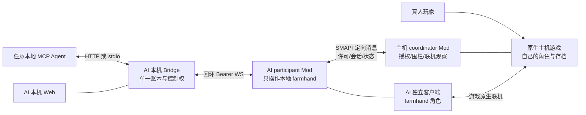

# Stardew Agent Bridge：联机功能完整开发交接书

> 日期：2026-10-24（北京时间）。版本：1.0。交付对象：Flash 或其他负责实施的 AI。
> 本文件是未来联机功能的开发规格；本次只制作交接文档，不修改游戏、Mod、Bridge 或 Docker 实现，不启动或部署联机。
> 沿用分工：实现 AI 完成代码、配置、脚本、测试源码和文档的编写；构建、测试、双客户端实机验收由原协作者 Codex 接手；GitHub 上传仍由原协作者处理。
> **现有 Docker 单人版任务继续按原范围进行。不要把本文件当成正在进行的 Docker 任务已获准修改联机的指令。联机另开实施工作区，待明确接手本任务后开发。**

## 0. 直接交给实现 AI 的任务

请先完整阅读本文件，再核对实际仓库与工作区。目标是让任意支持 MCP 的本地 Agent，控制一个真实、独立的星露谷农场助手角色，与真人在同一农场正常联机游玩。

首版固定采用：**真人作为原生游戏主机；AI 使用另一个正常游戏客户端和自己的 farmhand；两边安装兼容的项目 Mod；AI 侧 Bridge/Web/MCP 控制本地 AI 角色；主机侧 Mod 负责身份握手、授权、联机状态和有限核验，不替 AI 直接修改世界或库存。**

不要仅删除 `Context.IsMultiplayer` 的拒绝判断。完成第 21 节任务后，按第 24 节报告模板交付，不能把存在文件、通过语法解析或协议收到 ACK 写成实际联机成功。

### 0.1 实施 AI 的执行边界

- 只完成编写，不运行 npm 安装/构建/测试、dotnet 构建/测试、Docker、SMAPI、游戏、Steam、服务器或验收脚本。
- 不读取或修改真实存档，不创建真实角色，不加入用户农场，不登录账号，不自动打开防火墙/路由器端口。
- 不提交或推送 Git，不创建 GitHub Release，不发布镜像，不联系其他人。
- 允许只读源码/Git/官方资料核对，允许文件编辑；可选 `node --check` 或 JSON 解析只记为静态解析。
- 不删测试、不弱化认证、不改期望结果让测试“通过”、不生成假实机报告。
- 接手前已有改动必须保留。当前 Docker 在另行编写，相关文件可能继续变化；先建立隔离工作区，不在同一目录覆盖其进行中的代码。
- 无私有游戏输入时继续实现纯逻辑、适配器与合成测试；不得用“缺游戏”解释缺失的核心状态机/授权/账本实现。

### 0.2 状态措辞

实施交付统一写“编写完成；未运行构建/测试；待原协作者验证”。任务内部用 `not_started / in_progress / implemented_pending_validation`，验收用 `not_run / pass / fail / blocked`。

本文件所有新增字段、消息、模块、工具、配置和命令均为**待实现契约**。它们不是当前已经存在的 API；实现者必须真正写出对应代码。

## 1. 项目、基线和实际限制

| 项目 | 已核对情况 |
| --- | --- |
| GitHub | https://github.com/amy2022525-sketch/stardew-agent-bridge |
| 当前维护目录 | `D:\星露谷\stardew-agent-bridge`；不要未经核对改旧 F 盘副本 |
| 本文件核对的已提交基线 | `63a4f369feadacf9476660c7af6b1cb9b6ac9a00` |
| 当前额外工作区改动 | 有 Docker 相关未提交修改/新增文件；内容与完成状态以接手时实物为准 |
| 当前应用/Mod 版本 | 0.1.0 |
| Mod 目标 | net6.0、x64，当前最低 SMAPI 4.5.2 |
| 本地内部协议 | `stardew-agent-bridge/1`，共享契约 schemaVersion=1 |
| MCP 工具 | 当前 28 个，定义统一在 `packages/contracts/src/tools.ts` |
| 模型层 | 来自 DSH/Codex/Claude Code/其他 MCP 宿主，不绑定专用 AI 服务 |
| 当前联机支持 | 未实现；Mod 中保留明确 `UNSUPPORTED` 拒绝 |

### 1.1 必须阅读的现有文件

- `mods/StardewAgentBridge/ModEntry.cs`：主线程分发、握手、世界重置、控制、看门狗和多人拒绝位置。
- `ControlAuthority.cs`、`ActionCoordinator.cs`、`BackgroundUpdates.cs`：暂停假设、动作推进、背景更新。
- `Observations.cs`、`WorldState.cs`、`InteractionEvidence.cs`：本地角色、引用、任务/关系/物品后验。
- `GameActions.cs`、`MovementInput.cs`、`InventoryActions.cs`、`ShopBuyAction.cs`、`ShippingAction.cs`、`RealtimeActions.cs`、`LifecycleActions.cs`。
- `Protocol.cs`、`BridgeServer.cs`、`PlatformPaths.cs`：协议、回环认证、数据目录。
- `packages/contracts/src/protocol.ts`、`tools.ts`、相关 schema/归一化/去重辅助函数。
- `packages/game-client/src/mod-client.ts`：当前只有一条本地 Mod 链路，断线时写结果未知。
- `packages/control-core/src/action-service.ts`、`control-manager.ts`、`ledger.ts`、`event-log.ts`。
- `apps/server/src/bridge.ts`、`config.ts`、`hosts.ts`，Web 和 stdio adapter。
- `docs/PROTOCOL.md`、`CLIENTS.md`、`PLATFORM_MATRIX.md`、`LINUX_VALIDATION_REPORT.md`。
- Docker 任务书/进度/实际源码只作为后续集成输入，不假定其已经验收。

### 1.2 源码中需要重新审视的单人假设

1. 多处直接使用 `Game1.player`、`Game1.currentLocation`、`Game1.activeClickableMenu`。独立客户端中它们通常对应本地角色，但不能把此性质推广到主机控制远程玩家或分屏。
2. `ControlAuthority.TryOpenPauseMenu()` 和背景更新逻辑按单人停止世界的预期组织；联机中本地开菜单不能被报告为全世界暂停。
3. 当前动作后验主要比较本地金币/库存/位置变化；多人共享经济和同步延迟会破坏归因。
4. 现有账本 key 依赖游戏实例与 actionId，并记录本地 worldGeneration；联机需要额外的世界、主机会话和角色作用域。
5. 目标引用 `@s...` 在当前进程里解析；不同角色/重连后同形字符串不能误指新对象。
6. 世界/场景代次不能只在本地换图时更新；主机退出、角色解绑、跨日、保存屏障和重连都需要失效规则。
7. F9/看门狗必须停止 AI 自己的输入，不能误暂停/操作真人客户端。
8. 现有全局多人拒绝应逐渐替换为经过协商的**按角色、动作、政策和游戏阶段的准入**；未改好的动作继续拒绝。

## 2. 首版范围、后续阶段与完成目标

### 2.1 MP1 必须完成的最小完整产品

- PC 原生联机：真人主机 + 一个 AI farmhand 的独立游戏进程，Windows/Linux 先按各自实际验证记录。
- 主机和 AI 两端安装同一项目的联机版本 Mod；主机只做 coordinator，无需安装 AI 模型或常驻 Bridge。
- 手动通过原生 Co-op 加入并选定独立 farmhand；系统识别实际连接与角色，用户显式绑定，不能自动抢已有角色。
- 主机显式允许该角色；AI 每次开始控制时具有本地控制会话和有效主机许可。
- 结构化联机状态、公开玩家概要、权限说明、真实本地快照与截图。
- 有边界的本地移动/选择/正常使用、简单非破坏交互、等待、自己的进食/装备，以及下文工具矩阵指定的条件能力。
- 联机安全的 stop、F9、看门狗、重连隔离、保存/跨日屏障、去重和未知结果处理。
- 默认阻止共享钱包消费、共享箱子、出货、危险共享世界修改，不能用通用 use/menu/interact 绕过。
- 为受审计的合作工具提供可配置能力门，其他分支明确返回当前禁用的原因。
- 新协议/收据/账本迁移、旧单人兼容、Web/MCP、测试源码、文档和交接报告。

这个版本的价值是“AI 作为自己的角色与真人同时在线，能正常观察、走动和执行已授权动作”。不能把“28 个旧工具全部存在”描述成“28 个工具的多人玩法全部验收”。

“条件支持”也不能全部用 disabled 占位：MP1 至少写出并能在明确政策下开放允许区域正常浇水、正常门/出口交互、自己非交易菜单/关闭自有菜单、自己的进食/装备、只消耗自己背包材料的基础制作。这些分支各有真实适配器与测试源码。buy/ship/container 写/place/fish/combat 的 MP2 分支可保持明确禁用，不要求首版假装全部实现。

### 2.2 MP2：在 MP1 验证后分项开放

共享钱包预算、共享箱子和机器的并发操作、种植/收获/出货的归因、更多社交/任务/公共事件、较长时间钓鱼战斗与合作任务。第 11/12 节写出这些分支的目标细节和门槛，初版可以明确禁用；不得删掉保护假装全部支持。

### 2.3 MP3：另行立项

自动加入房间/自动重连 UI、AI 作为主机、多 AI 角色编排、分屏、手机/主机平台、第三方常开服务器、自动 Steam 登录、公网控制和游戏网络运维。它们不是 MP1 必须实现的范围。

Docker 与多人是两条能力轴。MP1 首先在两个正常桌面客户端上验证；Docker farmhand 集成依赖 Docker 单人版已验证，不作为跳过基础联机验收的理由。

## 3. 固定架构：本地控制与原生联机分离



### 3.1 三个层级的职责

| 层级 | 负责 | 不负责 |
| --- | --- | --- |
| 游戏原生网络 | 玩家入房、角色移动/世界同步、物品/建筑/存档等原生机制 | MCP 认证和动作账本 |
| SMAPI Mod 间协议 | 检查双方版本、主机身份、角色绑定、政策/许可、屏障、有限观察证据 | 重新实现整个游戏服务器、任意执行远程代码 |
| 本地 Bridge/MCP | Agent 认证、动作排队、会话/幂等/收据/Web | 把 MCP 端口暴露给其他游戏玩家或替代原生联机 |

MCP、Mod WebSocket 和 Docker Web 网关继续仅本机可达。玩家联机的可达性使用游戏原生机制。不要让 host coordinator 连接 AI 的 17654/17655，也不要通过开放 Mod/MCP 端口实现跨机器联机。

### 3.2 主机 coordinator

- 只在真实 `Context.IsMainPlayer` 的已载入主机上下文中提供联机协调服务。
- 默认不创建本地 BridgeServer、不要求客户端令牌文件、不向 AI 暴露主机角色控制。
- 使用 SMAPI 原生 peer 元数据确定连接对象，对指定 modID/playerID 定向发消息。
- 仅从主线程读取游戏状态与修改本 Mod 的授权/记录；不把网络消息当游戏操作脚本。
- 可通过主机本地 console 命令和简单 UI 查看/允许/撤销 AI 角色；没有 Agent 可以调用的“批准自己”接口。

### 3.3 AI participant

- 本地实际角色必须是已进入世界的 farmhand；主机角色或分屏角色不符合首版控制条件。
- 观察、菜单、输入和动作都绑定本进程的本地 actor，不能临时把 `Game1.player` 换成远程 Farmer。
- 本地写操作同时要求有效 Bridge 控制会话、主机许可、上下文和能力门。
- 主机不可用/版本不兼容/尚未允许时只提供诊断及允许的只读内容，不回退到单人动作。

### 3.4 第三方与恶意客户端边界

本项目的授权限制自己的 AI Mod 行为，不能防止其他玩家安装作弊 Mod、修改游戏或绕开原生网络。SMAPI sender 元数据提供当前游戏连接的发送方上下文，不等同于经本项目认证的 Steam 账号或服务器反作弊证明。

不要在文档承诺全农场的不可绕过权限、全局 exactly-once 或任意第三方客户端的强一致事务。

## 4. 身份与作用域：所有后续设计的基础

### 4.1 必须区分的标识

| 字段 | 来源与生命周期 | 不能替代它的东西 |
| --- | --- | --- |
| `worldId` | 主机核对的原生存档/农场标识，按底层真实类型转换字符串 | 目录名、玩家名、地址、邀请码 |
| `hostFarmerId` | 原生主机玩家的 UniqueMultiplayerID | payload 自称 host、clientId |
| `hostSessionId` | 每次主机加载/重新托管生成的随机新 nonce | 持久 worldId、操作系统 PID |
| `actorFarmerId` | AI 当前本地 farmhand 的 UniqueMultiplayerID | 主机 ID、farm 名、Agent 名称 |
| `actorSessionId` | 每次角色绑定/重连/切角色生成的新 nonce | 稳定角色 ID、上一次连接 |
| `connectionId` | 本次双方握手确认的 peer 会话 nonce | 仅 IP、peer 列表索引 |
| `policyRevision` | 主机政策版本，变化即失效旧许可 | 本地 Bridge epoch |
| `permissionLeaseId` | 主机短期许可 ID | 客户端 Bearer token |
| `controlSessionId / epoch` | 本地 Bridge/Mod 当前写者与围栏 | 主机许可或玩家身份 |
| `worldGeneration` | 现有本地世界代次，保留并扩展失效规则 | 单独 worldId |
| `sceneGeneration` | 当前 actor 的位置/菜单/观察场景代次 | 全农场所有玩家统一场景 |
| `dayGeneration / saveRevision` | 主机观测的日/保存阶段标记 | 本机墙钟或任何 ACK |

### 4.2 64 位 ID 必须用字符串

SMAPI player ID 使用 .NET `long`，Node/JSON 不能经过 JS Number 处理后再转回。wire DTO 的 farmerId 一律 canonical 十进制字符串，校验整个 Int64 范围；不要未经核对就拒绝底层可能出现的负数。

拒绝科学计数、空白、小数、`-0`、非规范前导零和溢出；C# 用 InvariantCulture，TS 用字符串与 BigInt 边界校验，JSON 不直接序列化 BigInt。

worldId 的底层类型以本游戏版本核对为准，保存无损的规范字符串。不得把 public roster 的玩家名作为授权键；重命名不会改变角色绑定。

### 4.3 ActorContext 契约

```typescript
interface MultiplayerActorContext {
  mode: 'multiplayer';
  role: 'farmhand';
  worldId: string;
  hostFarmerId: string;
  hostSessionId: string;
  actorFarmerId: string;
  actorSessionId: string;
  connectionId: string;
  policyRevision: number;
  permissionLeaseId: string;
  worldGeneration: number;
  sceneGeneration: number;
  dayGeneration: number;
}
```

这是传输/校验后的会话上下文，不由 Agent 任填。Bridge 从完成协商的 Mod 状态注入写请求；Mod 每次派发前和长动作每 tick 重新核对。主机收到的角色 ID 必须与原生 FromPlayerID/实际绑定一致。

### 4.4 绑定流程

首次加入后在 Web/本地设置中展示实际 worldId、角色名、角色 ID 和主机概要，由用户显式保存预期绑定。显示身份不等于取得控制权；主机仍需允许。

后续连接到不同 worldId/不同 actor 时进入 `binding_required`，不能自动把 AI 权限授予新角色。主机释放/重新分配 cabin 后同名角色也要重新核对。

## 5. 协议与版本协商

### 5.1 三套版本分开

1. 本地 Mod WS 协议：新增 `stardew-agent-bridge/2`，保留 v1 的受限兼容解码。
2. MCP structuredContent/快照/收据：新增 schemaVersion=2，保持现有工具名与普通参数兼容；为新作用域增加字段。
3. Mod 间消息：独立 `sab-mp/1`，与 MCP 和本地 WS 的 major 不混用。

应用/Mod 公开版本由原协作者发布时决定，不擅自把整个项目叫 v2.0。schema major 升级要在 C#/TS/夹具/文档/错误映射同步，不能只改一个常量。

### 5.2 兼容矩阵

| Bridge / Mod | 单人 | 多人 |
| --- | --- | --- |
| 旧 Bridge v1 + 旧 Mod v1 | 原行为 | 继续原拒绝 |
| 新 Bridge + 旧 Mod | 协商 legacy 路径，保留原单人工具行为 | 禁止多人写，不凭 hello 推测允许 |
| 旧 Bridge + 新 Mod | Mod 保留 v1 单人 DTO/命令路径 | 禁止控制获取和游戏写；只允许安全诊断/本地停手 |
| 新 Bridge + 新 participant，但无兼容 coordinator | 单人按原行为 | 诊断/有限只读，写返回明确原因 |
| 新 Bridge + 双方兼容 Mod + 角色已许可 | 单人按原行为 | 只允许协商/政策/工具矩阵交集中的能力 |

本地协议降级只为旧单人兼容。不能通过伪装 singlePlayer=true、移除 ActorContext 或降级 v1 绕过多人限制。

### 5.3 hello / status 扩展

保持已有 instanceId、worldGeneration、singlePlayer、capabilities、writeCommands；schema2 增加 multiplayer 对象：

```json
{
  "multiplayer": {
    "enabled": true,
    "role": "farmhand",
    "state": "authorized",
    "worldId": "<native-id-string>",
    "hostFarmerId": "<int64-string>",
    "hostSessionId": "<nonce>",
    "actorFarmerId": "<int64-string>",
    "actorSessionId": "<nonce>",
    "connectionId": "<nonce>",
    "policyRevision": 3,
    "permissionLeaseHeld": true,
    "worldClock": {"state": "advancing", "scope": "host_observed"},
    "blockedCapabilities": [{"command": "buy", "reason": "SHARED_WALLET_DISABLED"}]
  }
}
```

示例是待实现 DTO。对 MCP/Web 暴露必要身份和剩余许可时间即可，许可内部细节不输出为可复制的远程权限凭据。角色/政策未就绪时 writeCommands 为实际可用交集，不能继续列所有单人写命令。

## 6. SMAPI 联机消息协议

### 6.1 使用已存在的官方 API

固定当前工程参考版本 SMAPI 4.5.2，基于 `IMultiplayerHelper.SendMessage`、`GetConnectedPlayers/GetConnectedPlayer` 与原生 Multiplayer 事件。收包检查真实的 `FromModID`、`FromPlayerID`、Type，不能相信消息 payload 的 claimed sender。

官方接口支持按 modIDs/playerIDs 定向发送，参见 [IMultiplayerHelper 4.5.2](https://raw.githubusercontent.com/Pathoschild/SMAPI/4.5.2/src/SMAPI/IMultiplayerHelper.cs)。事件参数的发送方字段见 [ModMessageReceivedEventArgs](https://raw.githubusercontent.com/Pathoschild/SMAPI/4.5.2/src/SMAPI/Events/ModMessageReceivedEventArgs.cs)。

### 6.2 信封

```typescript
interface MpEnvelope<T> {
  protocol: 'sab-mp/1';
  type: string;              // 固定白名单
  messageId: string;         // 只在指定会话内去重
  correlationId: string | null;
  hostSessionId: string | null; // 初始 ClientHello 可以为空
  actorSessionId: string;
  connectionId: string | null;
  sequence: number;
  payload: T;
}
```

不以 wall clock 排序。sequence 为有界安全整数，按“方向 + 会话”单调增加；非规范 JSON、越界/多余字段、过大字符串/数组都要受限。初始设计单消息 16 KiB、每 peer 每秒 20 条、合计队列 128 条，作为应用自己的限制写入配置/测试，不声称是 SMAPI 的默认限制。

### 6.3 消息白名单与方向

| 消息 | 方向 | 含义/关键校验 |
| --- | --- | --- |
| `ClientHello` | participant→host | 声明协议/Mod 版本、实际 actor 与本次 nonce，不直接授予权限 |
| `HostHello` | host→participant | 原生主机发送，带世界/会话与政策概要，回显挑战 correlation |
| `BindRequest` | participant→host | 实际 actor 绑定请求，角色必须已入房并匹配 FromPlayerID |
| `BindResult` | host→participant | pending/denied/approved，包含新的 connectionId |
| `LeaseRequest` | participant→host | 当前本地控制者请求短期许可，带本次请求 nonce |
| `LeaseGrant` | host→participant | 指定 actor/会话/政策的短许可，不能成为跨角色 token |
| `LeaseRenew` | participant→host | 针对现有许可和 sequence 续期 |
| `LeaseRevoke` | host→participant | 主机撤销，立即停新动作/释放输入，旧许可不能复活 |
| `PolicyChanged` | host→participant | 政策修订，旧许可失效，需重新协商 |
| `PhaseChanged` | host→participants | loading/active/saving/day_transition/closing；单调阶段序号 |
| `ObservationRequest` | participant→host | 受控对象/状态核验请求，不能请求任意 Farmer/世界 dump |
| `ObservationReport` | host→participant | 主机观察摘要与 scope/tick，不能冒充游戏提交 ACK |
| `ActionIntentNotice` | participant→host | 供许可核对/审计的动作意图，不让 host 执行该动作 |
| `ActionOutcomeNotice` | participant→host | 本地观测结果，含确认级别，接收不等于认可副作用 |
| `ResourceLeaseRequest/Result/Release` | 双向受限 | 仅 MP2 指定共享操作的合作预约，非原生世界强锁 |
| `ActorStopped` | participant→host | 输入释放结果；不能报告全局暂停 |

不增加 `ExecuteCode`、任意 console command、任意路径读写、通用游戏方法反射或背包/金币直接赋值消息。

### 6.4 收包处理顺序

1. 判断消息 type/modID 是否为本项目白名单。
2. 通过原生 peer 元数据确定发送方和真实 host，不从 payload 得出角色。
3. 检查消息大小/结构/版本/方向/序号/会话；解析异常受控返回，不把异常传播到游戏主循环。
4. 网络事件回调仅入有界队列；所有游戏状态读取和政策修改在当前合法主线程上下文处理。不要假设所有回调线程语义永远不变。
5. 丢弃陈旧连接、重复/乱序/错误 actor 的消息；必要回复拒绝原因，不泄露其他玩家私有状态。
6. 超时/队列满会撤销/收紧本 AI 许可，不能让合法玩家的游戏主循环阻塞。

### 6.5 加入事件不等于角色就绪

`PeerContextReceived` 发生在连接获准前，不能在该事件里开始控制；`PeerConnected` 也不能替代当前 actor 已初始化、世界已就绪和本项目绑定成功。事件顺序依据 [IMultiplayerEvents](https://raw.githubusercontent.com/Pathoschild/SMAPI/4.5.2/src/SMAPI/Events/IMultiplayerEvents.cs) 核对。

主机身份使用 `IMultiplayerPeer.IsHost` 等原生元数据与当前游戏主机上下文交叉核验；ScreenID 只是分屏信息，不能当全局角色 ID，参见 [IMultiplayerPeer](https://raw.githubusercontent.com/Pathoschild/SMAPI/4.5.2/src/SMAPI/IMultiplayerPeer.cs)。

## 7. 主机政策、双层许可与围栏

### 7.1 默认政策

默认 Disabled；主机显式启用后，未批准角色仍只读。每个允许项按 worldId + actorFarmerId 绑定，不按名字、IP、MCP clientId 或“所有 farmhand”自动放行。

政策至少包括：允许的 actor、允许位置、允许动作类别、最大单次时长、最大连续控制时间、资源/消费门、可访问区域和是否允许某种共享操作。政策变化写本地受保护配置，并递增 policyRevision。

角色本地健康阈值可以比主机政策更保守，Agent 不得通过工具参数放宽主机限制。未识别的动作/物品/菜单默认拒绝。

### 7.2 双层控制

- 第一层：现有 Bridge 的 clientId/controlSessionId/epoch，决定哪个 Agent 可以控制这个本地 actor。
- 第二层：主机 permissionLease，决定该 actor 是否可在当前农场、当前政策下接受 AI 动作。
- 两层都有效才派发写操作；释放其中一层不能让另一层替代它。
- 本地多个 Agent 争一个 farmhand 时仍使用原控制权机制；不允许“每个 clientId 一份 farmhand 全权限”。

### 7.3 短期许可与时钟

初始建议主机许可 TTL 5 秒、每秒续期，后续实测调整；本地 Bridge 心跳/Mod watchdog 保留自己的独立时限。许可用单调时钟，不比较两台机器的墙钟时间。

续期请求记录本地 sentAtMono/deadline。响应必须匹配尚有效的 correlation/lease/session；有效窗口从请求发送时刻保守计算，扣除已耗时间，而不是从迟到响应接收时刻重新给满 TTL。

重复/旧 sequence、过期 correlation、已经 revoke 的 LeaseGrant 都不能延长许可。主机端也按自己的单调时钟到期；不能凭 payload 的远未来 expiresAt 自动相信许可有效。

长动作每 tick 检查两层许可、actor 身份、世界会话和政策。无法续期时停止后续输入，不等待 55 秒钓鱼循环结束才发现许可过期。

连续控制硬上限由主机按 actor 计时，不因 LeaseRenew、新clientId、新本地session或短暂断开就重新计满。达到上限后需要主机明确重新授权，或使用主机事先配置的冷却政策；不能让Agent循环开session绕过。

### 7.4 撤销

主机可本地 revoke 某 actor；participant 收到后立刻停止新动作并释放自己持有的输入。丢失 revoke 消息时仍受短 TTL 限制，不宣称网络断开后绝对即时全局停手。

主机撤销不篡改该角色库存/位置、不踢走真人玩家、不暂停全农场。必要时向操作者报告“AI 权限已撤销，游戏世界继续运行”。

### 7.5 主机管理入口

至少提供本地 console 命令的完整实现与文档：`sab_mp status / list / allow / revoke / policy / disable`。参数为结构化子命令，校验 ID/政策文件，不接受任意 shell 文本。

`allow` 只对当前真实 peer/已核对世界生效，可保存到主机本地政策；不通过全局聊天命令让任意玩家批准自己。Web/Agent 的只读联机工具不得调用 allow/revoke 管理接口。

## 8. 联机状态机、世界阶段与屏障

### 8.1 participant 连接状态

```text
disabled
  或 enabled -> waiting_for_world
  -> detecting_role
  -> waiting_for_host_mod
  -> negotiating
  -> binding_required / awaiting_host_approval
  -> bound_readonly
  -> authorized
  -> controlling

任意阶段 -> suspended       保存/跨日/角色不可行动/政策变更
任意阶段 -> disconnected    peer/主机/世界/本地 Mod 链路失效
任意阶段 -> incompatible    协议/角色/分屏/绑定不符合首版
```

`authorized` 仅指主机许可可用，不代表已取得本地写会话；`controlling` 也不代表世界可暂停。状态更新附原因码、当前身份概要和代次，不输出旧世界状态冒充新世界。

### 8.2 原生游戏阶段

```text
title -> loading/joining -> actor_initializing -> active
active -> saving -> saved -> day_transition -> active
active -> event_blocked / menu_blocked / incapacitated
任何阶段 -> returning_to_title / host_closing / disconnected
```

阶段检测来自实际游戏事件/上下文；不只依赖网络消息或固定等待几秒。对于切图、矿井楼层变化、节日和私有实例场景，不以 displayName 相同推断位置相同。

### 8.3 保存/跨日屏障

- 主机 Saving 时递增 phaseSequence，禁止新许可/新写，并向受控 actor 广播屏障。
- participant 本地检测到保存/过场也必须停止后续输入；延迟的 PhaseChanged 不能覆盖更高序号。
- 正在运行的动作尽力停止；副作用已发出且无法归因时记 partial/unknown，不回滚或重播。
- 主机不能为等 AI 回 ACK 阻塞整个原生存档流程；超时就撤销 AI 许可，正常游戏仍继续。
- Saved/DayStarted 的实际事件后刷新 dayGeneration、saveRevision/场景状态；必须重新观察并取得符合新阶段的许可。
- 跨日不会自动改变角色 ID，但会让旧目标引用、旧动作前提和待执行队列失效。
- 主机回标题或重新托管时换 hostSessionId，关闭所有许可与资源预约。

事件是否在 farmhand 触发、顺序与语义必须以固定 SMAPI/游戏版本核对。不能看到 farmhand 的本地事件就声称主机磁盘保存已经完成，参见 [IGameLoopEvents 4.5.2](https://raw.githubusercontent.com/Pathoschild/SMAPI/4.5.2/src/SMAPI/Events/IGameLoopEvents.cs)。

### 8.4 缺少信息时

世界阶段不明、actor 不存在、位置未同步、主机失联或政策无法解析时，停止新写并解释原因。保留诊断/状态查询。不要退化为“先执行，失败了再修”。

## 9. 观察、玩家隐私与目标引用

### 9.1 Snapshot schema2

保留原字段，增加：actorContext 的非秘密部分、联机状态、主机世界阶段、观察范围、同步时间/序号及确认级别。自己的背包/技能/任务与世界共享状态分组，不能把主机的资料当成 AI 的状态。

快照不是跨所有客户端的一致性事务。分别给 localObservedAt、hostObservationSequence（如有）、phaseSequence 和 freshness；网络缓存无法确认新鲜时标明 stale/unknown。

### 9.2 玩家信息

默认 roster 只提供当前联机所需 ID、显示名、host/farmhand、在线与本 Mod 兼容状态。位置是否显示取决于主机政策；不自动读取真人背包、钱包、私聊、关系、任务或未同步位置。

`WorldState.cs`、邮件/任务/关系读取逐项确认是否为本 actor；无法确认时省略并给 reason，不用另一个 Farmer 的值补齐。

### 9.3 位置标识

使用游戏的真正 unique location 标识与实例信息。`Farm`、`Cabin`、`Mine` 等显示/基础名字不能区分所有副本。Native location ID/NameOrUniqueName 的真实接口由实现者核对；不拼一个看似稳定但实际冲突的 key。

### 9.4 MP 专用引用

单人保留 `@s...`，多人新增不可预测快照 nonce 引用，示例格式：

```text
@mp2_<22字符base64url快照nonce>_e12
@mp2_<22字符base64url快照nonce>_m3
```

schema 允许单人旧格式与多人新格式的并集；**多人动作拒绝旧格式**，以免旧世界的 `@s1:e0` 在新会话中碰巧指向新目标。

服务端引用表绑定：worldId、hostSessionId、actorFarmerId、actorSessionId、connectionId、worldGeneration、sceneGeneration、dayGeneration、location unique key、snapshot nonce、目标类型、真实对象引用/可用原生 ID 和观察 fingerprint。

只接受当前 actor 最新有效上下文的引用。换图、菜单变化、跨日、断线、重新绑定、对象替换或状态前提变化时失效；对其他角色引用报 ACTOR_MISMATCH/STALE_REF，不在主机为它重新搜索同名对象。

### 9.5 主线程即时复核

派发前重新确认目标距离、当前地点、库存槽位/物品、菜单实例、对象是否仍是观察时的对象，以及政策是否允许此操作。共享对象同一格被替换/破坏时拒绝，不把相同 itemId 当同一对象。

没有可用原生稳定 ID 时，使用本地对象身份与字段前提并承认同步局限；无法建立可靠前提时返回陈旧/不可核验。不要声称自制 fingerprint 等同原生 compare-and-swap。

## 10. 动作管线、去重与结果语义

### 10.1 统一派发顺序

1. 本地 Agent Bearer 与 clientId 检查，工具 schema 校验。
2. 读取已协商 actorContext；检查本地角色/主机/世界/阶段和能力交集。
3. 校验 controlSessionId/epoch、主机许可/政策、限时/健康阈值。
4. 验证目标引用、实际操作类别与敏感分支；不能只检查工具名字。
5. 查 MP 作用域去重记录；冲突/已有意图一律不重放。
6. 账本先持久记录完整上下文和意图；不可写时拒绝，不能先执行后补记录。
7. 需要时向 coordinator 发受限意图/观察请求，或取得 MP2 合作预约。
8. 在 participant 的合法主线程执行正常本地角色游戏动作，绝不由主机替它改库存/位置。
9. 长动作每 tick 重新检查许可/阶段/actor，收集本地与允许的主机观察证据。
10. 保存最终收据，释放本动作拥有的输入/菜单/预约；不释放别人或原生玩家持有的资源。

Central guard 必须覆盖旧代码中在多人拒绝前就处理的 control/stop/hello 等分支。stop/安全诊断有特别允许路径，获取控制和其他写操作不能借早期分支绕过新准入。

### 10.2 MP 去重键

MP namespace 固定绑定 `(worldId, actorFarmerId, actionId)`，用带版本的规范编码/哈希生成 dedup_key。不能仅用 clientId、同名角色、Bridge PID 或本次 connectionId。

刻意不把 connectionId/actorSessionId 放在去重主键中：重连不能把旧 actionId 变成一条可再次消费的新动作。完整 session/context 放入签名与记录；同 actionId 跨会话的写请求返回冲突/陈旧上下文并要求重新观察，不直接重放。

签名包括操作、规范参数、clientId、控制会话及派发时 actorContext。两个客户端在同一角色用同一 ID 也不能重复执行；参数或主体不同是冲突。

旧单人去重规则不原地改成另一种 key。新增 MP 记录空间，保留 legacy 查询/墓碑；缓存淘汰不删除“不重放”记录。

### 10.3 收据新增字段

```typescript
interface MultiplayerReceiptDetail {
  actor: {
    worldId: string;
    actorFarmerId: string;
    actorSessionId: string;
    hostSessionId: string;
    connectionId: string;
  };
  policyRevision: number;
  confirmationScope: 'none' | 'local_observed' | 'host_observed' | 'replicated_observed';
  durability: 'not_saved' | 'host_save_observed_after_effect' | 'unknown';
  resourceScope: 'actor' | 'shared_world' | 'shared_wallet' | 'shared_container';
  evidenceSequence: number | null;
  worldContinues: boolean | null;
}
```

保留 status、verified、effectKnown、effects、reconciliation。`verified=true` 的判据按动作明确规定；协议 ACK/许可 ACK 不是副作用证据。

host_observed 只表示主机也观察到相关状态，不是原生游戏网络提供了可证明的提交回执。观测不到或归因不清时不能填“server committed”。

### 10.4 状态判断

| 情况 | 应报告 |
| --- | --- |
| 派发前权限/前提拒绝 | failed，effectKnown=true，确认未派发 |
| 输入已发出但网络断线/动画未完成/结果归因不明 | unknown 或已知部分的 partial，绝不自动重试 |
| 本地与要求的观察证据满足该动作判据 | succeeded 或 partial，记录确认范围；不等于已存档 |
| 主机/真人同时改变共享资源，无法区分贡献 | verified=false，说明观察到的变化与不确定性 |
| 本动作已确认终态后才断线 | 返回已存终态，不能因晚到断线又重播 |
| 存档被回退到更早快照 | 旧收据作为审计保留；重新操作需新 ID/新观察，不假装旧效果仍在 |

### 10.5 默认不自动重试的范围

消费、制作、出货、箱子转移、使用可消耗物品、种植/收获及任何其他写操作都不在网络重试策略中。重发握手/只读状态可有上限和退避，但不能把整个工具函数套进 retry。

主机意图审计的重复 Notice 只能返回原记录/ACK，不能重复预留预算或再次执行副作用；host 本身不会执行这些 actor 动作。

## 11. 共享资源与并发细节

### 11.1 钱包

- snapshot 分开显示当前钱包模式、actor 可见余额与共享余额（允许且可获得时）。不知道模式就禁止购买，不能推测。
- MP1：分离钱包的购买也要专项审计和政策显式启用；共享钱包购买默认关闭。
- MP2：主机配置 actor/session/action 预算，价格上界/数量与原生商店规则都能核实时才许可；无法取得可靠报价时继续拒绝。
- 预算限制的是本 AI 操作额度，不是阻止真人花钱的农场全局余额锁。真人并发消费后余额不足是正常可预期结果。
- 先预留、后观察结算；未知动作冻结对应额度等待核对，不立即退款再允许第二次消费。
- 不依据共享余额总差值推断 AI 花了多少钱；必须结合 actor 背包、菜单报价/库存与可用主机观察，无法归因就降级。
- 不直接写 `Money`、总收入或 shared wallet NetField 来“修正差额”。

### 11.2 箱子和机器

- MP1 默认禁止共享容器/机器写；自己的背包操作仍按明确分类执行。
- MP2 必须复用原生 NetMutex/菜单占用规则；自制预约只协调本项目 AI，不覆盖真人占用或原生锁。
- 资源 key 含 world/location unique identity/tile/原生 entity ID（可用时）；不能只用箱子名字或物品种类。
- 遇到真人打开箱子、对象移走、容量变化、库存被同时改变时返回 RESOURCE_BUSY/STALE_REF/partial/unknown。
- 获取锁、等待、取消和释放均有边界；只释放本动作实际取得的锁，不强制清空 mutex owner。
- 不直接操作远程 Farmer 的 Items 或用一次列表编辑模拟搬运；正常菜单/原生调用后逐件核对两侧增减。
- 机器投入/取出属于独立操作；不能把容器 put 的代码不加检查套到所有 CraftingMachine。

### 11.3 地块、作物和拾取物

- 主机明确允许的区域/操作才能使用工具；默认只读，不把全 Farm 当 AI 私产。
- watering 与 axe/pickaxe/scythe/hoe/seed 的风险类别分别定义，不能因为 use 已允许就全部可用。
- 合作预约无法阻止真人同 tick 行为；每次真实执行前后重新观察，原生游戏规则决定最终变化。
- 另一玩家已收获/浇水/拾取时，不重复消费/攻击；返回 stale/no_change/partial 并解释。
- 相同地块已长出别的对象不能自动重新定位新对象继续做旧动作。
- 树木破坏、建筑拆除、家居出售等默认关闭；通用 interact/menu 也要拦截相应分支。

### 11.4 社交/任务/公共事件

观察自己的任务/关系与共享公告分开；不自动送礼、接受/提交全局特殊订单、交捐献、触发婚姻/节日或用对话选择推进不可逆剧情。

主机政策与全队同意机制尚未实现的分支直接拒绝。NPC 相同并不代表交互菜单对每个 Farmer 相同；菜单 action/ref 必须来自当前 actor 实际菜单。

### 11.5 主机观察服务

只接受固定白名单：当前 actor 的公开位置/连接、必要的允许资源状态、阶段/钱包模式。不能通过 ObservationRequest 读取任意文件、角色私有背包或卸载所有地图。

利用原生 active/synced location 能力时核对实际范围；主机没有当前可用观察就返回不可提供，不扫描/强行加载未活动地图替 AI 全图探测。

## 12. 28 个旧工具逐项准入矩阵

“条件”意味着必须写实际 classifier/guard、能力门、证据要求和失败路径；不是删掉全局多人拒绝后默认开放。无明确支持分支必须返回 `UNSUPPORTED_IN_MULTIPLAYER`，兼容映射见第 19 节。

| 工具 | MP1 决定 | 关键细节/不能绕过的限制 |
| --- | --- | --- |
| stardew_doctor | 必须支持 | 显示真实角色/主机/政策/版本/许可/禁用原因，不写世界 |
| stardew_snapshot | 必须支持 | 本 actor 的位置/库存；共享状态有观察范围和 freshness |
| stardew_inspect | 条件只读 | 只检查有权限、有效引用、实际可观察目标 |
| stardew_screenshot | 必须支持 | 截当前 AI 客户端窗口，附 actor/session，不截主机/别的桌面 |
| stardew_status | 必须支持 | 收据/控制/联机状态；不能混入上一会话正在运行的假状态 |
| stardew_move | 必须支持 | 本地 farmhand，动态障碍含其他玩家，不能传送或推开/冻结真人 |
| stardew_select | 必须支持 | 只选自己的背包槽位；状态切换也有 actor 校验 |
| stardew_use | 条件支持 | 对实际工具/目标分类；默认只开已审计动作，如允许区域正常浇水；其他拒绝 |
| stardew_interact | 条件支持 | 只开已审计非破坏分支；NPC奖励/共享箱/提交/床/商店交易等重新分类 |
| stardew_menu | 条件支持 | 当前 actor 菜单白名单；不能通过通用 click 绕过 buy/ship/睡觉门 |
| stardew_wait | 必须支持 | 世界继续运行；有界等待与逐 tick 许可/健康检查 |
| stardew_pause | 不支持全局暂停 | 明确拒绝全局暂停；提示 stop 只能停自己，不能虚报 paused |
| stardew_closemenu | 条件支持 | 只关本动作/本 AI 明确拥有的菜单，不关真人或原生保存/事件屏障 |
| stardew_shop | 条件只读 | 当前角色实际商店菜单/价格，不能推断主机菜单与折扣一致 |
| stardew_buy | 默认关闭 | 分离钱包可经审计/显式政策开启；共享钱包等 MP2 门槛 |
| stardew_ship | 默认关闭 | 共享出货/收入归因、日终结算需要专项核验 |
| stardew_container | list 条件只读，写关闭 | 必须按 operation 拦截；MP2 原生锁/双向增减/并发检查 |
| stardew_recipes | 必须支持只读 | 自己实际配方/解锁，不借主机配方补齐 |
| stardew_craft | 条件支持 | 明确只消费自己的背包，不搜索/消费附近共享箱；不明配方副作用拒绝 |
| stardew_place | 默认关闭 | 私有背包消耗+共享世界变化的双侧核验，MP2 分项开启 |
| stardew_eat | 条件支持 | 只消耗自己的食物、正常动画；健康/体力变化不可直接赋值 |
| stardew_equip | 必须支持自己角色 | 原生 Equip API、库存空间检查，不改远程角色装备 |
| stardew_fish | 默认关闭，后续审计开启 | 长循环续租、实时世界继续、小游戏/位置/拾取网络后验 |
| stardew_combat | 默认关闭，后续审计开启 | minHealth/时长/目标范围；不攻击其他 Farmer，不操纵全局怪物状态 |
| stardew_session | 必须支持 | MP 只接受明确 mode=realtime；未指定/step 给出不支持原因，不静默冒充暂停 |
| stardew_saves | MP1 仅诊断拒绝 | 不列主机磁盘存档；原单人/标题页入口保持独立语义 |
| stardew_load | 当前联机世界拒绝 | 不退出主机/切世界/自动读存档；正常 Co-op 手工进入不等同这个工具 |
| stardew_stop | 必须支持 | 释放自己输入/本地写权/资源预约；报告世界可能继续，不宣称全局暂停 |

### 12.1 新增唯一只读工具

新增 `stardew_multiplayer`，operation=`status / players / policy / connection`，统一进入工具注册/JSON Schema/MCP/Web/文档。没有任意 playerId 操作参数，不支持 allow/join/kick/ban/save。

本地 Mod 对应新增只读命令 `multiplayer`，args.operation 使用同一白名单；加入只读 capabilities，不加入 WriteCommands。未就绪时 status/connection 仍给诊断，players/policy 只返回当前上下文有权提供的摘要。命令处理不得顺带续租、批准角色、打开存档或读取主机磁盘。

`players` 为受限 roster；`policy` 是当前 actor 的可用政策摘要，不包括主机私有配置路径或其他玩家授权细节。工具计数从实际注册表得出，不在 Web 写死 28 或 29。

### 12.2 通用工具绕过测试

必须尝试用 `use/interact/menu/closemenu/container operation` 触发购买、出货、睡觉、箱子转移、任务提交等已禁用分支。准入判断基于将执行的真实游戏操作，而不是 MCP 工具表面的 read/write 标注。

## 13. 暂停、人工接管与看门狗

### 13.1 联机不支持原来的全局分步暂停承诺

MP session 要求显式 realtime。Agent 请求 step 或未指定模式时返回 `MODE_UNSUPPORTED`，指出需要 realtime，并在工具说明给示例。不能偷偷把 step 改成 realtime 后继续消耗资源。

`PauseReport` schema2 加 scope 与 worldClock 信息；原 paused/running/blocked/unknown 枚举保持兼容。actor 开菜单和 world clock 停止分开，不根据 `Game1.shouldTimePass()` 的本地结果直接宣布全世界停了。

### 13.2 F9 / stop

- F9 仅由 AI 客户端本地 input 事件处理，始终可优先停自己，不要求主机 round-trip 才释放输入。
- 释放本 actor 由自动化持有的按键/鼠标/动作；停止续租并撤销本地写 epoch。
- 不广播一个“所有玩家 halt”的消息，不改主机玩家的位置/菜单/输入状态。
- 角色正在正常原生不可取消动画时如实报告等待/已停止后续输入；不能立即复原资源伪造取消。
- 人工在 AI 角色客户端接管时，由明确按钮/F9/用户操作政策撤销 AI 控制，不把网络上另一个真人的移动事件误判成 AI 侧接管。

### 13.3 链路失联

本地 Bridge 失联沿用 watchdog；主机 coordinator/peer 失联另有短许可到期。两者任一失效均停止新动作，记录最后已知 world/actor/actionId。

联机中玩家停止移动仍可能被攻击、耗时、进入夜晚；开菜单也不能承诺安全。默认不瞬移、不无敌、不改时间、不自动踢自己或强制退出游戏；自动离线策略若未来需要另行授权和验收。

### 13.4 背景更新

审核 `BackgroundUpdates.cs`。联机不能沿用单人“窗口失焦/暂停时自行推进世界”的补丁路径，避免双 tick、重复网络更新或卡住真人。

默认多人禁用该类单人补偿，依赖原生联机更新。若失焦导致当前客户端无法稳定更新，标为环境未就绪并停止 AI，而不是给整个游戏强行 extra update。

## 14. 进入世界、断线和恢复

### 14.1 入房流程

用户通过正常 Co-op UI 加入，选择/创建有明确授权的独立 farmhand。没有 cabin、版本不同、角色已占用等交给原生界面处理；MP1 不自动创建房间或更改玩家绑定文件。

发现实际角色后完成两端握手、预期 world/actor 绑定、主机 allow、本地 session start。任何一步缺失都不能把写工具标成 ready。

### 14.2 三种重连分别处理

| 情况 | 允许自动做 | 不自动做 |
| --- | --- | --- |
| Agent/stdio 断开，本地 Bridge/游戏仍在 | 关闭本会话/逐原政策停手，后续客户端可重新握手 | 重放原写工具 |
| Bridge↔Mod 回环断开 | 原有有限退避重连/hello，重建只读状态 | 沿用旧 epoch/控制会话与待执行输入 |
| AI↔主机原生游戏连接断开 | 清许可/引用、等待用户正常重新加入 | 自动登录平台、抢另一个 farmhand、自动重新加载最近世界 |

同 world/同 actor 重入仍生成新 actorSessionId/connectionId；worldId 没变不代表旧动作/许可仍有效。用户必须重新取得控制。

### 14.3 主机退出/重启

主机回标题、换农场、崩溃或 coordinator 重启都关闭旧 hostSession。旧 LeaseGrant、PhaseChanged、ObservationReport、旧收据回包不能污染新世界。

不实现主机迁移、AI 自动接管主机或把 farmhand 当主存档载入。主机不在线时状态为 unavailable，不能承诺农场常开。

### 14.4 人类角色变更

解除 cabin 绑定、重建角色、同名重入、角色已被另一客户端占用，都需要重新绑定/授权。预期 actor 不匹配时停止写，不按显示名或 roster 顺序选择替代角色。

## 15. 正常保存、跨日、睡眠和备份

首版不新增强制保存 API。主机原生游戏拥有世界保存流程；farmhand 本机的 SQLite 账本不是世界存档。

### 15.1 睡觉与日终

- 原生睡觉可能影响所有玩家日终，必须从通用 interact/menu 中识别。
- MP1 不提供自动逼全队睡觉、强制 ready 或跳过他人菜单的能力。
- 用户已明确协作睡眠的未来分支，需要正常本角色床/原生确认，只报告本角色 ready，不能伪报全员已睡。
- day barrier 后重新观察；日终出货金额不能直接归因 AI 个体收入。

### 15.2 保存证据

主机观察到 Saved 事件才可报告相应保存序号。schema 中 `durability=host_save_observed_after_effect` 只是“观察到效果后的主机保存事件”，不是每个动作都获得独立磁盘事务证明。

`IDataHelper.WriteSaveData` 仅主玩家且已载入存档可用，并且未正常保存当天就退出会丢失该数据；不能把它当即时持久化日志，见 [IDataHelper 4.5.2](https://raw.githubusercontent.com/Pathoschild/SMAPI/4.5.2/src/SMAPI/IDataHelper.cs)。

### 15.3 两边的备份

- 主机负责真实世界/角色存档的离线一致备份；AI 侧备份配置、自己的联机绑定、账本、测试证据。
- 两份备份记录 worldId 与已观察 hostSession/saveRevision，恢复时不假装本机账本能重建主机世界。
- 恢复主机旧存档后重新 handshake/bind；原收据仅审计，不能自动补执行“丢失的进度”。
- 不修改存档里的 farmer/Steam ID 来解决登录/角色占用；使用正常游戏设置或人工处理。
- 原游戏和非 QA 存档的前后哈希独立核对，测试只对明确的 QA 副本。

## 16. Web、MCP 与面向 Agent 的信息

### 16.1 联机页

在现有 Web 中添加“联机”状态区，而不是另做一套网站。显示：

- 当前模式 singleplayer/multiplayer、角色 host-coordinator/farmhand/unsupported。
- 实际农场/actor 绑定概要和预期是否匹配。
- 主机 Mod/本地 Mod/协议/政策兼容性，禁用原因。
- 原生入房、Mod 间握手、本地 Bridge、Agent 会话四段链路状态。
- 本地控制者、主机许可剩余时间、允许能力和关键限制。
- 世界正在运行/保存/跨日等状态；明确“停止 AI 不会暂停其他玩家”。
- 最近断线、撤销、陈旧引用与未知结果，提供只读收据查询入口。

没有主机管理权限时只显示“等待主机允许”，不能出现会假成功的批准按钮。绑定本角色是本地设置，不等于主机授权。

### 16.2 配置生成

DSH/Codex/Claude Code/通用 MCP 配置继续连接 AI **本机** Bridge。不要把主机游戏 IP 写进 MCP URL，也不要把 host session/permissionLease 当 Bearer 令牌。

公共 URL 与 Docker 映射仍遵循 Docker 地址解析规则；标准客户端认证/CSRF 保留。主机不用把自己的 Web 或 Mod 端口转发给 AI。

### 16.3 对模型的系统性提示

更新工具 description/帮助/示例：

1. 先 `stardew_multiplayer status/policy`、doctor 与 snapshot，确认角色/主机/阶段。
2. 联机 session 必须显式 realtime；不能请求全局暂停。
3. 用当前多人引用和较短动作执行一步，再观察；人类可能同时改变世界。
4. unknown 先查原 actionId/重新 snapshot，不自动重试消费。
5. 不把 roster 中的真人当可操作目标；不尝试批准自己、开共享资源门或加载主机存档。

这些信息必须实际进入 MCP 注册表输出与 Web，而不是只留在文档。模型可以是任意支持工具调用的模型，不添加 Jev 或专有决策服务。

### 16.4 时间线与诊断

事件类型建议增加 `mp_negotiated / actor_bound / host_policy_changed / host_lease_granted / host_lease_revoked / mp_phase_changed / mp_disconnected / actor_scope_invalidated`。

事件负载保持小而明确，带上下文代次，不广播玩家隐私。诊断导出脱敏玩家名字、地址/邀请码、平台账号和本机路径；player IDs 默认可用稳定短哈希替代，原私有审计可保留原值。

不要把整个 Farmer、NetRoot、全部游戏对象、socket 或原始网络包直接 JSON 序列化给 Web/Agent。

## 17. 配置、默认值与管理 UX

### 17.1 Mod 新配置

建议在原 config 下增加可选对象，保持旧字段/旧文件可用：

```json
{
  "Multiplayer": {
    "Enabled": false,
    "Role": "farmhand",
    "ExpectedWorldId": null,
    "ExpectedActorFarmerId": null,
    "RequireHostCoordinator": true,
    "PermissionLeaseMs": 5000,
    "PolicyFile": "multiplayer/policy.json"
  }
}
```

Role 只支持 `farmhand / host-coordinator`；Enabled=false 时完全沿用单人默认路径。MP1 RequireHostCoordinator 必须为 true，配置 false 应报错，不能提供“暂时不校验主机”的开关。

主机角色配置 Enabled=true、Role=host-coordinator，实际必须为原生主机；默认关闭本地 BridgeServer 初始化。AI 角色配置 Enabled=true、Role=farmhand，实际必须为远程 farmhand。分屏、角色错位或单人误用该固定 MP profile 给明确错误。

协议/许可时限有合理上下限；Agent 不能用工具参数修改它们。PolicyFile 是本项目数据目录下的相对受管理路径，不接受遍历、任意绝对文件或符号链接越界。

### 17.2 主机政策示意

```json
{
  "schemaVersion": 1,
  "worldId": "<actual-native-world-id>",
  "revision": 1,
  "actors": {
    "<actual-int64-farmer-id>": {
      "enabled": true,
      "maxActionMs": 5000,
      "maxContinuousControlMs": 120000,
      "allowedLocations": ["<actual-location-unique-key>"],
      "allowedAreas": [],
      "allowMovement": true,
      "allowWatering": false,
      "allowOwnInventoryCraft": false,
      "allowOwnFood": true,
      "allowOwnEquipment": true,
      "allowSharedWalletSpend": false,
      "allowSharedContainerWrite": false,
      "allowShipping": false,
      "allowDestructiveWorldActions": false
    }
  }
}
```

占位值仅在文档示例里；实现不把它们当有效政策。区域坐标、位置 key、动作类型必须显式核对。主机 policy 不能写入 farmhand DataDirectory 的凭据文件，不共享 modToken。

配置默认拒绝未知操作，但不设置一套声称“安全”的隐藏无限额度。保存政策前校验并原子写；读取失败保持禁用，不回退成全允许。

### 17.3 文件权限

coordinator 有自己的私有数据根，用于政策/审计/版本记录，0700/0600；不要求为了没有本地 Bridge 而创建一份有效 AI 客户端令牌。

participant 继续使用自己的 SAB_HOME 与本机 credentials/ledger。两台机器不共享同一 credentials、SQLite、实例锁或 Docker 数据卷。

### 17.4 用户准备步骤必须真实

文档给出主机安装 Mod/启用 coordinator、准备 QA 农场与 cabin、正常打开 Co-op、AI 客户端入房选角色、双方确认绑定/allow、启动本地 Bridge、连接 MCP 的完整顺序。

游戏/SMAPI/内容 Mod 兼容性按实际版本核对。平台正常登录、许可证与账号由用户管理；不声称同一账号同时启动任意多个客户端一定可行，不索取凭据。

MP1 不运行端口转发/防火墙脚本。若原生游戏本身连不上，先给区分诊断：游戏入房问题与 MCP/Mod 握手问题不是同一层故障。

## 18. 逐文件实现建议

以下是建议拆分；允许合理组织调整，但交付报告必须给实际映射，不能只是创建空文件。

```text
packages/contracts/src/
  multiplayer.ts                  ActorContext、状态、能力/政策摘要、收据字段
  protocol.ts                     v1/v2 DTO、schema2、常量与版本定义
  tools.ts                        原28工具说明/准入信息、新只读工具
  ...                             schema/归一化/错误映射/签名同步修改
packages/game-client/src/
  mod-client.ts                   本地v1/v2协商、scope失效、无写重放
packages/control-core/src/
  actor-context.ts                 scope比较/失效的纯逻辑
  multiplayer-policy.ts           本地政策摘要与准入，不替代host审批
  action-service.ts               MP管线、收据、确认级别与引用
  control-manager.ts              realtime限定、双层许可与本地控制
  ledger.ts                       additive迁移、MP命名空间、主体查询隔离
  event-log.ts                    联机事件
mods/StardewAgentBridge/
  Multiplayer/
    MultiplayerContext.cs         从原生上下文安全生成身份与角色
    MultiplayerProtocol.cs        sab-mp/1 DTO/白名单/限额
    MultiplayerCoordinator.cs     主机端状态/政策/许可/阶段
    MultiplayerParticipant.cs     farmhand握手/绑定/续租/失效
    MultiplayerPolicy.cs          主机政策解析/默认拒绝/管理
    PermissionLease.cs            单调时钟、nonce/sequence、防迟到复活
    ActorScope.cs                 当前actor不可被请求替换
    MultiplayerActionGuard.cs     实际操作分类/阶段/资源门
    MultiplayerEvidence.cs        本地/主机/同步观察与归因
    MultiplayerReferences.cs      MP nonce引用与作用域表
    MultiplayerAdminCommands.cs   主机本地 status/list/allow/revoke/policy
  ModEntry.cs                     按角色启动、主线程事件、中央guard
  Protocol.cs                     双版本、context字段、错误语义
  Observations.cs/WorldState.cs    actor视角、位置key、隐私与freshness
  ControlAuthority.cs             MP不宣称全局暂停
  ActionCoordinator.cs            长动作逐tick检查actor/许可/屏障
  BackgroundUpdates.cs            MP不套单人补偿路径
  GameActions.cs/...               逐个动作分支审计，不全量默认开放
apps/server/src/
  bridge.ts/config.ts              可选MP状态、绑定、兼容配置与路由
  hosts.ts                        继续复用标准本机MCP配置
apps/web/
  index.html/src/main.ts/styles.css 联机状态/绑定/能力/时间线
tests/
  src/multiplayer-*.test.ts        TS纯逻辑/契约/Bridge测试
  mod/MultiplayerTests.cs          无真实游戏的状态机/DTO/许可测试
  mod/Program.cs                  接入新增隔离检查
  fixtures/multiplayer/...        合成64位ID/乱序消息/重连/资源场景
  scripts/multiplayer-sim.mjs      双peer网络模拟、显式运行
  scripts/multiplayer-e2e.mjs      QA实机步骤/记录入口，默认不启动游戏
docs/
  MULTIPLAYER_INSTALL.md
  MULTIPLAYER_PROTOCOL.md
  MULTIPLAYER_CAPABILITIES.md
  MULTIPLAYER_ACCEPTANCE.md
  MULTIPLAYER_TROUBLESHOOTING.md
  MULTIPLAYER_PROGRESS.md
MULTIPLAYER_HANDOVER_REPORT.md
```

现有 `manifest.json`、C# csproj、TS project references、package scripts、README 中英文、CHANGELOG、平台矩阵、CLIENTS、PROTOCOL、TASKS 和发布清单按需要同步。

不要新建第二个名字冲突的 Mod 目录让同一游戏装两份相同 UniqueID。单一 Mod 包通过角色配置运行 coordinator/participant；角色配置保留在各自机器，不随公共包分发。

### 18.1 隔离测试设计

MultiplayerContext/Lease/Policy/Scope/Protocol 尽量分离纯逻辑与 Game1 适配层，用接口注入单调时钟、消息队列、角色快照和观察证据。

无游戏测试只编译纯类/合成 adapter，不引入全部真实游戏程序集或伪造已加载游戏。不要为测试方便创建在正式代码会被触发的“跳过角色/授权/核验”开关。

### 18.2 主线程与性能

每 tick 有固定预算，队列有界。大日志/JSON/哈希/磁盘写与慢 peer 不能阻塞游戏主循环。主线程只推进必要状态，账本/网络有受控边界；涉及游戏对象的数据在主线程转为小 DTO 后再处理。

进程退出注销事件、取消定时器/队列、释放本动作资源。回标题重新进入不重复注册事件处理器，也不重复续租。

coordinator 角色不运行原 participant 的“Bridge无连接→自动halt/开菜单”看门狗，不注册会截获真人F9并停止主机角色的自动化路径。主机管理撤销通过明确的本地管理入口；不能因为host没启动Bridge就周期性打断真人游戏。

## 19. 存储迁移、错误码和兼容

### 19.1 SQLite

保持原单人 actions/sessions/墓碑语义，新增 MP 作用域表或可追溯的 additive 列/索引；不要直接改旧 dedup_key 后把旧记录当成不存在。

schema 迁移必须先取得现有数据目录独占写权限，并生成一致备份；涉及 WAL 时不能只复制 sqlite 主文件。迁移在事务内完成、可检测中断，不调用第二个 Bridge 来做迁移。

记录 legacy schemaVersion=1 与 MP schemaVersion=2 的真实映射。旧 Bridge 不支持新库时应明确拒绝降级启动；恢复旧版本须用匹配备份，而不是清空账本。

### 19.2 Host 审计

主机政策/许可状态和必要审计独立于 AI 账本。短许可本身不需要重启后恢复：coordinator 重启必须生成新 session 并全部撤销。

MP2 若记录共享预算/资源意图，授予会导致消费的许可前必须可靠记录相应保留；未知结果不返还预算。未正常保存的游戏 modData 不能替代即时审计持久化。

### 19.3 新错误码

在 C#、TS、MCP structured fault、文本提示和 nextAction 中统一。下表的 effectKnown=true 只适用于派发前拒绝；动作已经发出则不能机械套用。

| code | 含义 | 默认 nextAction |
| --- | --- | --- |
| MULTIPLAYER_DISABLED | 当前profile未启用MP | fix_environment |
| HOST_COORDINATOR_REQUIRED | 无兼容主机Mod | fix_environment |
| MULTIPLAYER_VERSION_MISMATCH | peer/本地协议不兼容 | upgrade |
| HOST_REQUIRED | 当前不是原生主机却调用管理入口 | fix_environment |
| FARMHAND_REQUIRED | 当前不是首版允许的独立farmhand | fix_environment |
| SPLIT_SCREEN_UNSUPPORTED | 不支持分屏上下文 | fix_environment |
| ACTOR_BINDING_REQUIRED | 预期世界/角色尚未确认 | fix_environment |
| ACTOR_MISMATCH | 请求/引用/绑定属于别的actor | observe |
| STALE_ACTOR_SESSION | 角色/连接代次已变 | restart_control |
| STALE_HOST_SESSION | 主机已重启/换世界 | restart_control |
| HOST_PERMISSION_REQUIRED | 未得到主机许可 | fix_environment |
| HOST_PERMISSION_EXPIRED | 短许可过期/失联 | stop |
| HOST_PERMISSION_REVOKED | 主机撤销 | stop |
| POLICY_CHANGED | 政策修订需重新协商 | restart_control |
| WORLD_TRANSITION | 保存/跨日/加载/关闭中 | wait |
| MODE_UNSUPPORTED | MP要求显式realtime | restart_control |
| UNSUPPORTED_IN_MULTIPLAYER | 当前动作/分支未开放 | observe |
| RESOURCE_BUSY | 原生锁/对象被占用 | observe |
| RESOURCE_CHANGED | 对象/库存/前提已变 | observe |
| SHARED_WALLET_DISABLED | 共享消费被政策禁止 | observe |
| ATTRIBUTION_UNKNOWN | 已观察变化但不能归因 | query_action |
| HOST_OBSERVATION_UNAVAILABLE | 无足够主机观察证据 | observe |

新协议保留具体 code；legacy v1 不能识别时映射兼容的 UNSUPPORTED/STALE_REF/RESULT_UNKNOWN，同时保留人类可读 reason。不能把新错误统一归成“重启即可”。

### 19.4 无副作用拒绝与未知结果

对已经派发的动作发生撤销/断线，使用现有 RESULT_UNKNOWN/TIMEOUT/partial 并在 detail 保留联机原因；不能直接返回 HOST_PERMISSION_EXPIRED + effectKnown=true，误导调用者认为没有消耗。

资源归因失败不是扣回物品/金币的理由。查询旧收据必须按实际调用者/actor scope 权限隔离，不能只凭 actionId 读到其他玩家记录。

## 20. 与 Docker 单人版的后续集成

### 20.1 合并顺序

当前 Docker 单人任务不改范围。先完成独立 native MP1 编写/验收与 Docker 单人版验收，再在明确的联机集成任务中合并。

这份文档不要求正在编写 Docker 的 AI 去掉其单人检查；只有实施并验证新角色协议后，才根据 `Multiplayer.Enabled/Role/Capabilities` 逐分支允许 farmhand。

### 20.2 容器拓扑

真人主机保持正常独立客户端；AI game-runtime 是**另一个 farmhand 游戏客户端**。不能把一个常开服务器容器当成 AI 玩家，也不能给真人主机和 AI 共用 game-home/sab-data/credentials/存档写卷。

MCP 仍只对 AI 宿主回环发布；原生游戏网络属于另一层。AI 作为加入方通常不需要为 MCP 或 Mod 发布 UDP 端口；实际游戏连通性在目标 Docker/平台网络上验证，不自动改 host network/路由器。

### 20.3 集成改动点

- 容器 profile 明确期望 farmhand；预检发现实际主机/单人/分屏则拒绝进入 MP 控制。
- runtime readiness 分开检测原生入房、host-coordinator、角色绑定、许可与存档，不能只有 saveLoaded。
- noVNC 用于人工正常进入 Co-op/选角色，不存 Steam 登录密码或邀请码到镜像/公开日志。
- Docker SIGTERM 只停止 AI 自己；不能调用主机保存/踢其他人/关闭整个农场。
- 独立 game-home 的备份不是主机世界备份；文档重复强调两者不同。
- 多个 AI 容器与多 actor 编排不在 MP1；每个未来实例必须有独立数据、身份与许可，不能 clone credentials。

## 21. 实现任务与依赖：MPL-001–028

这些任务是 MP1 的完整编写范围。MP2/MP3 分支只实现明确禁用门和文档，不用占位伪装已支持。Docker 实机集成是独立后续验证项。

| ID | 任务 | 最低交付内容 | 依赖 |
| --- | --- | --- | --- |
| MPL-001 | 接手/隔离/事实记录 | HEAD/工作区状态、Docker并行边界、进度文件 | 无 |
| MPL-002 | 冻结MP1能力矩阵 | 必须支持与明确禁用分支，默认政策 | 001 |
| MPL-003 | 无损64位ID/ActorContext | C#/TS DTO、规范化、边界夹具 | 002 |
| MPL-004 | 本地wire v2 + legacy单人 | 双版本协商、legacy多人写拒绝、schema2 | 003 |
| MPL-005 | sab-mp/1消息契约 | 定向、sender校验、限额、顺序/去重 | 003 |
| MPL-006 | 主机角色/启动分离 | 不误开主机控制端口、不要求AI凭据 | 004/005 |
| MPL-007 | participant原生身份检测 | farmhand/screen/世界就绪/绑定前禁止写 | 004/005 |
| MPL-008 | host政策与本地管理 | allow/revoke/list/status、原子私有配置 | 006 |
| MPL-009 | 握手/绑定状态机 | native peer/host核验、双向nonce、错误状态 | 006/007/008 |
| MPL-010 | 短许可与续期 | 单调时钟、过期/乱序/撤销不复活 | 009 |
| MPL-011 | 本地控制会话接入 | realtime、双层许可、失效epoch | 004/010 |
| MPL-012 | 世界阶段/保存/跨日屏障 | 不阻塞真人、关闭/重开会话隔离 | 009/010 |
| MPL-013 | MP观察和隐私 | actor视角、location unique、freshness | 007/012 |
| MPL-014 | MP目标引用 | nonce、scope绑定、换图/换角/跨日失效 | 003/013 |
| MPL-015 | 中央动作guard/操作分类 | 检查真实分支；封堵use/menu/interact绕过 | 002/011/014 |
| MPL-016 | MP1必需动作适配 | 移动/选择/浇水/门/自有菜单/自己物品等实际实现 | 015 |
| MPL-017 | 默认关闭的共享/危险分支 | 明确原因与可用能力交集，非全量假支持 | 015/016 |
| MPL-018 | 主机观察/证据与归因 | ACK不等于效果，local/host scope、未知语义 | 005/013/016 |
| MPL-019 | MP账本/收据/签名迁移 | 稳定actor去重、旧记录保留、查询主体隔离 | 003/004/018 |
| MPL-020 | 停手/F9/watchdog/长循环 | 只停止自己、每tick许可检查、MP背景更新审计 | 010–019 |
| MPL-021 | 重连/主机退出/角色重绑定 | 清旧scope、无自动写重放/换角色 | 012/019/020 |
| MPL-022 | MCP新只读工具/标准宿主 | 不开放host审批、不新增模型服务 | 011/013/019 |
| MPL-023 | Web状态/绑定/能力/时间线 | 明确各链路和世界继续运行、窄屏/隐私 | 022 |
| MPL-024 | 纯C#/TS/网络模拟测试源码 | 乱序/重复/断线/竞争/归因、无游戏输入 | 003–023 |
| MPL-025 | 实机/跨平台验收脚本源码 | QA保护、步骤/证据/未执行状态 | 024 |
| MPL-026 | 单人/旧协议/Linux/Docker兼容自查 | 冲突点映射、保留默认单人和Docker边界 | 004–025 |
| MPL-027 | 文档/发布说明/升级回退 | 中英文入口、工具矩阵、迁移风险、未来集成 | 026 |
| MPL-028 | 完整交接和未执行报告 | 实际文件/任务映射、缺口/最可能返工、接手命令 | 001–027 |

每项完成都写实际文件与函数/职责、对应验收编号和未验证处。若某必需动作只有永久 UNSUPPORTED，则不满足 MPL-016，不能隐藏在“功能门”里。

## 22. 自动化测试源码矩阵：全部初始 not_run

实现者只写测试与合成夹具，原协作者运行后再填状态。unit 不连接真实游戏、读取真实 Steam 或启动 Docker。integration 使用两个合成 peer/假 Mod 和真实 Bridge/MCP 路径验证协议，不冒充双客户端实机。

| 编号 | 场景 | 必须成立的结果 | 级别 | 初始状态 |
| --- | --- | --- | --- | --- |
| ID01 | farmer ID 超过 2^53 | C#/TS/JSON往返无精度损失 | unit | not_run |
| ID02 | Int64上下界、负数、溢出/科学计数 | 规范原生值可用，非规范/溢出拒绝 | unit | not_run |
| ID03 | 同名不同ID、改名同ID | 不按名字转移授权 | unit | not_run |
| ID04 | world同名但ID不同 | 必须重新绑定，不共享许可/引用 | unit | not_run |
| ID05 | 本机为host而配置farmhand | FARMHAND_REQUIRED，无本地AI写 | unit | not_run |
| ID06 | 远程farmhand误配置coordinator | HOST_REQUIRED，不提供host审批 | unit | not_run |
| ID07 | 分屏/非零Screen/远程分屏元数据 | 不把ScreenID当FarmerID，首版明确拒绝 | unit | not_run |
| ID08 | 同一世界同actor重入 | 新actorSession/connection，旧context失效 | unit | not_run |
| ID09 | 不同actor复用同actionId | 各自namespace隔离；不能控制对方 | unit | not_run |
| ID10 | Agent传入任意actor/host字段 | schema/guard拒绝，不能选择远程角色 | unit/integration | not_run |
| VR01 | 新Bridge+新Mod单人 | 原工具流程和默认模式保留 | integration | not_run |
| VR02 | 新Bridge+旧Mod单人 | legacy协商成功，原单人写仍有效 | integration | not_run |
| VR03 | 旧Bridge+新Mod单人 | v1 DTO/命令兼容，不混schema2给旧解析器 | integration | not_run |
| VR04 | 旧协议进入多人 | 所有获取控制/写分支拒绝，stop仍只停自己 | integration | not_run |
| VR05 | 主机无Mod或旧Mod | 只读诊断，写HOST_COORDINATOR_REQUIRED/版本错误 | integration | not_run |
| VR06 | 本地wire/peer协议major不匹配 | 不自动降级为多人写 | unit/integration | not_run |
| VR07 | capabilities与政策交集 | 未开放分支不列为可写；工具总数来自注册表 | unit | not_run |
| VR08 | 未知消息/字段/超限版本 | 受控拒绝，不崩游戏/协议 | unit | not_run |
| NW01 | FromModID错误/未知FromPlayerID | host与participant均拒绝 | unit | not_run |
| NW02 | payload自称host/另一个actor | 不替代原生peer/host身份 | unit | not_run |
| NW03 | PeerContextReceived早于入房 | 不批准控制，不读取尚不存在的actor | unit | not_run |
| NW04 | 消息重复/乱序/延迟 | 单调序号与context规则有效，无状态回退 | unit | not_run |
| NW05 | 超大JSON/深数组/非法类型 | 大小/结构/队列限制，受控失败 | unit | not_run |
| NW06 | 速率超限/队列满/慢peer | 游戏主线程不阻塞，拒绝/收紧该actor | simulation | not_run |
| NW07 | HostHello错误correlation/session | 不建立绑定或许可 | unit | not_run |
| NW08 | 旧世界消息在新世界到达 | 不污染新角色/政策/阶段 | simulation | not_run |
| NW09 | 其他peer发host管理消息 | 不允许批准/撤销/切阶段 | simulation | not_run |
| NW10 | 收包线程/主线程适配 | 游戏API只在合法上下文执行，异常不逸出 | unit/static | not_run |
| PL01 | 默认Enabled=false | 保留单人，MP写明确禁用 | unit | not_run |
| PL02 | Enabled但无主机allow | 绑定/只读可用，写被拒绝 | integration | not_run |
| PL03 | 本地有控制无主机许可 | 不派发任何游戏动作 | integration | not_run |
| PL04 | 主机许可有效但本地epoch错误 | 仍被本地控制权拒绝 | integration | not_run |
| PL05 | TTL到期/主机断线 | 有界停止新输入，不等长动作自然结束 | unit/simulation | not_run |
| PL06 | 延迟续租/重复Grant/旧revoke后Grant | 不复活或延长过期许可 | unit | not_run |
| PL07 | 两机墙钟严重偏差/回拨 | 单调时钟逻辑不受影响 | unit | not_run |
| PL08 | policyRevision变化/解析失败 | 旧许可失效，不回退全允许 | unit | not_run |
| PL09 | Role或RequireHostCoordinator非法 | 启动/控制前明确失败 | unit | not_run |
| PL10 | host本地allow与Agent审批尝试 | 只有正确host管理路径可批准 | integration | not_run |
| OB01 | snapshot角色/背包/邮件/关系 | 来自自己actor，无主机资料补齐 | unit/adapter | not_run |
| OB02 | roster隐私与诊断脱敏 | 无真人私有背包/账户/路径/邀请码 | unit | not_run |
| OB03 | 相同地点显示名的不同实例 | unique key不冲突 | unit | not_run |
| OB04 | MP旧@s引用与他人引用 | 明确拒绝，不能碰巧解析新对象 | unit | not_run |
| OB05 | 换图/菜单/跨日/重连 | nonce/context引用按规则失效 | unit | not_run |
| OB06 | 同一格对象被替换/移走 | 立即复核失败，不操作新对象 | unit/adapter | not_run |
| OB07 | 主机无活动地点观察/状态过旧 | 返回不可提供/陈旧，不全图加载探测 | unit | not_run |
| OB08 | 截图与actor/session标签 | 不截错窗口，不用占位图 | adapter | not_run |
| AC01 | 每次写前双层guard | 失败时未写入游戏输入/消费 | unit/integration | not_run |
| AC02 | 长动作中政策/actor/phase变化 | 每tick检测，停后续输入，状态如实 | unit | not_run |
| AC03 | MP去重跨重连 | 同world/actor/actionId不重新执行 | integration | not_run |
| AC04 | 同ID不同参数/客户端/会话 | IDEMPOTENCY_CONFLICT，旧收据不当新效果 | integration | not_run |
| AC05 | 账本不可写/迁移失败 | 派发前拒绝，不能先消费后补记录 | integration | not_run |
| AC06 | ACK存在但无游戏观察证据 | 不填verified=true/host committed | unit | not_run |
| AC07 | 请求发出后断线/撤销 | unknown/partial，effectKnown不误填true | integration | not_run |
| AC08 | 本地终态已保存后才断线 | 保留终态，不重复执行/覆盖为新动作 | integration | not_run |
| AC09 | 原始use/menu/interact敏感分支 | 不能绕过共享消费/睡眠/箱子/任务门 | unit/adapter | not_run |
| AC10 | 当前收据查询跨actor/client | 不能只凭actionId越权读取 | integration | not_run |
| RS01 | 钱包模式未知/共享消费默认禁用 | 不派发购买，不按总余额归因 | unit | not_run |
| RS02 | 真人并发花钱/取物/收获 | 不用总差值冒充AI贡献，不补偿资源 | simulation | not_run |
| RS03 | MP2开关不具备核验实现 | 继续明确拒绝，不列可写能力 | unit | not_run |
| RS04 | MP1 own inventory craft/eat/equip | 仅自己物品，不能搜索/消费共享箱 | adapter | not_run |
| RS05 | 原生mutex忙/他人菜单占用 | 不强制解锁，不移动他人物品 | adapter | not_run |
| RS06 | 允许区域浇水与换成斧头等工具 | 仅被允许类别执行，危险类别被拒绝 | adapter | not_run |
| RS07 | MP2合作预约超时/断线 | 只释放本AI预约，不覆盖真人原生锁 | unit | not_run |
| RS08 | 共享预算结果未知 | 不直接退款后再允许新消费 | unit | not_run |
| LC01 | 标题/加载/actor初始化中控制 | 不在未就绪上下文执行 | unit | not_run |
| LC02 | 保存屏障与消息延迟/乱序 | 不接受新写，不阻塞真人正常保存 | simulation | not_run |
| LC03 | Saved/DayStarted后恢复 | 新观察/许可，旧引用与排队动作失效 | unit | not_run |
| LC04 | 主机回标题/重托管/换世界 | hostSession更换、旧Grant/Report无效 | simulation | not_run |
| LC05 | 回环Mod重连 | 原自动握手可恢复，只读先行，无旧写会话 | integration | not_run |
| LC06 | 游戏peer断开/重入 | 不自动抢角色/登录/重放动作 | simulation | not_run |
| LC07 | F9与stop在主机失联时 | 立即只停自己，不等待主机ACK | unit/adapter | not_run |
| LC08 | MP session step/省略模式 | MODE_UNSUPPORTED，不静默转realtime | integration | not_run |
| LC09 | 本地菜单/窗口失焦/背景更新 | 不宣称全局暂停、不额外推进多人世界 | adapter/static | not_run |
| LC10 | 重复加载/回标题/销毁 | 不重复订阅、续租、回调或遗留输入 | unit | not_run |
| UI01 | Web四段连接/许可/身份状态 | 不用单一绿色已连接掩盖禁用原因 | browser | not_run |
| UI02 | MCP新只读工具及原模板 | 不含host审批、远程控制或秘密字段 | integration | not_run |
| UI03 | 配置导出的URL与Bearer | 指向AI本机Bridge，不指游戏IP或permissionLease | unit | not_run |
| UI04 | 390px/宽屏与切换模式 | 布局可用，console/pageerror无新增错误 | browser | not_run |
| UI05 | 报告/事件/诊断导出 | 无玩家私有信息/平台账号/原始对象dump | unit | not_run |
| UI06 | 非兼容peer/未绑定/未批准页面 | 明确原因与下一步，不给假批准按钮 | browser | not_run |
| RG01 | 默认单人完整回归 | 原动作/暂停/旧引用/控制权不退化 | regression | not_run |
| RG02 | 新旧本地wire组合 | 对应兼容矩阵全部成立 | regression | not_run |
| RG03 | 旧SQLite到新schema/中断恢复 | 原记录/墓碑/凭据保留，不清库 | regression | not_run |
| RG04 | 降级旧程序打开新库 | 明确拒绝或匹配备份恢复，无静默重建 | regression | not_run |
| RG05 | 原Windows/Linux路径/安装器 | 行为与权限不退化，无全局profile改动 | regression | not_run |
| RG06 | Docker单人开关/地址/卷 | 原单人默认不因MP文件存在被放开 | regression | not_run |
| RG07 | 多人未授权的所有写入口 | 包括旧control早分支、内部API、stdio、Web均拒绝 | integration | not_run |
| RG08 | 源码/包/日志扫描 | 无游戏DLL、存档、token、账号秘密进入公开交付 | static/package | not_run |

矩阵中混合级别的用例分子结果填写；unit 通过不意味着 adapter、browser 或真游戏通过。MP2 行针对关闭/拒绝与纯逻辑安全行为，不能据此宣布共享玩法已支持。

## 23. 双客户端真实验收：原协作者执行

必须使用独立 QA 世界/存档、两个真实游戏进程、不同明确的玩家身份/角色。主机与 farmhand 可以在不同机器；同机双客户端的正常平台运行限制需先核对，不能用改存档 ID 绕过。

| 编号 | 真实场景 | 证据要求 | 初始状态 |
| --- | --- | --- | --- |
| G01 | 两个原生游戏客户端正常联机 | 真人主机与独立farmhand同时存在，记录游戏/SMAPI/Mod版本 | not_run |
| G02 | coordinator与participant分角色启动 | 主机不暴露AI写端口；participant只绑定自己的角色 | not_run |
| G03 | 未批准→host allow→本地realtime | 三阶段状态/能力真实变化，未批准前没有游戏写 | not_run |
| G04 | 真人与AI同时走动 | 各自角色独立，AI不会移动/停住真人 | not_run |
| G05 | AI区域浇水/正常门交互 | 原生画面与双端观察一致，区域外/危险工具被拒绝 | not_run |
| G06 | 自己的物品/基础制作/装备 | 只消耗/修改AI背包，真人库存与共享箱未被触碰 | not_run |
| G07 | 当前本地菜单与截图/引用 | 画面属于AI客户端，旧菜单/换图引用无效 | not_run |
| G08 | 真人同时改变目标/拿走物品 | 冲突被观察，结果不被错误归因/补偿/重试 | not_run |
| G09 | 多个本地MCP客户端争一个AI | 单写者/epoch有效，真人照常玩 | not_run |
| G10 | F9/主机revoke/本地Bridge失联 | 只停AI；世界可能继续；许可过期后不发新动作 | not_run |
| G11 | 敏感动作和通用工具绕过 | 共享买/箱写/出货/睡觉等未开放分支均被拒绝 | not_run |
| G12 | 主机正常保存与跨日 | 不等待AI卡死存档；旧引用失效；实际进度可加载 | not_run |
| G13 | AI断开后同角色重入 | 新session/connection，需重新控制，旧actionId不重放 | not_run |
| G14 | 主机回标题/重托管/切QA世界 | 旧许可/观察包/收据不驱动新世界动作 | not_run |
| G15 | 通过实际MCP宿主完成短合作任务 | 记录宿主/模型/传输；工具调用与双端画面对应 | not_run |
| G16 | 持续30分钟及正常跨日保存 | 无输入残留、循环重连、身份串用、误暂停或资源重复消费 | not_run |
| H01 | Windows主机+Windows farmhand | 完整执行适用G用例，记录版本/环境/网络 | not_run |
| H02 | Windows/Linux跨平台PC组合 | 原生游戏先连通，再独立验证Mod/MCP，不由H01推定 | not_run |
| H03 | Linux主机+Linux farmhand | native图形游戏真实运行，非仅WSL无游戏测试 | not_run |
| H04 | 后续Docker farmhand加入原生host | Docker单人/原生MP均验收后单独执行；不算MP1已完成 | not_run |

### 23.1 首次短任务建议

先读 doctor/multiplayer/snapshot，确认身份，取得显式 realtime 控制；走几格并停止，再到主机允许区域浇一格水，观察双方一致变化。第一次接入不使用大额消费、长战斗或修改关键剧情的任务。

每个实际宿主分别记录 HTTP/stdio 连接与短任务。一个宿主成功不能把其他宿主、其他模型或未测传输标成通过。

### 23.2 证据模板

```text
用例编号：
日期/测试者：
源码HEAD/工作区diff摘要：
host与participant平台/游戏/SMAPI/Mod版本：
角色/世界标识（私有原件；公开报告用脱敏值）：
配置与授权前提（不含secret）：
原生游戏连接方式/网络条件：
具体操作/实际命令：
前后截图/本地与主机观察/收据ID：
实际退出码/错误/效果：
原QA存档前后清单/哈希：
结论 pass/fail/blocked 与未覆盖分支：
```

不在公开证据中保留邀请码、Steam/GOG账号、token、真人背包详情、私聊或用户原始存档。

## 24. 交付报告、进度文件与完成定义

### 24.1 `MULTIPLAYER_HANDOVER_REPORT.md`

```markdown
# 联机功能MP1编写交付报告
状态：编写完成；未运行构建/测试；待原协作者验证。
日期：
接手基线 / 实际源码目录 / 当前HEAD：
与Docker并行开发的隔离方式和待合并点：

## 1. 已实现范围
真人host + AI独立farmhand；实际允许/禁用工具分支。
MP2/MP3和Docker集成未包含项，不能用“联机全部完成”概括。

## 2. MPL-001–028映射
| ID | 编写状态 | 实际文件/关键函数 | 测试源码/验收编号 | 未验证处 |

## 3. 架构和冻结契约
身份/角色；本地v1/v2；sab-mp/1；许可/阶段/引用；收据/去重；配置/默认权限。

## 4. 逐文件改动
原文件的接手前修改与本次新增分开；列合并冲突风险。

## 5. 依赖/上游核对
SMAPI/游戏API来源、固定tag、真正使用的签名、许可/平台限制。
发现和交接书不一致时列明原因、替代实现和影响。

## 6. 只做过的静态解析
命令/退出码/范围；没有则写未执行。不得把它算作构建或实机验证。

## 7. 未执行验证
ID/VR/NW/PL/OB/AC/RS/LC/UI/RG/G/H逐项初始not_run。

## 8. 已知缺口与最可能返工点
真实必需功能缺失必须直说，不能放进“仅待测试”掩盖。
重点：sender身份、角色初始化、单调时钟、共享资源归因、保存屏障、legacy兼容。

## 9. 原协作者第一轮验证
真实命令、临时目录/QA存档要求、双端准备、日志位置、预期结果。

## 10. 未执行外部动作
未安装/构建/测试/启动游戏/Docker/加入农场/碰真实存档/提交推送。
如有意外执行，逐项如实说明，不沿用模板宣称未执行。
```

### 24.2 `docs/MULTIPLAYER_PROGRESS.md`

记录接手基线、隔离工作区、最后更新时间、当前阶段、冻结契约、MPL任务状态表、实际文件、尚缺实现、未运行项、下一位继续的准确步骤。

上下文不足时先写进度文件，不用聊天摘要代替；后续接手者先读任务书+进度+handover，再继续。不能因为阶段结束或生成了报告就自动把所有任务标完成。

### 24.3 “编写完成”最低条件

- MPL-001–028 均有实际实现/文档映射，MP1必需动作不是空壳或永久拒绝。
- 主机/participant 分角色，真实身份、双层许可、世代失效和默认拒绝路径完整。
- 每个现有工具均明确审计；敏感通用入口不能绕过门控。
- 独立实现 legacy 单人兼容和 MP2 禁用门，不直接破坏旧单人或全量放开多人。
- 模拟测试与实机步骤完整但未冒充已运行；存在真实未解决缺口应写“编写未完成”。
- 无游戏DLL、存档、平台凭据、客户端令牌进入公开源码/包。
- 没有替用户部署、开服、加入农场或推送GitHub。

## 25. 原协作者接手的验证顺序

1. 保存源码快照/差异，核对实际分支、Docker并行修改和交接任务映射；确认没有混用旧目录。
2. 静态看中央准入/旧early分支、角色绑定、64位ID、FromPlayerID/host核验、TTL和未知结果。
3. 安装依赖并跑 build、原TS单元、Mod隔离检查、安装器回归；按失败修复，不删除旧覆盖。
4. 跑新增纯状态机/协议/许可/引用/账本迁移测试，再跑双peer模拟和真实Bridge/MCP集成。
5. 用真实只读引用构建Mod并核对产物；不含游戏程序集或私有输入。
6. 在两个原生QA客户端安装角色配置，先确认原生Co-op连通，再查Mod握手；不要先怀疑MCP。
7. 逐项执行G01–G16，重点双人并发、F9/revoke/断线、保存屏障、重复actionId与资源保护。
8. 按H01–H03分别记录平台结果；条件不足保留blocked/not_run，不从一组平台推断另一组。
9. 用实际DSH/Codex/Claude Code分别做短任务与传输抽检，记录真实模型/客户端版本。
10. 补齐支持矩阵、错误码、变更记录和最终验收报告；Docker集成另按H04处理。
11. 由用户明确要求后再同步GitHub/发布，原协作者执行；不自动把“源码上传”称为联机稳定版。

遇到副作用未知，先停AI/查收据/重新观察；不要在真人农场中靠不断重试来定位。

## 26. 交付前的高风险错误清单

1. 仅删除 `Context.IsMultiplayer` 就宣布支持联机。
2. 在host用Game1.player控制真人，或临时切换静态player去操作远程Farmer。
3. 把MCP clientId、玩家名、IP或ScreenID当成稳定角色身份。
4. JSON里的64位ID先过JS Number，两个不同角色变成相同数字。
5. 接到PeerContextReceived就授权，actor尚未存在也开始输入。
6. 信任payload的host/actor字段，不检查FromModID/FromPlayerID/真实host peer。
7. 主机无Mod/旧版本时自动降级为多人写，或伪报singlePlayer=true。
8. 所有玩家共用一个控制会话或数据库，revoke一人时错误停掉真人。
9. 许可按跨机器wall clock判断，或迟到续租收到时重新给满TTL。
10. policy改了但旧许可/长动作不复核，或revoke后的旧Grant能复活。
11. 去重key含connectionId，重连后同actionId再次扣资源。
12. 用旧`@s1:e0`在新角色上解析出新目标，或相同地名误指不同Cabin。
13. 共享钱包总差值直接当AI花费；未知动作立即返预算再允许消费。
14. 自制预约覆盖真人原生NetMutex，强行解锁或直接改远程背包。
15. use/interact/menu绕过buy/箱子/睡眠/任务门，工具名检查没有检查真实分支。
16. 本地背包已变就宣告主机已提交/已存档，ACK被当成游戏效果证据。
17. 本地开菜单/窗口失焦被报告成世界暂停，watchdog靠冻结全世界保护AI。
18. 把单人背景补偿更新搬进多人导致双tick或同步异常。
19. 主机保存等AI ACK无限阻塞；Saved与DayStarted/peer状态串用。
20. 主机重托管后旧许可、旧观察包、旧排队动作进入新世界。
21. AI客户端断线自动选另一个farmhand，或改存档账号字段来占角色。
22. 把farmhand账本/容器HOME备份当成主机世界存档备份。
23. coordinator要求AI凭据并默认启动可控制主机的本地服务。
24. 向Agent输出完整玩家对象/私聊/平台账号/邀请码/文件路径。
25. 直接改正在编写中的Docker单人任务，未经隔离合并破坏另一协作者文件。
26. “条件支持”全部做成空函数或永久拒绝，却把MP1必需能力标完成。
27. 编写了测试就标pass，或把双peer mock等同双客户端实机。
28. 把一个MCP宿主成功推广成所有模型/平台/传输和手机都已支持。

## 27. 参考来源与核对边界

查阅日期：2026-10-24。以下核心API采用 SMAPI 4.5.2 固定tag；若实施者升级版本，必须对照实际签名和事件语义记录变更。

| 来源 | 本任务书使用的事实 |
| --- | --- |
| [IMultiplayerHelper 4.5.2](https://raw.githubusercontent.com/Pathoschild/SMAPI/4.5.2/src/SMAPI/IMultiplayerHelper.cs) | 获取peer/活动同步位置、按modID/playerID定向发送消息 |
| [IMultiplayerPeer 4.5.2](https://raw.githubusercontent.com/Pathoschild/SMAPI/4.5.2/src/SMAPI/IMultiplayerPeer.cs) | PlayerID/IsHost/HasSmapi/ScreenID/版本与Mod元数据 |
| [IMultiplayerEvents 4.5.2](https://raw.githubusercontent.com/Pathoschild/SMAPI/4.5.2/src/SMAPI/Events/IMultiplayerEvents.cs) | PeerContextReceived在入房批准前；连接/断开/消息事件 |
| [ModMessageReceivedEventArgs 4.5.2](https://raw.githubusercontent.com/Pathoschild/SMAPI/4.5.2/src/SMAPI/Events/ModMessageReceivedEventArgs.cs) | FromPlayerID、FromModID、Type与ReadAs接口 |
| [Context 4.5.2](https://raw.githubusercontent.com/Pathoschild/SMAPI/4.5.2/src/SMAPI/Context.cs) | IsWorldReady/IsMainPlayer/IsMultiplayer/IsSplitScreen/ScreenId的区分 |
| [IGameLoopEvents 4.5.2](https://raw.githubusercontent.com/Pathoschild/SMAPI/4.5.2/src/SMAPI/Events/IGameLoopEvents.cs) | SaveLoaded/Saving/Saved/DayStarted等生命周期入口，具体客户端触发需验证 |
| [IDataHelper 4.5.2](https://raw.githubusercontent.com/Pathoschild/SMAPI/4.5.2/src/SMAPI/IDataHelper.cs) | 读写SaveData需要主玩家/已加载世界，未保存退出会丢当天写入 |
| [官方1.6.9更新说明](https://www.stardewvalley.net/stardew-valley-1-6-9-changelog/) | 角色解绑等原生行为会影响角色重入，不能只依赖名字 |
| [官方联机原理说明（2018历史页）](https://www.stardewvalley.net/stardew-valley-v1-3-beta/) | host/farmhand/cabin与原生入房的基本结构；不照搬旧beta步骤/邀请码细节/人数限制 |

本地源码事实来自第1节文件与实际工作区；体系结构、消息DTO、政策/许可、任务和验收矩阵是本项目的设计规格，不是SMAPI现成提供的完整联机桥接框架。

原生游戏方法、mutex、钱包与菜单接口只有在对应私有程序集/版本核对后才可写成已确认签名；实现者不得凭本任务书编造不存在的 API。无法可靠核验的MP2能力继续明确禁用。

## 28. 可直接复制给实现 AI 的总指令

> 请在独立工作区接手 stardew-agent-bridge 的联机MP1编写，完整阅读 `docs/MULTIPLAYER_DEVELOPMENT_HANDOFF.md`。现有Docker单人版由其他协作者进行，不覆盖其未完成修改；本任务另行隔离。固定拓扑是真人原生host+AI独立farmhand，双方项目Mod，AI本机Bridge/MCP只控制自己。按MPL-001–028完成真实身份/64位ID、v1/v2单人兼容、sab-mp/1定向握手、主机政策与单调时钟短许可、本地控制双层围栏、世界/角色/连接失效、nonce目标引用、默认拒绝与实际操作分类、MP1必需动作、共享资源禁用门、带确认范围/持久化范围的收据、稳定actor去重、停手/F9/watchdog、保存/跨日/重连、MCP/Web、测试源码、文档和交接报告。不要仅删除多人拒绝，不切Game1.player操作真人，不把本地暂停/ACK当世界暂停/游戏提交，不重试未知副作用。MP2/MP3与Docker实机集成明确列为后续，不虚报全部联机能力。你只编写，不安装/构建/测试，不启动Docker/Steam/游戏或加入真实农场，不读取修改真实存档，不提交推送GitHub。允许只读核对与可选纯语法解析，但不算测试通过。完成交付 `MULTIPLAYER_HANDOVER_REPORT.md`、`docs/MULTIPLAYER_PROGRESS.md`，写清实际文件/任务映射、未验证项/真实缺口、最可能返工点和原协作者双客户端验证步骤，状态为“编写完成；未运行构建/测试；待原协作者验证”。

---

本次交付仅是联机开发任务书。当前程序不会因本文件存在而获得联机能力；现有单人和Docker代码也未在这一步被改为联机实现。
